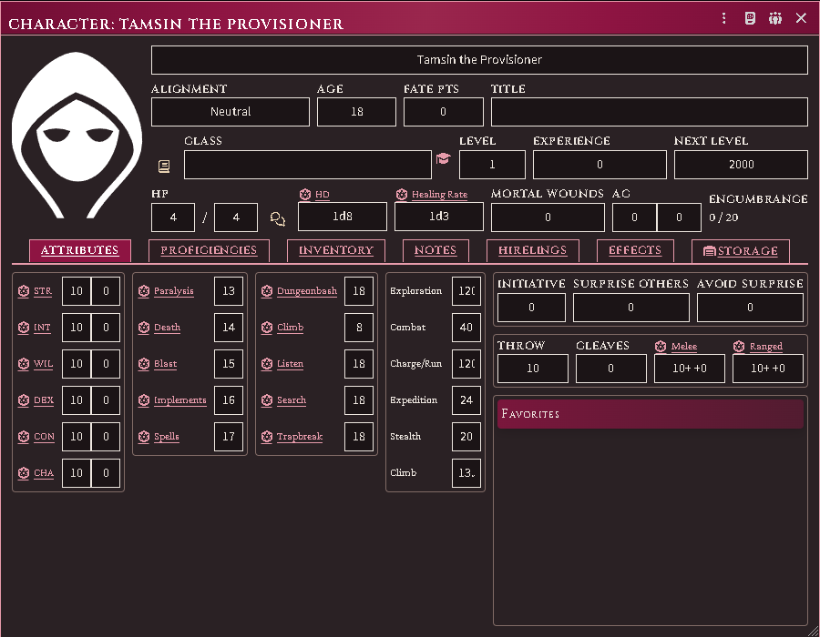
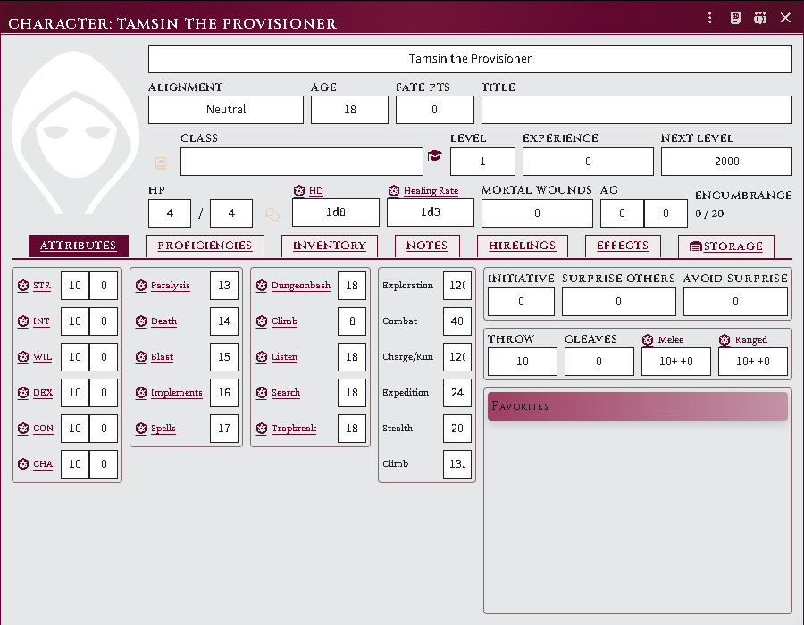
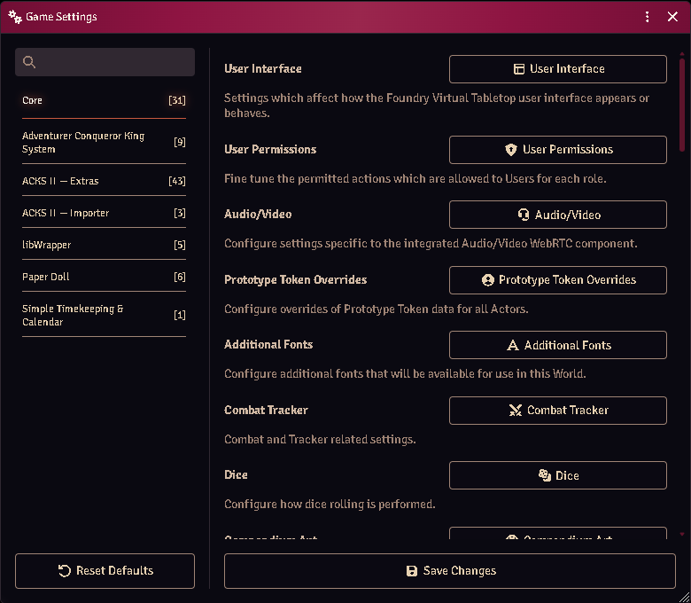
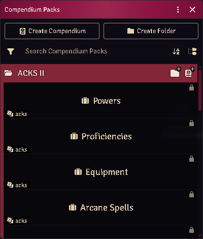

# Appearance

Every window this module opens — and every window the ACKS system opens — is
drawn from one palette: the burgundy spot colour and warm black the books are
printed in, on parchment or on tooled leather depending on your seat.

If that is not what you want, **ACKS look → System style** turns all of it off
for your seat. Start there; the rest of this page describes the settings that
shape the book look, and they only apply while you are using it.

*The system's own character sheet on a dark seat, in the ACKS palette.*

*The same sheet on a light seat: ruled page, boxed write-in fields.*

## Turn the ACKS look off

**Settings tab → Game Settings → ACKS II — Extras → ACKS look.** Per player; it
changes nothing for anyone else at the table.

| Setting | What it does |
|---|---|
| **World default** (default) | Draws what the Judge chose for the table under *Default look and sheets (world)*, [below](#choose-what-the-world-opens-on) |
| **Book style** | The ACKS palette and lettering, everywhere this module draws |
| **System style** | No ACKS palette and no ACKS lettering anywhere — every surface uses the colours and faces your client already uses |

Book style and System style are your own choice and win over the world's on
your seat.

System style is a genuine opt-out rather than a lighter version of the same
thing. It covers this module's own windows too — follower cards, the location
and henchmen sheets, every dialog — not just the system's. Your roll cards in
chat change the most visibly, because those are dressed by this module and
nothing else.

Two honest limits. **It gives you the ACKS *system's* look, not a neutral
Foundry**: the system itself paints every window header and hardcodes some of its
own dialog colours, and turning this module down cannot turn that off. And
**light versus dark becomes Foundry's business** — the ACKS colour scheme setting
below stops applying, because there is no ACKS palette left for it to pin. Set
your seat in **Settings tab → Game Settings → Core → User Interface →
Theme and Color Scheme** instead.

Text size is a separate setting; see below.

## Pick a colour scheme

**Settings tab → Game Settings → ACKS II — Extras → ACKS colour scheme.** Per
player; it changes nothing for anyone else at the table.

| Setting | What it does |
|---|---|
| **Follow Foundry** (default) | Matches whatever colour scheme the rest of your client uses |
| **Always light** | Parchment, whatever Foundry is set to |
| **Always dark** | Tooled leather, whatever Foundry is set to |

*The per-player setting that holds the ACKS look steady.*

Follow Foundry genuinely follows. Foundry lets you theme application windows
separately from the rest of the interface (**Theme and Color Scheme** in the
same User Interface menu), and the ACKS palette tracks whichever of those
applies to the window you are looking at.

One combination is imperfect: with the interface set **dark** and application
windows set **light**, ACKS surfaces stay dark inside those windows. Set ACKS
colour scheme to **Always light** and it resolves.

## Change the text size

**Settings tab → Game Settings → ACKS II — Extras → ACKS font size** sets the
base size, in pixels, for every ACKS surface — follower cards, module windows,
and, under Book style, the system's sheets. One knob rescales the whole family;
Foundry's own UI scale applies on top of it. Per player.

## Choose how much styling the system's sheets take

**Settings tab → Game Settings → ACKS II — Extras → ACKS styling on system
sheets** decides how far the look reaches into the windows the ACKS *system*
opens — the character sheet, the item sheet, its dialogs. Per player, and
ignored under System style.

| Setting | What it does |
|---|---|
| **Full dress** (default) | Banners, tabs and ACKS write-in fields throughout. The character sheet opens wider to fit them |
| **Palette only** | The system keeps its own layout, spacing and width; only the colours change |

Both follow your colour scheme. This setting is how much ACKS, never whether
dark mode works.

Full dress widens the system's character sheet. The ACKS write-in fields are
roomier than the ones that sheet was laid out around, so it is given the room
rather than made to do without them. If you would rather keep the sheet exactly
as the system draws it, that is what **Palette only** is for.

There is no separate on/off switch for the system sheets' theme: **ACKS look →
System style** is the opt-out, and everything stands down together — this
module's windows and the system's — so there is no half-dressed state and
nothing picks its colours from a different scheme than the window around it.

## Choose what the world opens on

**Settings tab → Game Settings → ACKS II — Extras → Default look and sheets
(world).** One setting for the whole table, asked once at the world's first
launch (a window offers the three choices to the Judge's seat) and changeable
any time after.

| Choice | What it does |
|---|---|
| **Foundry — no ACKS styling** | Foundry's own colours and faces; sheets fall back to the next set that has one |
| **ACKS system sheets** | The ACKS look, and the system's own sheets wherever it has one |
| **ACKS Extras sheets** (default) | The ACKS look and this module's sheets throughout |

A type the chosen set has no sheet for takes the next set's — Extras, then
the system, then Foundry — so nothing is ever left without a sheet. Each
player's own **ACKS look** setting above still wins on their seat when it is
Book style or System style.

Changing it asks for a reload, and after the reload every actor and item
opens on the chosen set. If you had pinned a type through Foundry's
**Default Document Sheets** (Settings tab → Game Settings → Core) to one of the ACKS sheets, choosing a preset releases that
pin so the preset can govern; a pin naming a third-party sheet is yours and
stays. Pin a type again afterwards if you want one type to differ from the
rest.

## Where the ACKS compendia live

The **Compendium Packs** sidebar tab keeps this module's compendium in an
*ACKS II — Extras* folder, with the *ACKS Extras Macros* pack in a *Macros*
folder inside it, rather than loose at the root among everything else
installed. The system's own packs stay in the system's own folders, and the
packs the importer builds from your books are shelved in a *From your books*
folder inside the module's.

*The ACKS packs in their folders, rather than loose at the root.*

A folder is matched by name, so a module declaring one of the same name lands
in it rather than making its own. If you have rearranged the sidebar and want
the declared shelves back, a Judge runs the **Restore the Compendium Library
(GM)** macro from the *ACKS Extras Macros* pack; it asks first, and says that
folders you moved packs into, custom ordering, locks and player visibility go
back to their defaults.

## Animate attacks and spells on the map

Install and enable [Automated Animations](https://foundryvtt.com/packages/autoanimations),
with [Sequencer](https://foundryvtt.com/packages/sequencer) and
[JB2A](https://foundryvtt.com/packages/JB2A_DnD5e) (the free edition is enough).
There is nothing to set up in this module: each attack and spell card then plays
an effect on the map.

- **A hit lands on the target and a miss goes wide.** The effect goes to the
  target the attack was made at, even if you have targeted someone else since.
- **A weapon takes the row of Automated Animations' menus its name matches.** A
  weapon no row matches plays that module's *Sword* row in melee, *Bow* for a
  missile and *Dagger* when thrown. A creature's melee attack plays *Unarmed
  Strike*.
- **To give a weapon its own animation,** press the **Automated Animations**
  button in the menu on the item sheet's header, or add a row for its name to
  that module's **Automatic Recognition** menu.
- **A spell needs a row of its own.** It plays only if its name matches one.
- **A whispered or blind attack keeps its result.** It plays, on every seat, the
  way a hit does, whether it hit or not.
- **A hidden token's cards play nothing,** so an effect never shows where it
  stands. A status effect is the exception: Automated Animations plays those
  apart from the card, on a hidden token too.
- **With Dice So Nice,** the effect waits for the dice, so the map never gives
  the roll away.

An attack rolled with no weapon behind it has no name to match and plays nothing.

## Colour is never the only signal

No distinction in this module is carried by hue alone. A lit lamp and an unlit
one differ by the weight of the glyph, not its colour; a magical light and a
mundane one are different marks. That is partly the books' own discipline — they
are printed in one spot colour and a black — and partly so the interface still
reads on a colourblind seat, in greyscale, or printed.
