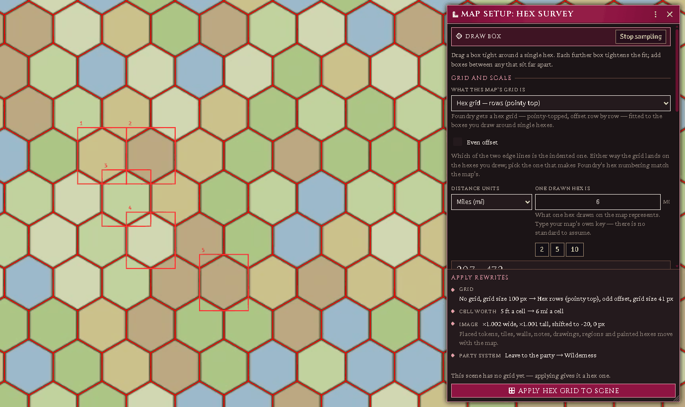
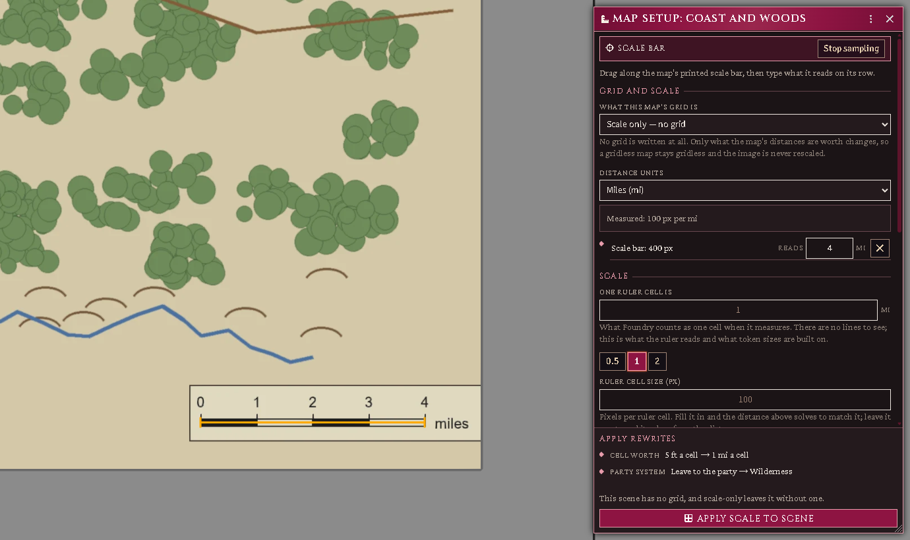
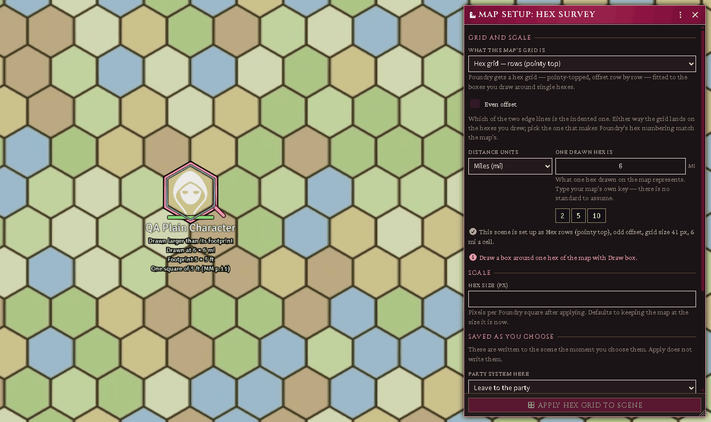
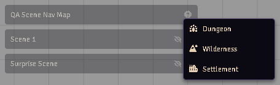
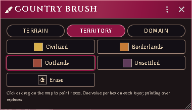
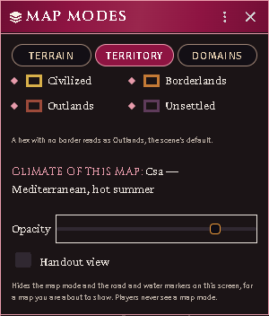
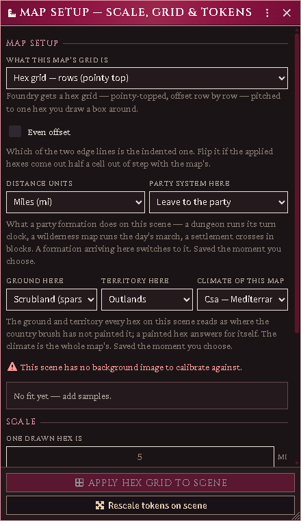
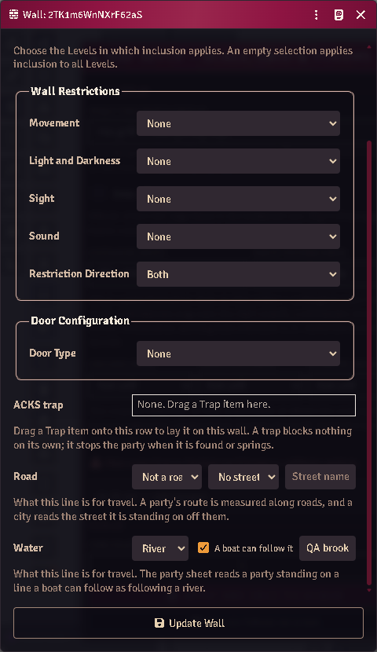

# Map setup & token scale

Most map images arrive slightly wrong: the drawn grid does not line up with
Foundry's, its cells are an odd number of pixels, and the only statement of
scale is a printed bar in the margin. **Map setup** fixes all three from a
few samples you draw on the canvas, then sizes tokens to what they actually
are.

It starts by asking what kind of map this is — squares, hexes, or no grid at
all — because everything else reads differently under that answer.

Two parts, and they do different jobs. **Battlemap** in the scene controls
down the left of the canvas — the ruler icon — holds the ways of sampling a
map, a wipe, the Country brush, the road and water presets, **Map setup** and
**Map modes**. The **Map setup** window is where the numbers and the buttons
live, with Apply pinned to the bottom so it is never something to scroll for.
Its title names the scene it is working on.

Entering the group brings the window up for you; the close button on its
title bar puts it away, and **Map setup** in the group brings it back. Drag
it wherever suits the map you are aligning — it opens clear of the middle.
Nothing is lost by closing it: your samples and the numbers you typed belong
to the scene, and they are still there when you come back. **Scene
Configuration → Basics tab → Battlemap → Map setup…** is a second way in; it
views that scene first, so the window always works on the scene you asked
about. GM only.

*A hex map halfway through setup: five boxes drawn with **Draw box**, each
tight around one hex, and the red preview grid already on the map's lines.
**Apply rewrites**, above the button, lists the grid, what a hex is worth, how
far the image moves (and that what is placed moves with it), and the party
system a party will take here.*

## What kind of map is this?

Four answers, under **What this map's grid is** at the top of the window. The
rest of the window changes to suit the one you pick, and it opens on whatever
the scene already uses.

- **Square grid** — the ordinary battlemap. Foundry gets a square grid fitted
  to the boxes you draw on the map's own squares.
- **Hex grid — rows** (pointy top) or **columns** (flat top) — a wilderness
  or campaign sheet. Draw boxes, each tight around **one** hex, and say what a
  hex is worth; one drawn hex becomes one Foundry hex, and every box you add
  tightens the fit. The grid lands on your hexes whether or not **Even
  offset** is ticked; tick it when Foundry's hex numbering should match the
  map's.
- **Scale only — no grid** — the map has no grid to fit, or you do not want
  one. Drag along its printed scale bar, say what the bar reads, and the scene
  measures true: the ruler and token sizes are right, the image is never
  rescaled, and a gridless map stays gridless.

*Scale only on a map with no grid: one drag along the printed bar, which reads
4 miles, gives the measured scale; Apply writes what a ruler cell is worth and
leaves the map gridless.*

**Distance units** are yours to name — feet, yards, miles, metres,
kilometres — and sit beside the cell's worth (**One drawn square is**, **One
drawn hex is** or **One ruler cell is**). Both are written to the scene when
you apply. Change the unit and the cell's worth empties until you fill it in,
so a scene never reads "5" in a unit it was not measured in. Everything that
knows a real length converts through them, so a party on a map of six-mile
hexes is sized as a party rather than as a county.

A list under the family says **what Apply still needs**, one line per gap,
each naming the one thing to do and where it is: draw a box with **Draw box**,
type what the bar reads, fill in the cell's worth. Apply waits until the list
is empty. A box the fit leaves out says why on its own row, and a warning
says when the boxes argue for the other hex family; the family stays as you
chose it. Reopened on a scene that is already set up, the window says what
grid it already is before you draw anything.

*The same map after Apply, its window reopened: it says what grid the scene
already is. On the map, a character one hex wide on six-mile hexes carries
the not-to-scale mark, and hovering it reads the size it is drawn at against
its footprint.*

## Teaching it the grid

Pick a tool from the Battlemap controls and work on the canvas — the window
mirrors them if you would rather stay in it. More samples make a better fit,
and the red preview grid, squares or hexes, snaps onto the map's lines as
soon as it has enough. Closing the window keeps your samples; the tools go on
working.

- **Draw box** — drag a rectangle over the map's own cells. On a square map,
  do a couple in different corners. A box does not have to be one square:
  drag across a block of them and say how many it spans **across** and
  **down** on the box's own row — easier to aim, and a better measurement. On
  a hex map, draw each box tight around one hex, a few rows apart; to reach a
  hex far from the others, add boxes between, since a box too far from the
  rest to place is left out until one is.
- **Pick corners** — click grid intersections on a square map. Corners
  several squares apart are the most informative kind of sample. On a hex
  map corners are not used: picking the tool says so and names **Draw box**.
- **Scale bar** — drag end-to-end along the map's printed scale bar, then
  type what it **reads** on the bar's own row. On a hex map the bar suggests
  what a hex is worth, measured centre to centre; only boxes place the hexes.
- **Eraser** — click a sample to remove it. **Ctrl+Z** removes one too and
  **Wipe** (the trash can in the group) clears everything. Each sample also
  has a remove button in the window's list. The right mouse button is left
  alone, so you can pan across a big map without losing samples. Typing in a
  field, in the window or the chat, keeps Ctrl+Z and Escape for the field.

**Stopping.** The arrow at the head of the Battlemap tools is *off* — nothing
is armed until you pick a mode, and picking the arrow again stops. So does
**Escape**, and so does the **Stop sampling** button that appears in the
window whenever a mode is armed. Your samples are kept either way.

The fit card reports the cell size, how many boxes it used, and how well the
samples agree; hover any figure for what it was worked out from. On a square
grid, if the map was scanned stretched, tick **Independent X / Y**; if it was
scanned crooked, tick **Allow skew** — the fit then reports the skew and
rotation it found. Where the image is crooked or its cells are not square,
the window offers **Bake corrected image**, a straightened copy saved beside
the original; your original file is never touched. A hex map does not need
it: the hex apply stretches each side of the image by itself.

## Confirming the scale

The window shows what it derived a map cell to be worth — from the scale bar,
or from what you typed in **One drawn square is** (or **One drawn hex is**) —
with chips for the likely intended value (4.9 becomes 5). Confirm it.

On a square map, then choose **One Foundry square is** — the grid this
actually writes. Leave it empty and one Foundry square is one drawn map
square. On a coarse map — a wilderness sheet drawn at 100' per square, say —
you can instead ask for 5' squares, and each drawn box carries a neat 20×20
of them. A warning appears if the two grids cannot share lines. **Square
size (px)** sets how many pixels a Foundry square takes after applying; it
defaults to keeping the map the size it is now. A hex map has no second
choice: one drawn hex is one Foundry hex.

## Applying

Above the Apply button, **Apply rewrites** lists one row per change: the
grid, what a cell is worth, the image (how far it is stretched and shifted),
token sizing, and the party system a party will take here where the scene
declares none. Each row reads as the scene has it → after Apply; hover it for
where the figure comes from. The confirmation repeats the same rows. A scene
that already matches says so, and there is nothing to apply.

- The button's label follows the map's kind. **Apply grid to scene**
  rescales and shifts the background so Foundry's grid sits exactly on the
  map's, and sets the scene's distance per square. Tokens, tiles, walls,
  notes, drawings and regions already placed move with the map, keeping
  their place on the picture, and the hexes painted with the Country brush
  follow the hexes now under them; the confirmation says so. On a hex map the
  button says **Apply hex grid to scene**, and lands the hexes you drew boxes
  around on real ones. In the scale-only mode it says **Apply scale to
  scene** and writes nothing but what the map's distances are worth: nothing
  is rescaled.
- The notice afterwards names the grid, its size in pixels and what a cell is
  worth, with the unit.

Applying also decides whether tokens dropped on the scene are sized to their
footprints: on, where a cell is under a mile; off, where it is a mile or
more, even if it was on, since a man sized to a six-mile hex would be too
small to see. Where that changes it, the token-sizing row says so. Change it afterwards with the
**Auto-size tokens** checkbox in **Scene Configuration → Basics tab →
Battlemap**.

On a scene whose cell is a mile or more, a party formation that arrives
takes the day's march (Wilderness) by itself, with a notice, unless the scene
declares a system (below).

**Party system here**, **Ground here**, **Territory here** and **Climate of
this map** sit together under **Saved as you choose**: each is written to the
scene the moment you pick it, and Apply does not write them.

**Party system here** says what a party formation does on this scene:
**Dungeon** runs its turn clock, **Wilderness** runs the day's march,
**Settlement** crosses in blocks. A formation arriving takes that system, and
follows if you change it while they are standing there. Leave it at *Leave to
the party* and nothing is imposed. There is no need to apply a grid to label
a map.

You do not need the window to see or set it. Every scene's card in the
navigation bar carries an icon for the system the map declares — a dungeon,
a wilderness map, a settlement — and a faint question mark for a map that
declares nothing. Hover it for what it means. Click the icon to pick a system
(the one declared is marked, and *Leave to the party* clears it); right-click
the icon to clear it outright. A party standing on the map switches as soon
as you choose. Players see no icon.

*A map's card in the navigation bar with its picker open: the three systems
to choose from, beneath the question mark the card shows while the map
declares nothing.*

## Token sizes

The **Token sizes** section sits at the foot of the window's body and sets
the footprint of the tokens you select, in feet. Selecting tokens means the
ordinary **Token** controls, so switch back to them when you want to — the
window stays open where you left it. Under **Size categories** there is one
chip per size category, each labelled with its footprint in feet; hover one
for where the figure comes from and how many cells it draws at here. Select
tokens and click a chip to stamp that footprint on them, or type a **Custom
size (feet)** and press the tick beside it. The arrow button resets the
selected tokens' footprint, removing the stamp and re-deriving from the
creature's size. A stamped footprint sticks to the token and survives
rescales. Pressed with nothing selected, each says so.

**Rescale tokens on scene**, below the chips, resizes every token to its
real footprint at the scene's scale: a monster by its size category, anything
else one footprint square. A formation's party token is left to the
formation rules, which size it by its frontage. Each size category's frontage
comes from the Monster Size table of the Monstrous Manual (MM ch. 1), which
arrives with the Monstrous Manual import
(Settings tab → Game Settings → ACKS II — Extras → Manage imports; see
[Managing imports](importer.md#managing-imports)). Until it is imported there
are no chips, a token with a size category keeps the size it has, and Rescale
says how many kept their size and what is missing; a token with no size
category is one footprint square whatever has been imported. Edit the table in the Ruledata Browser
(Settings tab → Game Settings → ACKS II — Extras → Imported Rules Tables →
Open Ruledata Browser) and your figure wins.

A line under the controls says whether tokens placed on the scene are
auto-sized, and where to change it. At a mile or more a cell the section is
one line saying tokens there are not sized to footprints, and none of its
controls is drawn.

### The not-to-scale mark

A token drawn at a size other than its footprint at the scene's scale
carries a frame like a magnifying glass: a pink rim along the token's shape
and a short handle from its lower right. A character one hex wide on a
six-mile map has it, so nobody judges distance by the size of the token.
Hover the token to read which way it is off and the size it is drawn at in
the scene's units; you, and the token's owner, also read its footprint in
feet and where that comes from. A party token and a place's, organisation's
or domain's token never carry it, and a token with a size category does not
until the Monstrous Manual's frontage is imported. Every player sees it; each can turn it off for
themselves in **Settings tab → Game Settings → ACKS II — Extras →
Not-to-scale mark on tokens**.

## Painting the country

The group's **Country brush** tool arms a brush on a hex-gridded map and opens
its palette. Two pills at the palette's head pick what the brush paints:

- **Terrain** — one swatch per kind of country the encounter tables know,
  forest, hills, mountains, scrubland, swamp and the rest in their varieties,
  with any further kind your imported travel tables name. Each kind becomes a
  tinted region everyone can see.
- **Territory** — civilized, borderlands, outlands or unsettled.

A third pill, **Domain**, appears once the world holds a domain: it paints
hexes into a domain ([Domains](domains.md#on-the-map)).

Click or drag to paint hexes. Each pill holds one value per hex, and painting
over replaces it; a hex can be a forest and borderlands at once. The eraser
clears the hex on the pill you are on and leaves the other alone. Territory is
drawn for you alone, as a map mode (below). A stroke paints only the map:
dragging across a window in front of it paints nothing behind the window.

*The Country brush on its Territory pill: one swatch per territory, and the
eraser.*

### Map modes

Your map shows one mode at a time over its terrain. **Terrain** is the map as
everyone sees it. **Territory** draws a border in each territory's colour
around the land you painted it on, inside the hexes, so the terrain colour
still fills each hex and two territories meeting show as two lines. A third
mode, **Domains**, does the same for the domains painted on the map
([Domains](domains.md#on-the-map)). The group's **Map modes** tool opens the
window that picks the mode; pressing the Territory or Domain pill on the
brush picks that mode too and opens the window, and it stays on, through every
control, until you pick another. A mode you pick while painting holds until
your next stroke on the brush's layer, which shows that layer's mode again.

The window lists what each colour means, what a hex with no border reads as
(the scene's own territory), and the map's climate. **Opacity** fades the
borders; **Handout view** hides them, and the road and water markers, while
you show your screen, until your next Territory or Domains stroke turns it off. Players never see a map mode. The territory regions
themselves show only on the Regions control.

*The Map modes window on Territory: the legend, what an unpainted hex reads
as, the map's climate, the opacity and the handout view.*

A hex nobody painted reads as the scene's own country. The Map setup window
has **Ground here** and **Territory here** for it, under **Saved as you
choose** — for a map that is one country throughout, or that is not a hex map
at all — and **Climate of this map**, the climate every hex of the map
shares. Each is saved the moment you pick it.

*The Map setup window with the scene's own ground and territory, and the
climate of the whole map.*

A journeying party reads all of it: the hex it stands in answers the ground its
speed, road and foraging are priced on, the table its encounters draw from,
its territory and its climate. The party sheet shows each answer and where it
came from, and the Judge tab overrides any of them (see the formation guide,
[Overland travel](formation.md#overland-travel)).

## Rivers and coasts

A river or a coastline is a line you draw, not a hex you paint. The group's
**River** and **Coastline** presets arm core's wall tool and hand it to you,
so the next walls you draw are that water — the same way the road presets
work ([Streets, and quarters](formation.md#streets-and-quarters)). For walls
that already exist, the **Walls** control carries **Mark the selected walls as
water**, which marks each selected wall as the water the wall tool
is set to draw: with the **Coastline** preset armed, a coast, and with **River**
armed, or any other wall type, a river. A water
line blocks nothing; if a wall you marked still restricts movement, the
notification says so, because the party cannot travel along it.

The wall's own sheet gains a water row: river or coast, **A boat can follow
it**, and the line's name. A river starts out one a boat can follow; a
coastline does not. While you are on the Walls or Battlemap controls the lines
are drawn over the map for you — a river solid, a line no boat can follow
dashed — and players see none of it.

*A wall drawn with the River preset: every restriction None, the road row
empty, and the water row naming a river a boat can follow.*

A party standing on a river a boat can follow is following it, and the party
sheet says so without being told. A party travelling by vessel over any water
line draws its encounters from the river's table.

## Formations

A party token is one square at the head of its marching column, at whatever
scale the scene uses, and Rescale tokens leaves it alone. The column, the
frontage and a fixed size of your own are set on the party sheet; the formation
guide covers them.
