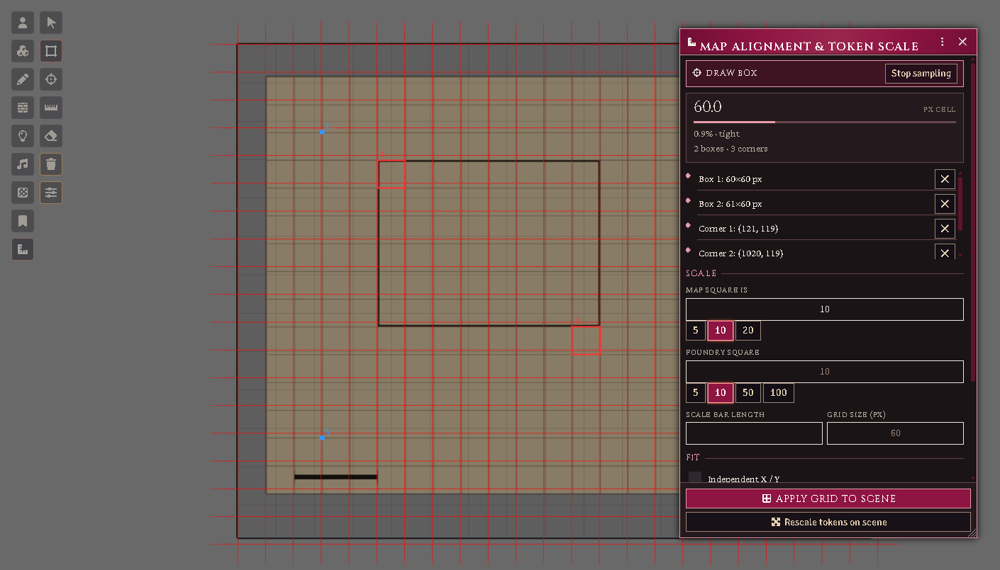
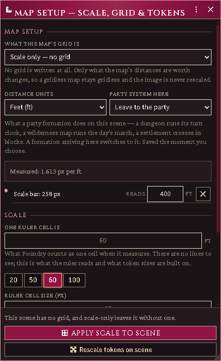
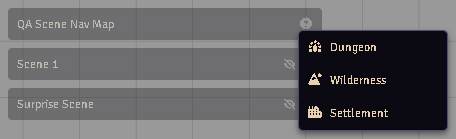
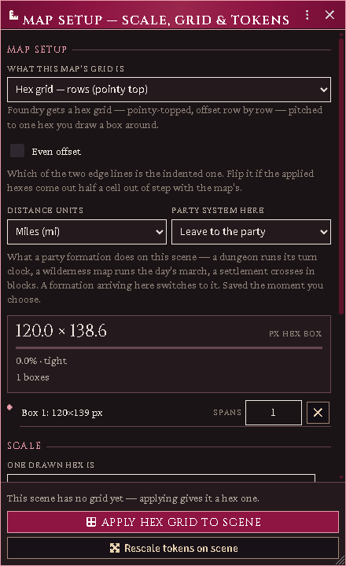
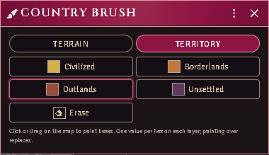
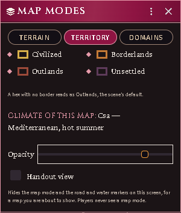
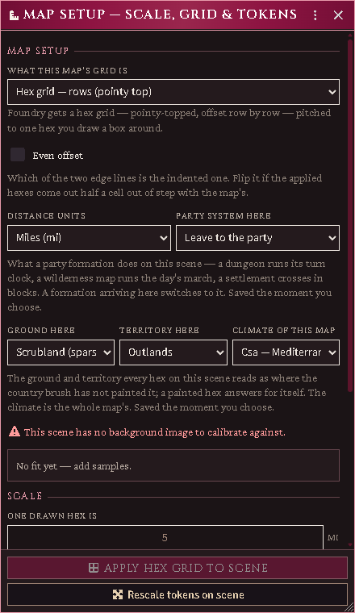
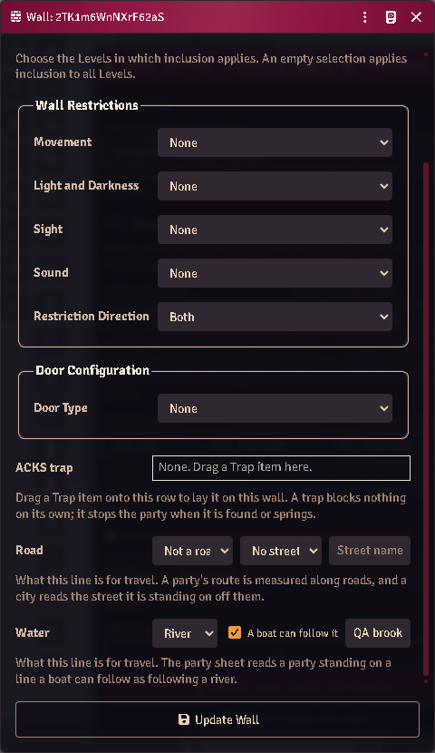

# Map alignment & token scale

Most map images arrive slightly wrong: the drawn grid does not line up with
Foundry's, its cells are an odd number of pixels, and the only statement of
scale is a printed bar in the margin. The assistant fixes all three from a
few samples you draw on the canvas, then sizes tokens to what they actually
are.

It starts by asking what kind of map this is — squares, hexes, or no grid at
all — because everything else reads differently under that answer.

Two parts, and they do different jobs. **Battlemap** in the scene controls
down the left of the canvas — the ruler icon — holds the ways of sampling a
map, a wipe, the Country brush, the road and water presets, **Map setup
panel** and **Map modes**. The panel is where the numbers and the buttons
live, with the apply pinned to the bottom so it is never something to scroll
for.

Entering the group brings the panel up for you; the close button on its title
bar puts it away, and **Map setup panel** in the group brings it back. Drag it
wherever suits the map you are aligning — it opens clear of the middle.
Nothing is lost by closing it: your samples and the numbers you typed belong
to the scene, and they are still there when you come back. **Scene
Configuration → Basics tab → Battlemap → Calibrate…** is a second way in.
GM only.

*The panel is a window: it opens over the map, carries its own title bar and
close button, and moves wherever you put it. Draw box is armed on the left,
two boxes and three corners are sampled on the map's own squares, and the
fitted lattice is drawn over the image. The card reads the cell it measured
and how well the samples agree; underneath, the two scale decisions — what the
map's square is worth, and what a Foundry square should be — each with its own
chips. Stop sampling sits at the top, the apply at the bottom.*

## What kind of map is this?

Four answers, under **What this map's grid is** at the top of the panel. The rest of the panel changes to suit
the one you pick, and it opens on whatever the scene already uses.

- **Square grid** — the ordinary battlemap. Foundry gets a square grid fitted
  to the boxes you draw on the map's own squares.
- **Hex grid — rows** (pointy-topped) or **columns** (flat-topped) — a
  wilderness or campaign sheet. Draw a box around **one** hex and say what a
  hex is worth; one drawn hex becomes one Foundry hex. If the applied hexes
  come out half a cell out of step with the map's, tick **Even offset**.
- **Scale only — no grid** — the map has no grid to fit, or you do not want
  one. Drag along its printed scale bar, say what the bar reads, and the scene
  measures true: the ruler and token sizes are right, the image is never
  rescaled, and a gridless map stays gridless.

*Scale only. The map's printed bar has been dragged and told what it reads —
400 feet — on the bar's own row, and the panel says what it measured: 1.613
pixels per foot. Below it, what one ruler cell should be worth, with chips for
round values near the one it would pick by itself.*

**Distance units** are yours to name — feet, yards, miles, metres,
kilometres — and are written to the scene with the scale. Everything that
knows a real length converts through them, so a party on a map of six-mile
hexes is sized as a party rather than as a county.

**Party system here** says what a party formation does on this scene:
**Dungeon** runs its turn clock, **Wilderness** runs the day's march,
**Settlement** crosses in blocks. A formation arriving takes that system, and
follows if you change it while they are standing there. Leave it at *Leave to
the party* and nothing is imposed. It saves the moment you choose it — there
is no need to apply a grid to label a map.

You do not need this panel to see or set it. Every scene's card in the
navigation bar carries an icon for the system the
map declares — a dungeon, a wilderness map, a settlement — and a faint
question mark for a map that declares nothing. Hover it for what it means.
Click the icon to pick a system (the one declared is marked, and *Leave to
the party* clears it); right-click the icon to clear it outright. A party
standing on the map switches as soon as you choose. Players see no icon.

*A map's card in the navigation bar with its picker open: the three systems
to choose from, beneath the question mark the card shows while the map
declares nothing.*

*The same panel set to hexes. One box has been drawn around a single hex; the
card reads the box it measured, and the apply says which grid it will write.*

## Teaching it the grid

Pick a tool from the Battlemap controls and work on the canvas — the panel
mirrors them if you would rather stay in the window. Mix and match: more
samples make a better fit, and the red preview grid snaps onto the map's lines
as soon as it has enough. Closing the panel keeps your samples; the tools go
on working.

- **Draw box** — drag a rectangle over the map's own squares. Do a couple in
  different corners of the map. A box does not have to be one square: drag
  across a run of them and say how many it **spans** on the box's own row —
  easier to aim, and a better measurement. If you know what a square
  represents (many maps say "1 square = 5 feet"), type it in **One drawn
  square is**.
- **Pick corners** — click grid intersections. Corners several squares apart
  are the most informative kind of sample.
- **Scale bar** — drag end-to-end along the map's printed scale bar, then
  type what it **reads** on the bar's own row.
- **Eraser** — click a sample to remove it. **Ctrl+Z** removes the newest one
  and **Wipe** (the trash can in the group) clears everything. Each sample
  also has a remove button in the panel's list. The right mouse button is left
  alone, so you can pan across a big map without losing samples.

**Stopping.** The arrow at the head of the Battlemap tools is *off* — nothing
is armed until you pick a mode, and picking the arrow again stops. So does
**Escape**, and so does the **Stop sampling** button that appears in the panel
whenever a mode is armed. Your samples are kept either way.

The fit card at the top of the panel reports the cell size and how well the
samples agree. On a square grid, if the map was scanned stretched, tick
**Independent X / Y**; if it was scanned crooked, tick **Allow skew** — the
fit then reports the skew and rotation it found. Where the image is crooked or
its cells are not square, the panel offers **Bake corrected image**, a
straightened copy saved beside the original; your original file is never
touched.

## Confirming the scale

The assistant shows what it derived a map square to be worth — from the scale
bar, or from what you typed in **One drawn square is** — with chips for the
likely intended value (4.9 becomes 5). Confirm it.

Then choose **One Foundry square is** — the grid this actually writes.
Leave it empty and one Foundry square is one drawn map square. On a coarse map
— a wilderness sheet drawn at 100' per square, say — you can instead ask for
5' squares, and each drawn box carries a neat 20×20 of them. A warning
appears if the two grids cannot share lines. **Square size (px)** sets how
many pixels a Foundry square takes after applying; it defaults to keeping the
map the size it is now.

## Applying

Two buttons at the foot of the panel, in either order, as often as you like:

- The apply button's label follows the map's kind. **Apply grid to scene**
  rescales and shifts the background so Foundry's grid sits exactly on the
  map's, and sets the scene's distance-per-square. Foundry repositions
  anything already placed proportionally — the confirmation dialog reminds
  you. On a hex map the button says **Apply hex grid to scene**, and lands the
  hex you drew a box around on a real one. In the scale-only mode it says
  **Apply scale to scene** and writes nothing but what the map's distances are
  worth: nothing is rescaled and nothing moves.
- **Rescale tokens on scene** resizes every token to its real footprint at
  the scene's scale: a monster by its size category, anything else one
  footprint square. A formation's party token is left to the formation rules,
  which size it by its frontage. The footprint square and each size
  category's frontage come from the Monster Size table of the Monstrous Manual
  (MM ch. 1), which arrives with the Monstrous Manual import (Settings tab →
  Game Settings → ACKS II — Extras → Manage imports; see
  [Managing imports](importer.md#managing-imports)). Until it is imported,
  tokens keep the size they have. Edit the
  table in the Ruledata Browser (Settings tab → Game Settings → ACKS II —
  Extras → Imported Rules Tables → Open Ruledata Browser) and your figure
  wins.

After applying, the scene auto-sizes tokens as they are dropped — a Large
monster lands at its imported frontage, and a character on a coarse wilderness
grid lands at the smallest size a token takes, a quarter square. Turn this off
with the **Auto-size tokens** checkbox in **Scene Configuration → Basics tab →
Battlemap**.

## The size hotbar

**Token sizes**, at the foot of the panel's body, stamps a footprint on the
tokens you select. Selecting tokens means the ordinary **Token** controls, so
switch back to them when you want to — the panel stays open where you left it.
Select tokens and click a chip — steps of the scene's own square from half of
one upward, so 2½', 5', 10' and up on a 5' scene — or type a **Custom size
(feet)** and press the tick beside it, to stamp that footprint on them. The
arrow button beside the chips, **Reset selected to default**, removes the
stamp and re-derives from the creature's size. A stamped footprint sticks to
the token and survives rescales.

## Painting the country

The group's **Country brush** tool arms a brush on a hex-gridded map and opens
its palette. Two pills at the palette's head pick what the brush paints:

- **Terrain** — one swatch per kind of country the encounter tables know,
  forest, hills, mountains, scrubland, swamp and the rest in their varieties,
  with any further kind your imported travel tables name. Each kind becomes a
  tinted region everyone can see.
- **Territory** — civilized, borderlands, outlands or unsettled.

A third pill, **Domain**, appears once the world holds a domain: it paints
hexes into a domain ([Domains](domains.md#on-the-map)).

Click or drag to paint hexes. Each pill holds one value per hex, and painting
over replaces it; a hex can be a forest and borderlands at once. The eraser
clears the hex on the pill you are on and leaves the other alone. Territory is
drawn for you alone, as a map mode (below). A stroke paints only the map:
dragging across a window in front of it paints nothing behind the window.

*The Country brush on its Territory pill: one swatch per territory, and the
eraser.*

### Map modes

Your map shows one mode at a time over its terrain. **Terrain** is the map as
everyone sees it. **Territory** draws a border in each territory's colour
around the land you painted it on, inside the hexes, so the terrain colour
still fills each hex and two territories meeting show as two lines. A third
mode, **Domains**, does the same for the domains painted on the map
([Domains](domains.md#on-the-map)). The group's **Map modes** tool opens the
window that picks the mode; pressing the Territory or Domain pill on the
brush picks that mode too and opens the window, and it stays on, through every
control, until you pick Terrain again.

The window lists what each colour means, what a hex with no border reads as
(the scene's own territory), and the map's climate. **Opacity** fades the
borders; **Handout view** hides them, and the road and water markers, while
you show your screen. Players never see a map mode. The territory regions
themselves show only on the Regions control.

*The Map modes window on Territory: the legend, what an unpainted hex reads
as, the map's climate, the opacity and the handout view.*

A hex nobody painted reads as the scene's own country. The map setup panel
has **Ground here** and **Territory here** for it — for a map that is one
country throughout, or that is not a hex map at all — and **Climate of this
map**, the climate every hex of the map shares. Each is saved the moment you
pick it.

*The map setup panel with the scene's own ground and territory, and the
climate of the whole map.*

A journeying party reads all of it: the hex it stands in answers the ground its
speed, road and foraging are priced on, the table its encounters draw from,
its territory and its climate. The party sheet shows each answer and where it
came from, and the Judge tab overrides any of them (see the formation guide,
[Overland travel](formation.md#overland-travel)).

## Rivers and coasts

A river or a coastline is a line you draw, not a hex you paint. The group's
**River** and **Coastline** presets arm core's wall tool and hand it to you,
so the next walls you draw are that water — the same way the road presets
work ([Streets, and quarters](formation.md#streets-and-quarters)). For walls
that already exist, the **Walls** control carries **Mark the selected walls as
water**, which makes each selected wall a river. A water
line blocks nothing; if a wall you marked still restricts movement, the
notification says so, because the party cannot travel along it.

The wall's own sheet gains a water row: river or coast, **A boat can follow
it**, and the line's name. A river starts out one a boat can follow; a
coastline does not. While you are on the Walls or Battlemap controls the lines
are drawn over the map for you — a river solid, a line no boat can follow
dashed — and players see none of it.

*A wall drawn with the River preset: every restriction None, the road row
empty, and the water row naming a river a boat can follow.*

A party standing on a river a boat can follow is following it, and the party
sheet says so without being told. A party travelling by vessel over any water
line draws its encounters from the river's table.

## Formations

A party token is one square at the head of its marching column, at whatever
scale the scene uses, and Rescale tokens leaves it alone. The column, the
frontage and a fixed size of your own are set on the party sheet; the formation
guide covers them.
