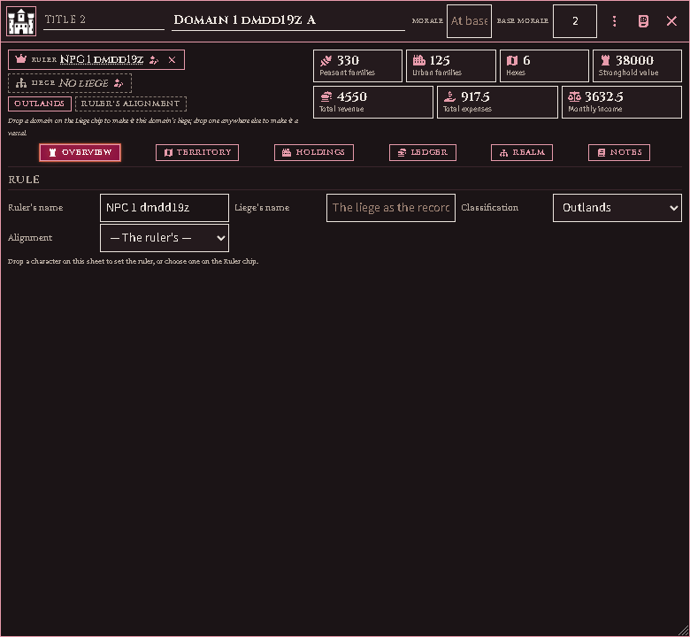
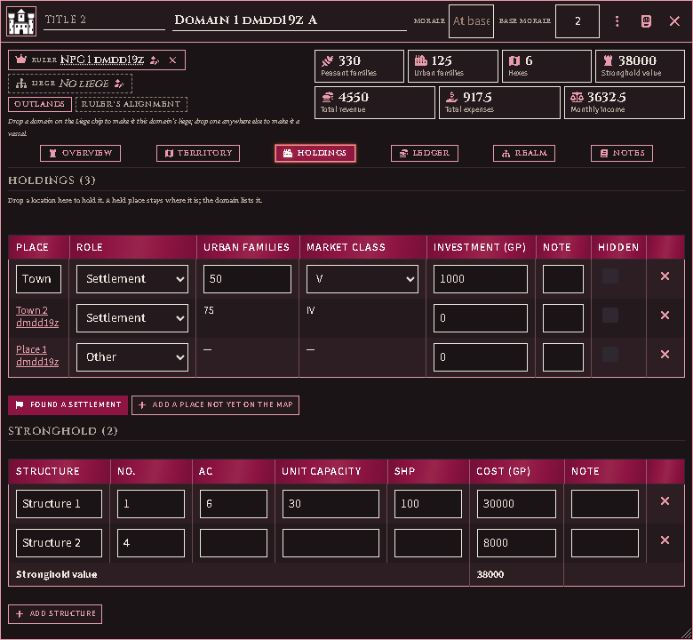
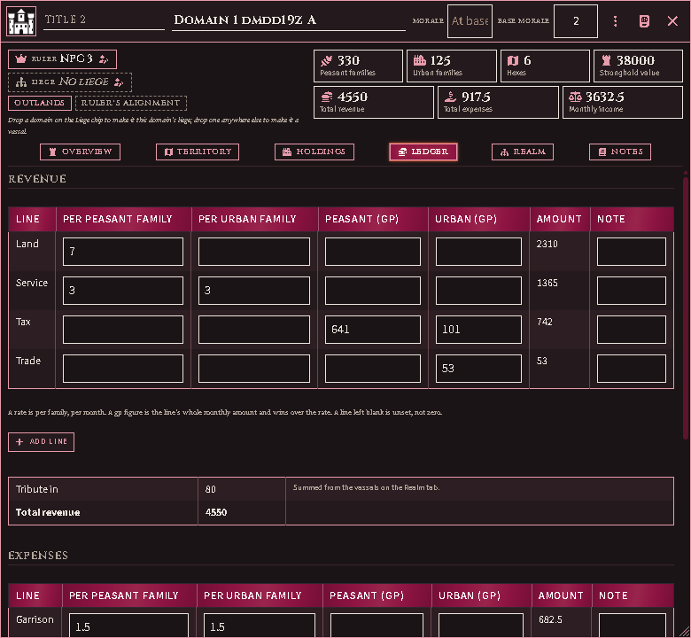
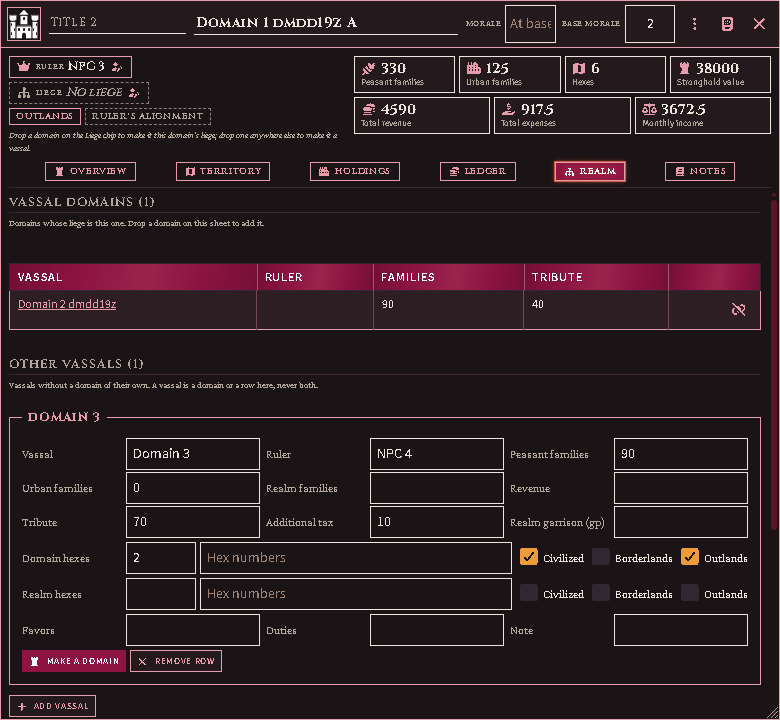

# Domains

A **domain** is a ruler's land, kept as the campaign game keeps it: the
territory and its peasant families, the settlements and strongholds it holds,
the month's revenue and expenses, its morale, and the lieges and vassals around
it. It is an actor like any other, with a sheet, a token and a place in a
folder.

This is the **record**. Every figure on it is one you or an imported adventure
enters; the module adds them up and says where something is missing, and
works nothing out from the rules yet. A line you have not filled in is
**unset**, not zero, and every total that leaves one out says so.

## Make a domain

Actors sidebar → **Create Actor** → type **Domain**.

The sheet is the Judge's. A player who can open it reads it, opens its tabs,
and changes nothing.

## The frame

The top of the sheet stays put whichever tab is open.

- **The band**, in the window's title bar: the domain's heraldry (click it to
  choose a picture), its **title** before its **name**, and its **morale** —
  the current score, the base score, or both, as your record gives them. A
  blank current score means it stands at its base.
- **Ruler** and **Liege** — each names the actor, or the record's word for
  one. Drag a character onto the Ruler, or a domain onto the Liege, or press
  the pencil to choose from a list. A domain cannot answer to one that already
  answers to it, and the list leaves those out. The × drops the actor and
  keeps the name.
- **The tags** — the classification, and the alignment (blank means the
  ruler's).
- **The rails** — the peasant and urban families, the hexes, the stronghold's
  value, and the month's revenue, expenses and income. A figure with a **+**
  is at least that much: something on the record has no figure yet. A
  month figure with a half-filled mark is over lines left blank; hover it to
  see which. Click any figure to open the tab it is kept on.

## Overview

The record's own words for the ruler and the liege, for a ruler or liege with
no actor; the classification and alignment; and, when a figure leaves
something out, a list of what.

## Territory

A row is a hex, or a run of hexes your record only gives as a total. Type the
hex numbers separated by commas, or a count where the numbers are not listed.
**Families** on each row add up to the domain's peasant families. **Shown**
lets players who can read the sheet see that row's land value.

### On the map

On a hex map, the Country brush's **Domain** pill paints hexes into a domain
(see [Painting the country](battlemap.md#painting-the-country)). The
**Domains** map mode draws each domain in a colour of its own, a vassal in a
shade of its liege's, with the border heaviest where two realms part. A hex
painted into a domain reads as the domain's classification unless you paint
it a territory of its own.

The Territory tab lists the hexes painted into the domain after its own rows,
each with a paintbrush mark. **Keep** turns one into a row of the record, or
ties it to a row that counts hexes without naming them. Erasing a hex on the
map deletes no row; the row is marked until you remove it.

*The Domains map mode: two realms and a vassal, the vassal a lighter shade of
its liege, and the Map modes window's legend.*

## Holdings

Drag a location onto the sheet to hold it. A place stays where it is; the
domain lists it, and the place's own sheet names the domain.

- **Found a settlement** makes a new location with a market and holds it at
  once. Its sheet opens so you can enter its families.
- A **settlement** — a location with a market — counts its own urban families
  and market class, read from its sheet. Change them there.
- **Add a place not yet on the map** is for a town your record names that has
  no location yet; type its families and market class on the row.
- A place can be held by one domain only. Dropping one another domain holds is
  refused, with that domain's name — release it there first.
- **Hidden** keeps a holding off the sheet for players. A place that has been deleted stays on
  the list, marked, until you remove the row.
- A held place is never removed by the empty-place cleanup, even when nothing
  is kept in it.

**Stronghold** lists the structures: count, AC, unit capacity, SHP and the
row's whole cost. Their costs add up to the stronghold value.

## Ledger

Each revenue and expense line takes a rate **per peasant family** and **per
urban family**, or a flat **gp** figure for either side; a gp figure wins over
the rate. The note beside a line is for anything the figure cannot say.
**Other** lines take whatever your record lists beyond these.

**Tribute in** adds up the vassals on the Realm tab. **Tribute out** is what
this domain pays its liege; a domain with no liege owes nothing.

When a line is blank, or a rate meets families nobody has counted, the totals
count only what is set and say how many lines they left out. The
**Treasury** row stays empty for now.

## Realm

- **Vassal domains** are domains whose liege is this one. Drag a domain onto
  this sheet anywhere but the Liege to make it a vassal; the button beside
  one releases it.
- **Other vassals** are the vassals your record summarises in a row: families,
  hexes and their classification, revenue, tribute and any additional tax.
  A vassal is one or the other — a domain of its own, or a row here.
- **Make a domain** turns a row into a domain of its own, answering to this
  one, and removes the row. The new domain keeps everything the row said: its
  hexes and peasants as territory, its urban families as a settlement not yet
  on the map, its tribute and additional tax as what it pays, and the rest in
  its notes. This domain's tribute in does not change.
- **Favors** and **duties** are rows of text.

A domain dropped on a location's sheet or an organisation's is refused: hold
a place, or set a liege, from the domain's own sheet.

## Notes

**Notes** are the domain's own; **Judge's notes** are for you alone.

## Coming next

The rules: the standard revenue and expense figures, morale, the treasury, the
month's turn and territory painted on the map. Each arrives without changing
what you have entered.
