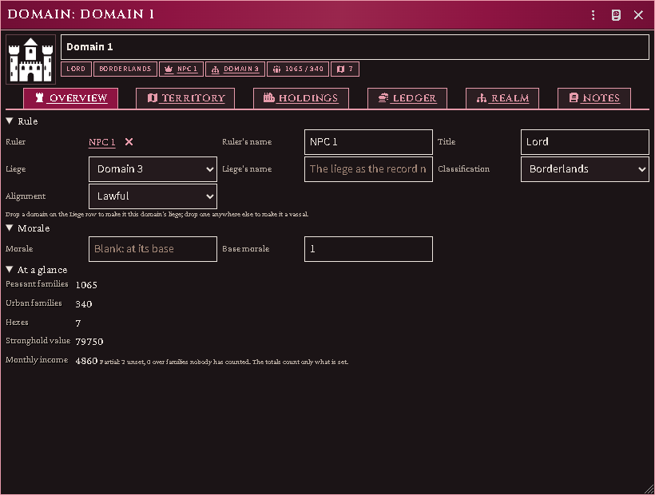
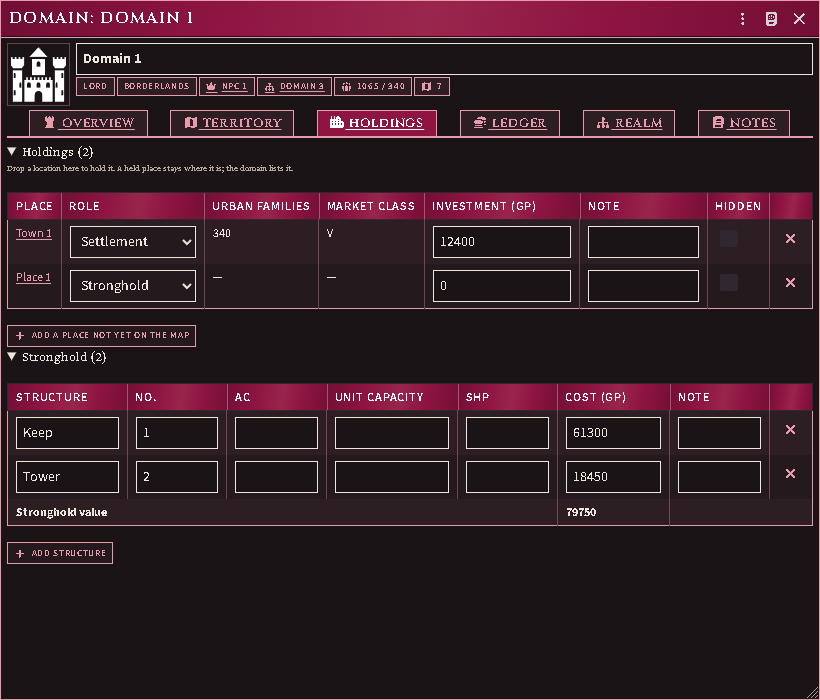
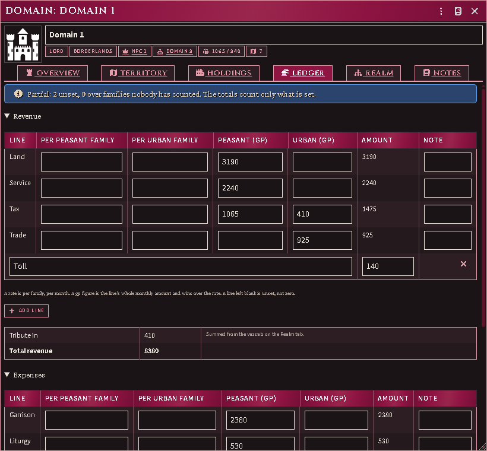
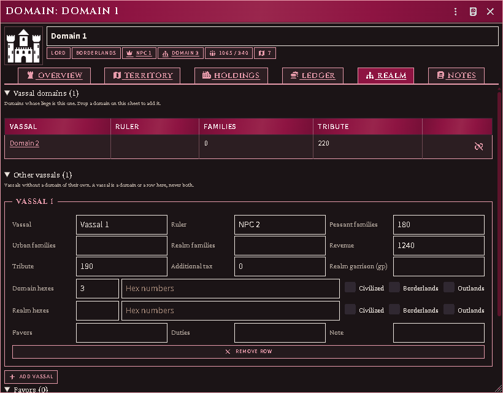

# Domains

A **domain** is a ruler's land, kept as the campaign game keeps it: the
territory and its peasant families, the settlements and strongholds it holds,
the month's revenue and expenses, its morale, and the lieges and vassals around
it. It is an actor like any other, with a sheet, a token and a place in a
folder.

This first release is the **record**. Every figure on it is one you or an
imported adventure enters; the module adds them up and says where something is
missing, and works nothing out from the rules yet. A line you have not filled
in is **unset**, not zero, and every total that leaves one out says so.

## Make a domain

Actors sidebar → **Create Actor** → type **Domain**.

The sheet is the Judge's. A player who can open it reads it and changes
nothing.

## Overview

- **Ruler** — drag a character onto the ruler row. **Ruler's name** is for a
  ruler with no actor; it is filled in when you drop one, so the record still
  reads if the actor is deleted. The × clears the link and keeps the name.
- **Title**, **classification** and **alignment**. Alignment left blank means
  the ruler's.
- **Liege** — pick the domain this one answers to, or drag one onto the
  **Liege** row. A domain cannot answer to one that already answers to it, and
  the picker leaves those out. **Liege's name** is for a liege with no actor.
- **Morale** — the current score, the base score, or both, as your record
  gives them. A blank current score means it stands at its base.
- **At a glance** — the families, the hexes, the stronghold's value and the
  month's income, each with a note when part of it is unknown.

## Territory

A row is a hex, or a run of hexes your record only gives as a total. Type the
hex numbers separated by commas, or a count where the numbers are not listed.
**Families** on each row add up to the domain's peasant families. **Shown**
lets players who can read the sheet see that row's land value.

## Holdings

Drag a location onto the sheet to hold it. A place stays where it is; the
domain lists it.

- A **settlement** — a location with a market — counts its own urban families
  and market class, read from its sheet. Change them there.
- **Add a place not yet on the map** is for a town your record names that has
  no location yet; type its families and market class on the row.
- A place can be held by one domain only. Dropping one another domain holds is
  refused, with that domain's name — release it there first.
- **Hidden** keeps a holding off the sheet for players. A place that has been deleted stays on
  the list, marked, until you remove the row.
- A held place is never removed by the empty-place cleanup, even when nothing
  is kept in it.

**Stronghold** lists the structures: count, AC, unit capacity, SHP and the
row's whole cost. Their costs add up to the stronghold value.

## Ledger

Each revenue and expense line takes a rate **per peasant family** and **per
urban family**, or a flat **gp** figure for either side; a gp figure wins over
the rate. The note beside a line is for anything the figure cannot say.
**Other** lines take whatever your record lists beyond these.

**Tribute in** adds up the vassals on the Realm tab. **Tribute out** is what
this domain pays its liege; a domain with no liege owes nothing.

When a line is blank, or a rate meets families nobody has counted, the totals
count only what is set and say how many lines they left out.

## Realm

- **Vassal domains** are domains whose liege is this one. Drag a domain onto
  this sheet anywhere but the Liege row to make it a vassal; the button beside
  one releases it.
- **Other vassals** are the vassals your record summarises in a row: families,
  hexes and their classification, revenue, tribute and any additional tax.
  A vassal is one or the other — a domain of its own, or a row here.
- **Favors** and **duties** are rows of text.

## Notes

**Notes** are the domain's own; **Judge's notes** are for you alone.

## Coming next

The framed sheet, then the rules: the standard revenue and expense figures,
morale, the month's turn and territory painted on the map. Each arrives
without changing what you have entered.
