# Exploration formations

A **formation** is the party as one thing: a marching order, one token on the
map, one exploration clock, and party-wide checks that resolve every member.

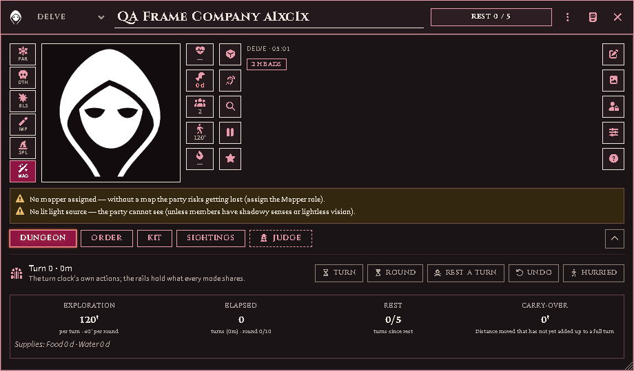

*The party sheet in a dungeon: the mode and the rest bar in the title bar, the
party's picture between the rails of saves, figures and quick tools, the
warnings it is under, and the Dungeon tab's own actions at its head.*

## Build one

Select the party's tokens on the map, right-click one and press **Add to party**
on its token HUD, or create a **Party Formation** actor in the Actors sidebar and
add members from its sheet. The **Party Sheet** macro in *ACKS Extras Macros*
(`Compendium Packs → ACKS II — Extras → Macros → ACKS Extras Macros`) opens the
party's sheet.

Members take roles — front, flank, rear, mapper, light-bearer — and the order is
the marching order. The party actor itself holds almost nothing; the formation
record holds the state.

When a formation takes the field, member tokens are stashed and one party token
stands in their place. Disbanding restores every stashed token to where it came
from.

Players choose who comes along. Once the party's token is on the map, a player
right-clicks a token of their own and presses **Bring into the party**. From the
sheet's Order tab, **Yours to bring in** lists their people who are in no party,
henchmen with no token on the map among them, and a press or a drag from the
Actors sidebar brings one in. The control at the end of a member's row takes them out,
and their token comes back beside the party token if they had one. A player moves
only what they own, the table sees each move in chat, and nobody moves during a
combat. The Judge can still add or remove anyone.

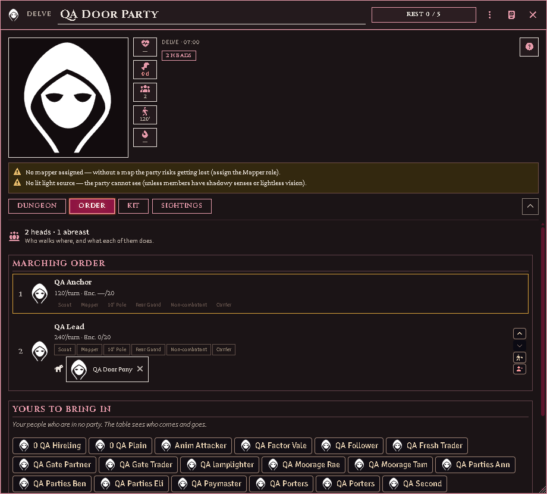

*A player's Order tab: their own member with the control that takes them out, and
their people still to bring in.*

## The party sheet

The party's name and the mode it travels in sit in the window's title bar,
beside a bar: on a journey it fills with the hours walked of the day's march,
in a dungeon or a city with the turns since the last rest. The crest opens the
marching order. Below is the party's picture between rails of square cells,
the same cells in every mode:

- **The saves**, left of the picture. Press one and every member throws it,
  on one card. The sixth cell, **Magical source**, says whether the throws are
  against magic, which decides whether each member's bonuses against magic
  count.
- **The figures**: hit points (how many are hurt), supplies (days of food and
  water), mouths, pace and light, each read the way the mode reads it. Press
  hit points to adjust them, supplies to ration, and pace to switch between
  careful and hurried (on a journey, to open Movement); mouths and light open
  the marching order and the kit.
- **The quick tools**: the encounter throw, the party's checks, a search, the
  pause and experience.
- **The reading**: the mode, and on a journey the day, the hex and the season;
  the clock; the territory and what the party follows, its heads, the pause,
  and on your seat whether it is astray; then the party's description.
- **The sheet tools**: the description, the picture, ownership, **Tweaks**
  (the table the party draws wandering monsters from where no zone names one)
  and the **Key**, which names every glyph on the rails.

The tabs are named by the mode. The first is **Dungeon**, **Wilderness** or
**City**, with that mode's own actions at its head; then the marching order
(**Order** in a dungeon, **Train** on a journey, **Company** in a city),
**Kit**, **Sightings** (the journey's log) and, on your seat alone, the dashed
**Judge** tab. The chevron at the end of the tab row folds the tabs away and
leaves the frame, and the sheet remembers that for you, party by party. Each
tab scrolls on its own and keeps its place, and the whole window follows the
type size setting.

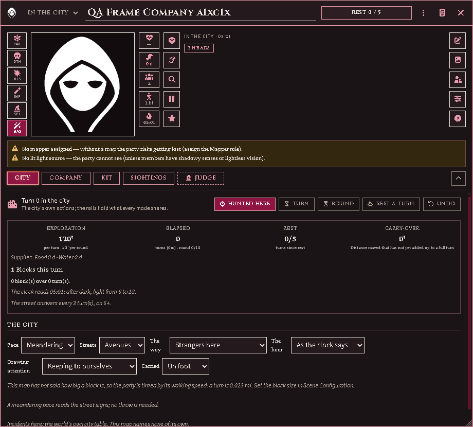

*In a city: the City tab first, with Hunted here at its head, then Company,
Kit, Sightings and the Judge's dashed tab.*

A player's sheet is the same frame without your parts: no saves, no quick
tools, the Key alone among the sheet tools, and no Judge tab. Hit points and
supplies only read there; mouths and light still open their tabs.

## Deploying, and which way the column points

A combat deploy lays the marching order out as a block: files abreast, ranks
behind, **facing the way the party token faces**. The heading is the token's
own rotation snapped to a cardinal — core rotates the token every time it is
dragged or walked, so the party token is already a record of which way the
party last marched, and turning it by hand (Shift+scroll with it selected)
turns the whole deploy.

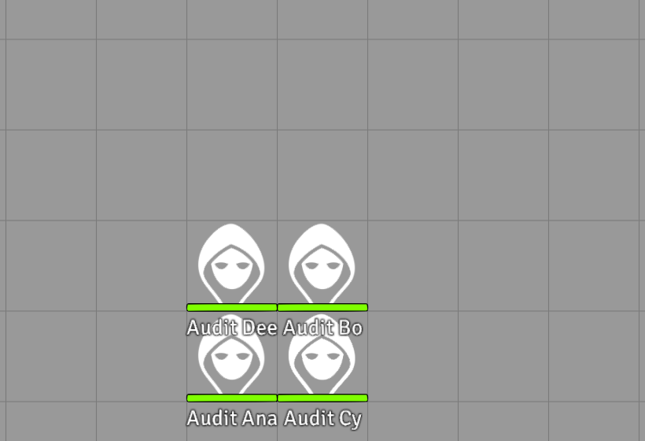

*A two-file block deployed on the canvas, trailing away behind the party token's
facing.*

An unrotated token faces **south**, so a party whose token has never turned
deploys its column trailing away to the **north**. To trail the column south,
turn the party token to face north.

The party token is **the head of a marching column**. It is one square, and the
rest of the party is drawn behind it on the squares it walked: each member's
portrait on a square tinted in the party's colour, files abreast at the
frontage, ranks following the head around every corner. Turn the party token by
hand and the column straightens out behind the new facing. Walls hold it in: a
file with a wall on the right steps to the left instead, and where the corridor
is narrower than the frontage the members who do not fit march in the next rank.
A combat deploy puts each member's token on the square their portrait stood on.
Players see the column only where they can see the squares it stands on.

Once the Revised Rulebook's **Rules tables** have been imported, the column is
spaced the way the book spaces a marching column: each member stands in a
square as wide as their frontage (wider for a member whose equipped weapon takes
a wider frontage), files are set side by
side at the sum of those widths, and ranks stand one rank interval apart along
the way the party walked, not one grid square apart. A combat deploy then puts a
member's token on the spot their square marks, even between grid squares, unless
a wall would touch it there; that member's token takes the grid square the
one-per-square column gives them. A token standing between squares snaps to the
grid the first time you move it. Until the **Rules tables** are imported the
column keeps one member to a square. Import them with **Rules tables** in the
**Reimport One Shelf (GM)** macro (`Compendium Packs → ACKS II — Extras → Macros →
ACKS Extras Macros → Import from your books`), with your books open on that seat,
or with Import Everything. Read what arrived in the Ruledata Browser
(`Settings tab → Game Settings → ACKS II — Extras → Imported Rules Tables → Open
Ruledata Browser`), where the three frontage rows can also be overridden.

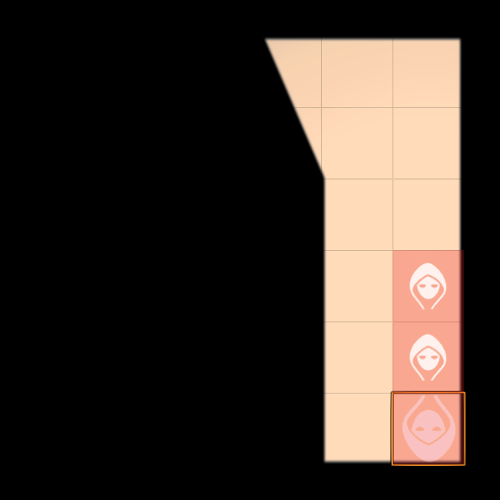

*A Player's view down a lit corridor: the party token at the head, and the
members' portraits on the tinted squares it walked.*

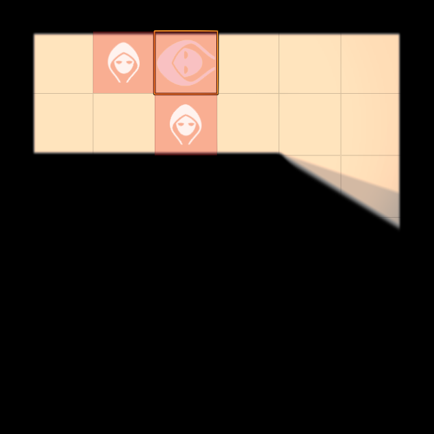

*A corridor narrower than the frontage: the file the wall shuts out marches in
the next rank, on the party's side of the wall.*

Two controls on the **Order** tab, beside the frontage, set this per party:

- **On the map**: *Marching order* (the column above), or *Fixed size*, where
  the party token keeps whatever size you give it and no column is drawn. Left
  on the world's default, a party follows **Settings tab → Game Settings → ACKS
  II — Extras → Party token on the map**.
- **Column tint**: the colour of the column's squares. Left empty, the party
  token's disposition colour.

On a hex map, a gridless map or a map measured in miles there is no column:
everyone stands at the party token.

### The party token and a fight

**Add the party token to a combat** (the combat button on its HUD) and the party
deploys: every member who can fight goes out as a token with a combatant of its
own, and the party token is hidden. **Add it to the same combat again** and the
party gathers: the members' combatants leave the tracker, their tokens go back
inside the party token, and the party token shows again. **End Combat** gathers
the party too. The encounter itself stays in the tracker when you gather from
the token; delete it yourself.

Only the party's own token does this. A copy of it (pasted, or left by a
duplicated scene) keeps its combatant, deploys nobody and whispers you that it is
not the party's token; the party's real token stays in charge, and a copy moved
or turned bills no travel. A party actor's token placed by hand while the party
already has one is refused with a warning. **Repair this world** (`Settings tab →
Game Settings → ACKS II — Extras → Repair this world → Open the repair tool`, or
the **Repair This World (GM)** macro in *ACKS Extras Macros*) lists extra party
tokens and fixes the ones that are safe to remove.

## Saved marching orders

The head of the party sheet's Order tab has **Save order**, which keeps the
current arrangement under a name, and **Load order**, which puts one back or
deletes one you no longer use. Saving under a name already in use replaces that
order. The party token's HUD carries a **Form up** button, for the Judge once an
order is saved, that applies a saved order and gathers everyone on the map back
inside the token. With one order saved the button applies it outright; with
several it asks. It is refused during a combat.

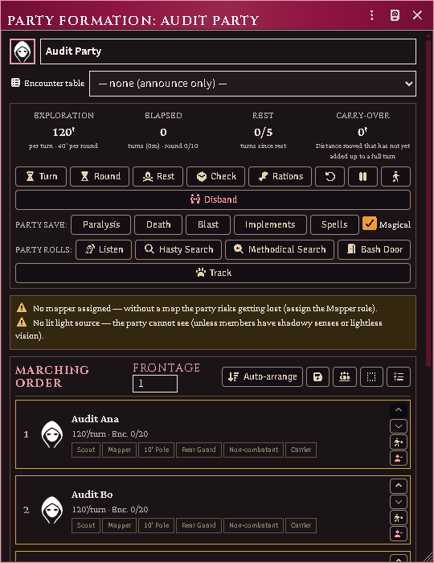

*The party sheet's march controls: frontage, the order, and the save that a
form-up restores.*

A saved order records the shape — who stands where, their roles, how many march
abreast — and nothing else, so restoring one can lose an arrangement but never
a character. Someone saved but gone is dropped and the line closes up; someone
new keeps the back rank. A role whose gear the character no longer carries is
not restored, and the chat line names who.

## Overland travel

The party sheet has one surface for every kind of travel: its first tab, named
for the mode, with the clock strip at its top. In a dungeon it counts turns; on
a journey it counts miles and hours; in a city it counts blocks. The mode is
picked from the selector beside the party's name in the title bar (yours alone;
a player's sheet reads the mode as a word), and a map
you have set up as a wilderness or a city map
picks it for you when the party token lands there — as does a map whose cells
are a mile or more across, which is read as wilderness unless you have said
otherwise. Setting a map's grid distance or units after the party is already
on it counts as landing there.

Every number behind this section is printed in your books and arrives through
**the importer**. Until you have imported them the strip still works, and says
plainly what it cannot price — it never guesses a distance, a target or a toll.

### The day

Drag the party token and the day is walked. The strip reads how fast the order
moves (miles an hour, and miles in a day's march), how far it has come and how
many hours that took against the hours the day holds, which hex it stands in
and how many it has entered, when the next encounter throw falls, and the
world clock with day or night and the hours left to dusk or dawn. The clock
runs as the miles are spent: torches and tracked spells burn down on the road
exactly as they do underground.

What the order is crossing is read off the map under the party token. The
Wilderness tab's **Country** section shows it as four cards — the **ground**,
the **road**, whether the party is **following** a river or a route it already
knows, and the **territory** — with the table its encounters draw on beneath
them; on your seat the **Sky** section reads the **climate** the same way. Each
answer comes from the hex the token stands in, as the battlemap's **Country
brush** painted it and the roads and rivers you drew cross it (see
[Painting the country](battlemap.md#painting-the-country)); where the map says nothing, from what the scene says of its
own country; and on a map that says nothing at all, from whatever the party had
been given before. Players see the cards. Your seat also shows where each
answer came from, and a card whose hex the brush has not painted offers
**Paint this hex**, which opens the brush on that card's layer.

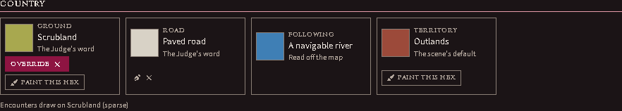

*The Country section on your seat: a ground your word overrides, with its
chip and clear; a road given where the map says nothing, with its pen mark; a
river read off the map; and a territory from the scene's default, offering
Paint this hex.*


*After a drag from a painted hex into one nobody painted: the cards read the
scene's own country, not the paint the party left behind.*

On a journey the party's picture becomes a drawing of the hex the token stands
in: the scene's own background under it, tinted by the ground painted there,
the roads and rivers that cross it, the points of interest the party has found
(on your seat the ones it has not found as well, as dashed rings) and the
party's mark at its middle. A square grid draws the square; a map with no grid
draws a square one grid unit across. The drawing is not a button: the picture
itself is changed from the sheet tools.

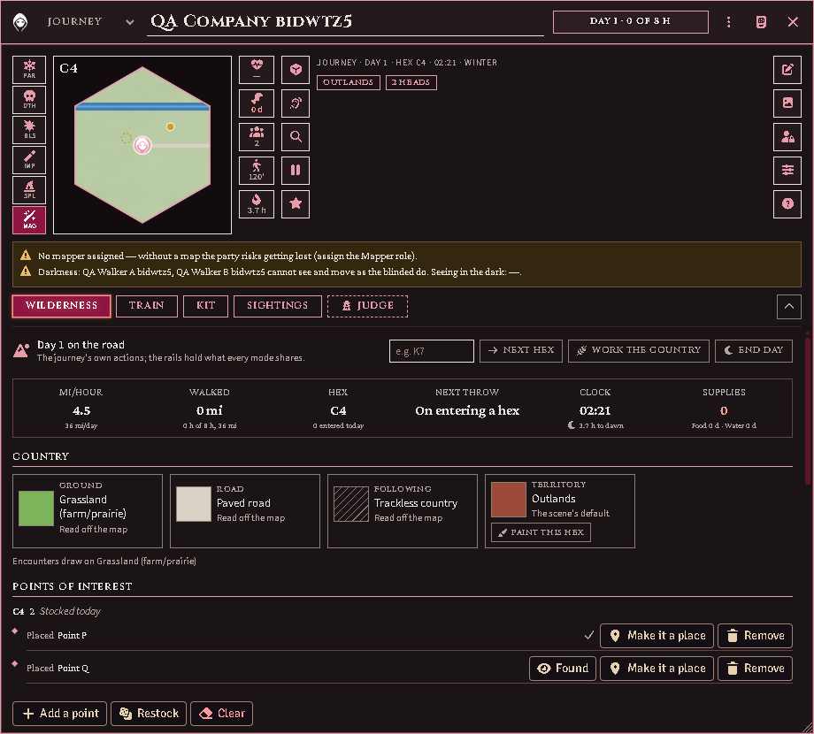

*The sheet on a journey: the hex drawn in the picture frame, with the road
and the river that cross it, the point the party has found and the one it has
not; the Country cards beneath, each saying what answered it.*

Your own word goes in **The Judge's hand**, on the Judge tab: one select for
each of the six — ground, encounter table, territory, climate, road and
following — with what the map reads there written beside it. A choice there
stands over the map until you clear it. A card your word overrides wears an
**Override** chip with its own clear; a card whose word stands where the map
has nothing to say, yours or one the sheet held from before, wears a pen mark
with a clear of its own. A ground you give takes the encounter table with it,
unless you name a table too. A route the party already knows is yours to
declare there, because nothing on the map draws one.

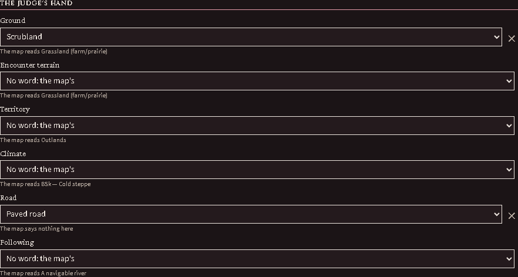

*The Judge's hand: a ground and a road given, each with its clear, and under
every select what the map reads there.*

**Movement** heads with who is setting the party's pace and on what, how many
ride, are carried and walk, and the pace; hover the figure for each member's. A
gold chip says when a faster ride is there to take. Below it are five tiles — on
foot, mounted, by vehicle, flying and by vessel. Without your touching them the
lit tile is how the party moves right now, read off who is on what, and it
decides which of everything else the party actually meets. A flier ignores roads
entirely; a vessel ignores the ground, and over a river or a coast it draws its
encounters from the river's table.

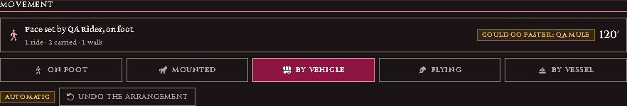

*Movement on the Judge's seat: who sets the pace, the chip for a faster ride, the
five tiles, and Undo after a pass.*

Players see all of this and press none of it. Press a tile yourself and it is
your word for the whole party, shown as **Set for the group**: on foot takes
everyone off everything, mounted and by vehicle put each member on the fastest
of that kind they have, by vessel puts them aboard, and flying moves nobody.
Your word outranks what a member picked for themselves, and their pick comes
back when you clear it. **Back to automatic** clears it, and **Undo the
arrangement** puts everyone back where your last press found them.

What each member travels on is theirs to say, on the Order tab's row beneath
their name: **Automatic**, **On foot**, or a ride, with each ride's pace beside
it. A ride counts for a member when the same player owns both, in the train or
not, and a wagon someone in the party is already in counts for everyone, so a
hireling no player owns can board it. **Fastest for all** at the head of that
tab gives each member their pick, or the fastest they have.

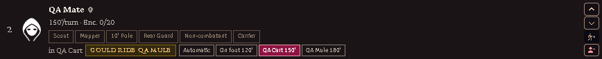

*A member's row: what they ride now, the faster ride they could take, and their
own pick, each ride with its pace.*

The party also does this by itself. A member who joins takes their ride, and at
each dawn on a journey everyone without a pick of their own takes the fastest
they have, and a note tells you who moved. Nothing moves while your word stands,
in a fight, or for a member who is down, left behind, out on the map, carrying a
casualty or at a station. A world with no calendar has its dawn when you end the
day. A ride nobody is on goes to the first of that player's parties to meet a
dawn, so if you keep a spare horse for a second party, have someone ride it.

The **Sky** section is the day's
weather; the **Day** section is one **kind of day** (a dedicated march, a forced
march, or a day in camp), the **ancillary hours** you give to travel,
foraging, hunting, searching or rest (how many a day kind leaves you is an
imported figure), and
the hour's own word, the world clock's or yours. An hour given to travel adds
an hour to the day's march. The Day section also takes two declarations of your
own: how many **traps** the order managed today, and **No sleep tonight**.

The sky's season is read from the world calendar where it can be: the
**Calendar seasons** setting, in Game Settings, lists the generator's
seasons in your calendar's own order, for a calendar whose season names the
module does not know; left blank, the names are matched. While the calendar
answers, the Sky section's season select shows its season and is locked.

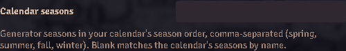

*The Calendar seasons setting and its hint.*

Under the sky's chips a list says what today's weather does: the penalty on a
search, a survey, the navigation throw and a tracker's hours, on foraging for
firewood or water, how far the party can be seen, a flier's storm, what a
night's rest needs and the sickness a run of such days risks. Every figure is
read from your own weather pages by the importer; until they are imported the
list stays empty, and nothing is charged. Each card that pays one
of these penalties names the weather on its own line.

**End day**, at the head of the Wilderness tab, closes the day: it feeds the
order, walks every body's hunger, thirst and exposure one step, writes the
miles and hours
actually walked into the log, and moves the calendar to the next dawn. It owes
an encounter throw for each batch of traps managed and carries the odd traps to
tomorrow. Two whispered cards follow on a day that has them. **The weather's
toll** carries the sun's burn, the heat's save for a body in heavy armour, the
frostbite save for a hypothermic one and the sickness throw when a run of bad
days comes due; a body that fails is marked Frostbitten or Diseased, and what
that does is resolved from your book (RR 277-279). **The night's rest** says
for each body whether the night was restful and where its fatigue stands, which
the module keeps as the Fatigued condition on the body.

You rarely have to notice that the day is done. Once the hours the day holds
have been walked, or the party marches on after dark, moving the token asks:

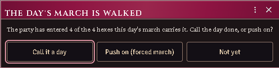

It is never answered for you — ending a day spends the provisions, settles the
ground, rolls tomorrow's sky and moves the calendar, and pushing on into a
forced march is a real choice with a real price. The question is put once, and
put again if pushing on bought more road. **Pause the clock**, among the quick tools,
stops a drag from spending anything, for when the token has to be moved and
the party has not.

### The camp

The **Camp** section, after Day on the Wilderness tab, is what the party is
living on: how many days of food and
water the packs hold across everyone in the order, and who is going short.
Food and water are **pooled** — one member's rations feed the whole order —
and dealt by a policy you choose in Game Settings (**How a short day is
shared**): evenly, so everyone
goes equally short, or by triage, so as many as possible eat properly. The
strip shows the days of food and water to the players too.

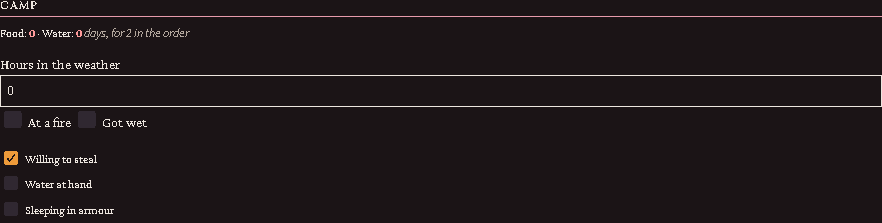

*The Camp section: the days of food and water, the hours in the weather with
At a fire and Got wet, and the three declarations.*

Only the suffering are listed. Someone who is hungry, thirsty, hypothermic or
losing Constitution appears with what it has cost them; the well-fed do not,
because a full roster would bury the one who is starving.

**Hours in the weather** is yours to set. A marching day is not automatically a
day spent unprotected, so the module does not assume one: say how long the
order actually stood in it, tick **At a fire** if they had one, and tick **Got
wet** if they did. The module reads each member's kit for shelter. The same
hours count under a burning sun and for armour worn in the heat. In mild
weather the field is greyed, because there is nothing to count.

Three more declarations sit in the section. **Willing to steal** is your word
for foraging settled country. **Water at hand** is your word that water needs
no throw; following a river says so by itself. **Sleeping in armour** has each
sleeper throw, and the night's rest card says who slept badly and how many
rounds each needs to don their kit.

**Work the country**, at the head of the Wilderness tab, rolls whatever the
day's hours were spent on: foraging for
food, water and firewood, or hunting. What is found is deposited on the people
who found it, and every attempt is reported — including the ones that turned
up nothing.

**Search an hour**, the magnifying glass among the quick tools, spends one of
the day's set-aside hours looking, runs the clock an hour, and owes an
encounter throw whatever it finds. **Something here**, at the foot of Points
of interest, is how the hour is answered: *From the stock* reads the hex's own
stock (below); *Yes* and *No* are your word, and the stock is left alone.
**Looking for** narrows the search to one point the party has not yet found,
or to *Elsewhere* — a search for something that is not there. A find with one
candidate is marked found; with several, the whispered card lists them and
you mark the one they came upon. A tracker in the order adds the Tracking
bonus; if that figure is not imported the card carries no line for it and throws without it.

### This hex

Lairs are the map's, not the party's. **Stock this hex** rolls the hex's lairs
by the book's own procedure from your imported tables — the terrain's dice,
the share a settled territory keeps, and the substitution of valuable,
dangerous and unique terrain for some of the lairs — and draws each lair
through the encounter chain, so a lair that is a monster is the monster the
chain would meet. Type a count to override the roll; a terrain with no imported
row asks for one. The stock is kept on the scene, under the hex, so two parties
crossing the same hex find the same things and a party that never comes back
leaves them where they were. The section names the world-clock day the hex was
stocked, so an old stock is plain to see. Nothing restocks a hex by itself:
**Restock** replaces the stock with its finds and its survey, and asks first.

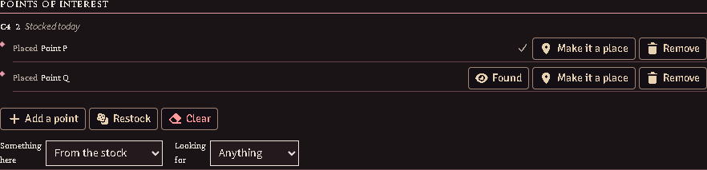

*The Points of interest section: the hex, its count and the day it was
stocked; each point with Found, Make it a place and Remove; and the search
row beneath.*

The **Points of interest** section of the Wilderness tab lists each point with
its kind, whether this party has found it, and
three buttons: **Found**, **Make it a place** (a location actor and a hidden
token at the hex's centre, revealed when the party has found it) and
**Remove**. Once the hex is stocked, **Add a point** places one of your own.
**Survey the hex** throws Land Surveying for the first member of the order who
holds it; a success tells the true count, a botched throw tells a confidently
wrong one, and anything else
tells nothing yet. The card shows you the truth beside what the surveyor
believes, and **Tell the party** posts the surveyor's count publicly in the
same words either way. A surveyor also tries by themselves after each search
hour until they have an assessment. **Clear** removes the stock.

A lost party searches and surveys where it really stands — the hidden marker's
hex — not where it believes it is, and cannot make a place there until it
knows.

### Encounters

**Encounter throw**, the die among the quick tools on a journey, runs the
whole wilderness encounter chain at once and whispers it to you as one card.
The card shows every roll, the creature or find it lands on, how far off it is and the party's chance to evade. A creature your
world or your imported library holds is linked. **Journey encounter throws** is
on by default: every encounter-table hex the party walks throws by itself —
a crossing on a map drawn at the table's own hex width, or that many miles on
any other map; the strip says when the next one falls — and **End day** throws
whatever the day owed. Day and night are read from the world clock, or from
the hour you set in the Day section.

When the throw lands on a terrain encounter, the card also rolls what that
result leads to. Each table it names is rolled on its own die, and the
terrain's treasure type or ruin modifier is read from the terrain the throw
drew on, so the whole find is on one card. A result that hands off — a double, a
monster, an either-or, a despoiling — is drawn through the chain and shown
indented beneath it. A result the module does not follow, or a table your
import lacks, tells you to draw from your book.

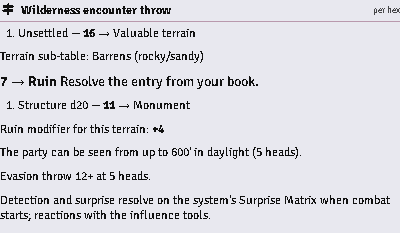

*A terrain encounter's card: the result, each table it led to with its die and
roll, and the terrain's modifier.*

### The navigation throw

Off the road a party can lose its way, and the day's first step away from one
decides it. The first time in a day that the party token is dragged off a road,
or you press **Next hex** there, the navigation throw is made for the order and
whispered to you; a player's drag sets it off, and the player sees nothing of
it. A day, for the throw, ends when the calendar's day changes or when you
press **End day**, whichever comes first, so a clock that keeps no calendar
still counts its days and a march that runs past midnight owes the new day's
throw at its next step off the road. A day spent on a road, along a navigable
river or on a route you have said the party knows owes no throw, and **End
day** makes none.

The throw is made against your imported figure for the ground the party
believes it is crossing, with what your import says the order's Navigation and
Pathfinding are worth; the card shows the throw, its target and the weather
that weighed on it.

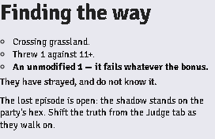

*The throw's card, whispered to the Judge: the ground, the throw against its
target, the verdict, and the episode it opened.*

**Navigation, quietly**, on the Judge tab, says where the day stands: owed at
the day's first step off the road, thrown today, or nothing owed while the
party follows a road or a route. Beneath it are the last ten throws, newest
first: the day, the hex, the throw against its target, and whether the party
kept its way. **Throw now** makes the throw by hand, for one the march does not
make for you, and counts as the day's.

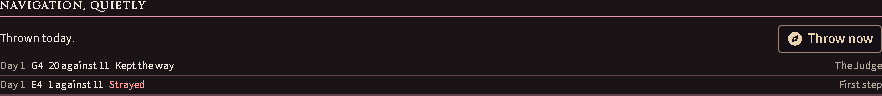

*Navigation, quietly: where the day stands, Throw now, and the last throws
with their day, hex, throw against its target and verdict.*

### Getting lost

A failed navigation throw opens the episode at once, whispered to you and not
announced. A hidden marker, the party's true position, appears under the party
token, and from then on the two are told apart. The party token is where the
party *believes* it is, and the map fills in for the players with the ground
they think they crossed. The marker is where they really are, and only you see
it; on a hex map every drag moves it by the same steps, hex for hex, from
wherever it stands. An episode opens only while you are viewing the party's
scene. When you are not, the card says so and offers **Begin the lost
episode**, which opens it once you are viewing the scene with nothing asked:
the marker starts under the party token, and the truth is yours to shift from
the Judge tab as they walk on. **They strayed…** on the Judge tab opens an
episode on your own word, and asks for the face they wandered off by or rolls
it.

What happens to a lost party happens where it really is. Its encounters are
thrown for the marker's hex, by that hex's table and at its cadence, and it
searches and surveys there (see *This hex*). What the players see is drawn
where they believe they are.

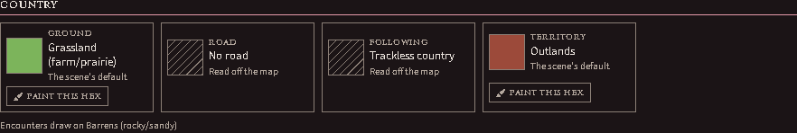

*A lost party's Country section on the Judge's seat: the cards read the
believed hex, and the encounters line names the table of the hex they really
stand in.*

**Where they are**, on the Judge tab, shows both. The **True** plate is the
marker's hex and the **Believed** plate the party token's; while they differ,
the believed plate is dashed and gold, and a badge names the direction the
truth lies in. **Shift the truth** moves the marker one hex toward any of the
six directions, or toward a face rolled blind from the middle cell, and the
players see nothing move: it is how the party comes to stand somewhere other
than where it believes.

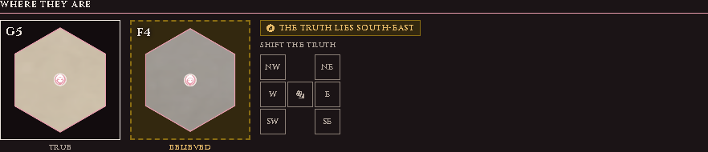

*Where they are: the True and Believed plates, the badge naming where the
truth lies, and the Shift the truth pad.*

**What the party is shown**, on the same tab, decides what the players' sheet
says of their position. **The believed hex**, the default, draws and reads the
hex the party token stands in. **Unknown country** blanks it: the players'
picture is an empty frame, no hex is named, and the Country section says
*Unknown country* and nothing more. Your own sheet shows the same under a gold
line, and the section previews a player's sheet beside the choice. Encounters
are thrown the same either way.

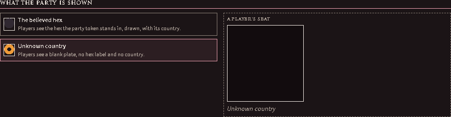

*What the party is shown, with Unknown country chosen, and the preview of a
player's seat beside it.*

Each later day's throw is still made, and none of them ends anything by
itself: a success while they are astray offers **They realise they are lost**
on its card. When they realise it — that press, or **They realise** on the
Judge tab because you told them — the imagined ground closes back over and the
players are told, in as many words, that the last few days were not where they
thought. They do not learn where they actually went. Finding their way back to
a known landmark is what puts the country they really crossed onto the map, in
its right place.

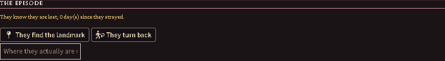

*The episode once they know it: the days since they strayed, the two ways
out, and the field for where they actually are.*

From then on the Judge's tab offers the two ways out. **They find the
landmark** credits the ground they really crossed, and can step the party token
onto its true position. **They turn back** closes the episode and credits
nothing. A true-position marker still on the map with no episode open is named on
the same tab, with **Move the party onto it** and **Remove the marker**.

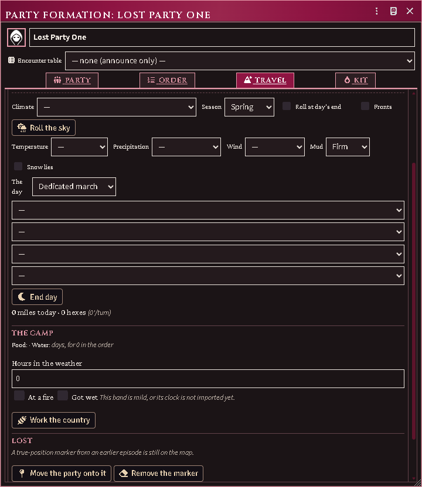

### In the city

**In the city**, picked in the mode selector in the title bar, swaps the
journey board for the City tab. Under *The city* on that tab, choose a **pace**,
whether the party is on the **avenues** or in the **alleys**, how well it knows
**the way**, and **the hour**, which reads the world clock unless you override
it. The lines beneath say what the board has worked out: what
the clock reads, how far a turn carries the party, which quarter it stands in
and which list the next incident is read from.

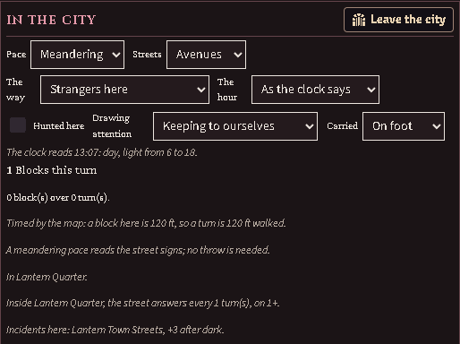

**A city is walked across, not clicked through.** Move the party's token and
turns are marked off exactly as they are in a dungeon — so a turn in the
streets costs a torch, a spell's duration and the rest interval, the same as a
turn in a corridor. Each turn covers the party's blocks, tests its way if the
pace and the route call for it, and gives the street its own chance at them.

How far a turn carries the party depends on **how big a block is on your map**,
and only your map can say: set it in **Scene Configuration → Basics → Battlemap → A block is**
on a scene set up as a settlement. Leave it blank and the party is timed by its
walking speed instead; the panel says which of the two is in force.

Being lost in a city is a wrong turning the party notices at once — a short
detour, not an episode. With **Crowded streets slow large parties** on (Game
Settings), a large party moves slower through a settlement; the thresholds and
the reduction come from your imported book, and splitting the party is the way
around it, at the price of each group answering for its own encounters.

Somewhere the party is **holed up** is the one place its own movement cannot
report, so a stay is counted off the calendar: advance world time however you
like and each whole day is thrown for once. A day that does not pass quietly
draws what found the party through the lists a street turn reads (the hunted
list, the quarter's, the zone's, the map's city list, then the world's table),
and the stay card lists it under that day's own *Day* row. Nothing is marked on
the map and the card offers no *Make it a place*: the party was indoors.

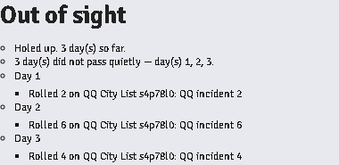

### Streets, and quarters

**Draw the streets as walls and the city measures itself along them.** The road
tools are on the **Battlemap** scene control (*Earthen road*, *Gravel road*,
*Paved road* and *Alley*), and each is a preset: pressing one arms core's wall
tool and hands it to you, so the next wall you draw is that road.
**Alley** is a modifier on whichever surface is armed rather than a road of its
own — a paved alley and an earthen one are both alleys. For walls that already
exist the **Walls** control carries a single tool, *Mark the selected walls as
roads*, which marks everything selected as a road of the kind a city scene
defaults to. In settlement mode a move is
then measured over the streets rather than across the blocks between them, so
a party that follows a curving avenue pays for the avenue. The panel says
which way the last move was measured. A map with no streets drawn is measured
in a straight line.

Either way the wall's own sheet gains a road row, and that is where the surface,
the street kind and the street's name are changed afterwards — it is the only
place an avenue already drawn becomes an alley. Nothing else about the wall is
touched: a street declared along the front of a building leaves the building
standing.

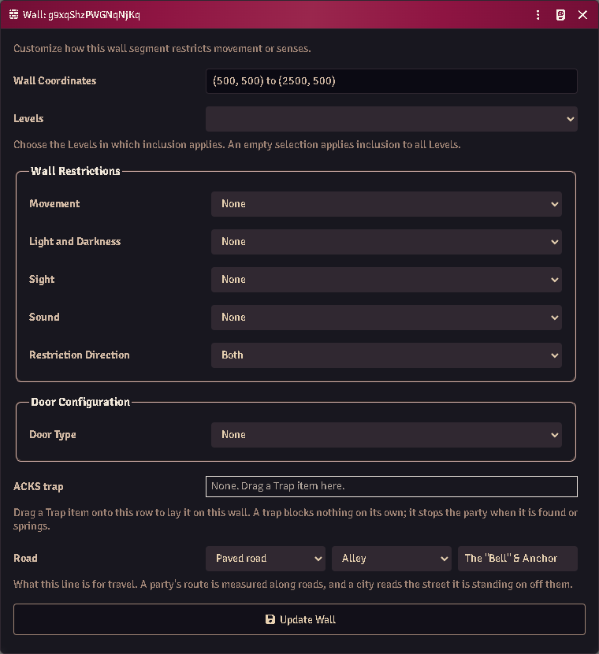

Where the party is standing is read off the map, not off the picker: a Judge
who drew an alley does not also have to remember to say so on the panel. The
one thing no street overrules is **holed up** — a party inside is not out on
the street its walls happen to sit on.

**A quarter that keeps its own time is a district.** Draw a Region over part
of the city and press *Mark as a district* on the Regions control, or select a
closed loop of walls and press *District from walls* on the Walls control. Either
way the Region gains an **ACKS District** behavior and its sheet opens:

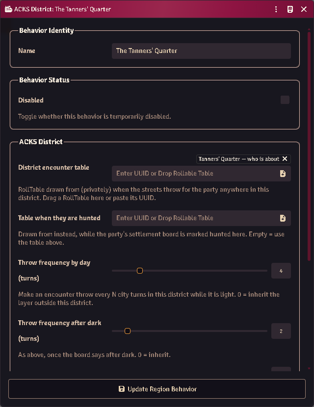

Every box is optional, and **a zero means "inherit"** — the layer outside the
district answers for anything the district leaves alone. That is what makes it
safe to price only what is distinctive: a quarter that is dangerous only after
dark fills in the two night boxes and leaves the day pair at zero. A district
with every box at zero changes nothing at all.

The table is who is about in this quarter, and the second one is who is about
when the party is **hunted here** — the toggle at the head of the City tab. Being
hunted belongs to the city the party is in: leave and come back and it is
gone, while the pace, the place, the route and the hour you set are kept.

**The hour follows the world clock.** Whether it is dark picks the quarter's
day pair or its night pair and whether the city's list adds its after-dark
figure, and the panel reads that off the calendar: the line under the pickers
says what the clock reads and whether that counts as day or night. Where dark
begins and ends are two Game Settings, **The hour it gets light** and **The
hour it gets dark**; left blank they stand at a quarter and three quarters of
the calendar's day. **The hour** picker is your override — *By day* or *After
dark* for a table that does not keep the clock, or a scene you are narrating
out of it — and while it is set the line still says what the clock reads, so a
board left on *After dark* through a morning is visible. *As the clock says*
hands it back.

The board says what all of this has come to:

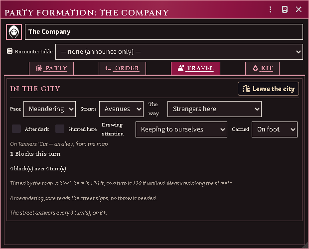

Streets still reads **Avenues** while the line under the pickers says the party
is in an alley — the map has answered, and the board states that rather than
quietly disagreeing with the picker. The last line is the quarter's cadence with each
half attributed: the interval is the district's and the target is the street's,
because the district left that box at zero and inherited it.

**Reaction adjustment** is what the quarter thinks of strangers, and it is
signed: a negative figure for a quarter that meets outsiders coldly, a
positive one for a quarter that is glad to see them. *Where it applies* narrows
it to the alleys, the avenues, or indoors, because a gazetteer usually says the
unwelcome happens somewhere in particular. When it is owed, the influence
roller shows it as its own row, naming the district — you can see what is being
applied and why, not just a total that moved.

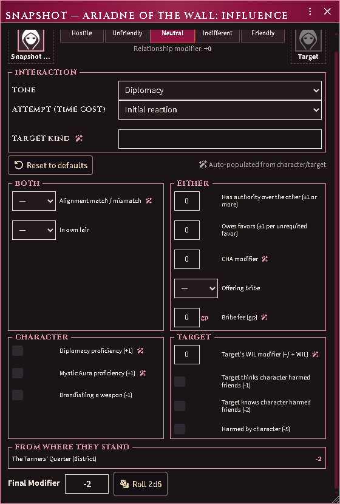

The row sits under **From where they stand**, apart from the boxes the roller's
own questions fill in, and it cannot be typed over: it is a fact about the
ground, not an answer anyone gave. A throw that a quarter's reception has
nothing to say about — a henchman's loyalty, a monster's morale — gets no row
and no adjustment.

A zone and a district can overlap, and a district outranks a zone: it is the
quarter's own gazetteer entry, and it is the order the tables are picked in
too. Press either tool twice and nothing is stacked — an existing district is
opened, not duplicated.

### Points of interest

**A place's token is a point of interest.** Drop a location actor on the city
map the way you drop any actor and it arrives as a marker: its name on hover,
no bars, nobody's side, no eyes, and a house for a picture until you give it
one. It cannot join a marching order and it is not counted among the map's
tenants. Stand the party beside it and the City tab says **At** it,
with a button to open the place, and a player can leave goods at the shop they
are standing outside.

**A quarter can have a place of its own.** On a district's sheet **The quarter's
place** picks the location actor the quarter is — its market, its notes — or
makes one named after the region. The panel then names it as the
quarter's own place whenever the party is inside the district, wherever in it
they stand.

**An incident leaves a marker.** When the street throws something up, the card
says a marker was left where it happened, and a note only you can see stands
at the spot. It lasts as long as **Incident markers last (turns)** says (Game Settings), in
city turns, and the calendar takes it away; set it to 0 for no markers at all. If the thing
that happened turns out to be a place — the tavern, the hideout — press **Make
it a place** on the card: name it, and a location actor appears inside the
quarter's place with the incident's words as its notes and its token where the
marker stood.

**Hop**, at the head of the City tab, walks the party to any place on the
map for the district-travel figure the book gives — within the quarter, or into
a neighbouring one — spending the turns like any other turns and moving the
token for you. Two quarters neighbour each other when their regions touch. A
walk the book does not price — across quarters that do not touch, from outside
any quarter, or before the figures are imported — is refused with the reason,
and dragging the token still works.

### Flying

Press the **Flying** tile and two more fields appear: how many **hours
aloft**, out of a day of how many, and what the flier is **carrying**. A party
that spends only part of the day in the air is priced on that share. A flier
still meets the ground below it and still feels the weather — except the wind,
which bites a flier by its own rule rather than the one that slows a walker,
and the readout names which replaced which.

## Traps

### Making one

A trap is an **item**. Make one with **Create Item** in the Items sidebar (type
*Trap*), or let the importer make them from your own book, and fill in
what it is. The sheet reads in five groups: **The trap** (how it is set off, in
your own words; **Springs on**; **Crudely built**), **This level** (the trap's
level, a strip marking which of the six levels state something, and the printed
sentence an imported trap keeps for the level), **How it resolves** (a saving
throw, an attack throw, damage with no throw at all, or nothing the module
rolls), **What it deals** and **Who it catches** (whoever set it off, or
everything within reach, with the reach in feet and an **And also** line for
riders such as prone or burning). A trap holds a row for each of its six levels,
and the level you pick decides which row you edit and which one fires.

Three fields are worth a word. **Springs on** is the band of the secret trigger
die: leave it blank and the trap reads the band imported from your books, or
type a figure to set this trap's own. Raise it for a trap that is easy to set
off and lower it for a hard one; 0 never springs it. **Attack throw** is the
number your own book gives for a fighter of the trap's level — the module ships
no fighter progression, so you supply the answer rather than the level. **Beating
the save is worth** says what a victim who makes the saving throw avoids: half
the damage, all of it, or nothing, where the rider is the point.

For a pit, leave the damage blank and set the depth: the fall's dice are filled
in for you from it, and ticking *Spiked* adds the spikes (RR ch. 6, Jumping and
Leaping; JJ p. 238). Where the fall table or the spike dice are not imported the
pit deals none of that part; a damage formula you type needs neither.

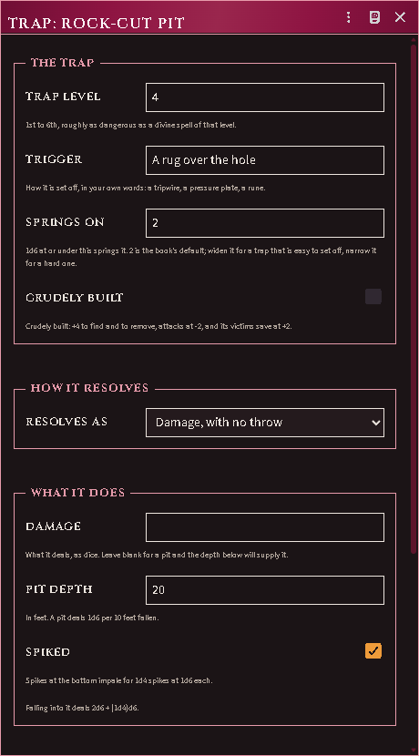

*A trap item: its level and trigger band, how it resolves, and a pit's depth
deriving its own damage.*

### Putting one in the dungeon

Two buttons, on the **Walls** scene control:

- **Trap the selected walls** puts a trap layer on whatever you have selected —
  an ordinary wall becomes a tripwire, and a door becomes a trapped door. The
  wall keeps doing its own job: a trap blocks nothing.
- **With nothing selected, the same button arms the pencil instead.** It works
  like core's secret-door button beside it: press it and every wall you draw from
  then on is a tripwire — a wall that blocks nothing and carries a trap. The dot
  on the button tells you it is still armed; press any other wall type to stop.
  Draw as many lines as you like in one go.
- **Enclose the selected walls as a trap area** takes a closed loop of walls and
  builds the region they contain — for a pit, a collapsing ceiling, anything
  the party stands *in* rather than crosses.

Then **drag a Trap item onto it**: onto the wall on the map, onto the **ACKS
trap** row on a wall's configuration sheet, or onto the **Trap** field of a
region's **Trap Zone** behavior. Dragging onto an untrapped wall lays the layer and assigns the trap in
one go.

You see a marker on each trap showing its state — armed, spotted, disarmed,
spent. **Players see nothing at all while a trap is hidden**, the same way they
see nothing of a secret door until it is found — and once the party HAS found
it, sprung it or disarmed it, they see its marker too. That is what they point
at to work on it.

A trap area is drawn for you and never for them, whichever scene layer they
open.

### Working a trap from its marker

While you are on the **Walls** or **Regions** controls, a trap's marker is a
control, and it takes the same two gestures a door does:

- **Left-click** sets the trap, or makes it safe. An armed trap goes safe; a
  safe one arms again. A trap that has already gone off is *rebuilt* — armed
  again and a fresh secret, with nobody's failed attempts held against it.
- **Right-click** decides whether the party can see it. A ring round the marker
  means they can. Use it when they learn about a trap some other way — a warning,
  a map, a captive — or to put one back out of sight.
- **Hover** it to read which trap it is, what state it is in, and who can see it.

Neither gesture rolls anything: they are you moving the mechanism. A character
working on a trap is **Trapbreaking**, below.

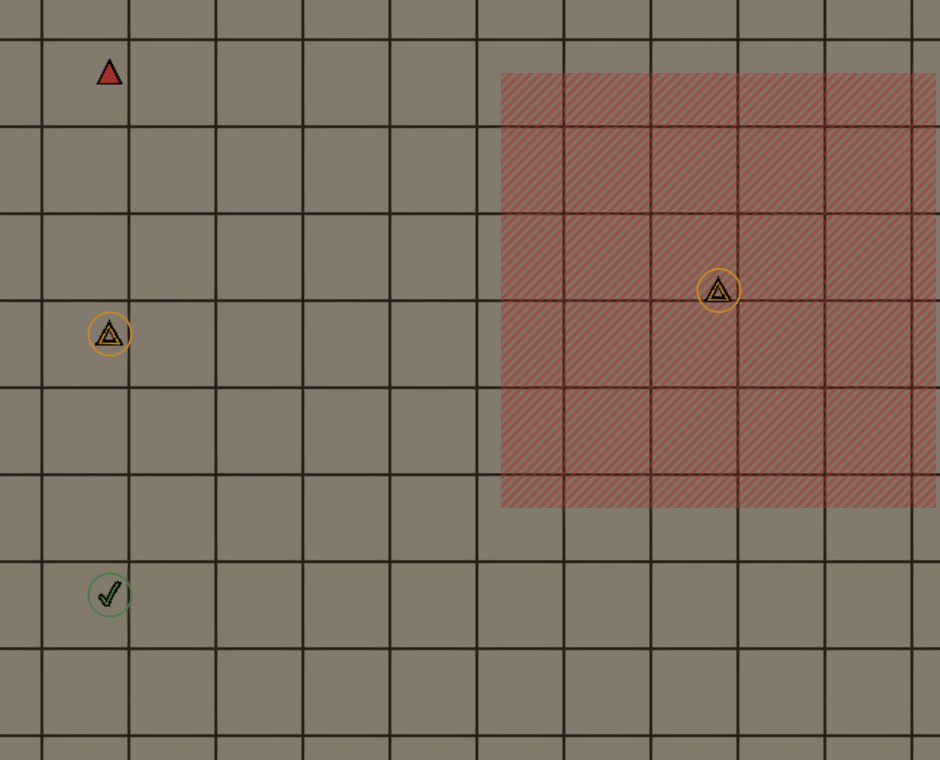

*Four traps as the Judge sees them: an armed one still secret (no ring), a
spotted one and a disarmed one the party knows about (ringed), and a trap area
whose marker sits at its middle.*

Markers are still drawn on every other layer, but they stop answering the mouse
there — so a trap can never be disarmed by a stray click while you are dragging
tokens. Players can never work one from the map at all.

### What happens when the party walks in

All of it is whispered to you, including the times nothing happened. A
player's chat shows none of it, not even a line saying dice were rolled.

There is nothing to press. Trap resolution fires on its own the moment the
**party token** moves, with no prompt and no button — you are never asked to
confirm a throw, and the table is never shown one. Two things it needs, though,
because neither announces itself when it is missing:

- **The party has to move as the party.** Traps resolve for the party token, so
  a session that moves each character's own token individually gets no trap
  throws at all. Add them to the party first.
- **A Judge has to be connected.** The automation runs on the GM's client, so
  a party moving in a world with no GM present crosses everything untouched.

Anyone who can search throws first — and not only against the trap in the way.
A thief moving at exploration speed throws against **every** hidden trap the
party passes within reach of, farther with a pole, measured against the ground they
actually walked rather than where they stopped. You hear about it only when
something is spotted; the misses are silent, or the log would be unreadable.
Each character gets one throw per trap per level, which is what a hasty search
costs them.

A thief at the front who makes it spots the trap before anyone touches it. Then
the pole, if someone in the party holds the **Pole** role, probes ahead of its
bearer, and then the party itself, rank by rank, each on its own secret throw.
The first throw that comes up inside the trigger band springs it, and the party
stops there rather than walking on.

Every distance in that sequence is imported from your books and can be edited in
the Ruledata Browser (`Settings tab → Game Settings → ACKS II — Extras → Imported
Rules Tables → Open Ruledata Browser`): the automatic search's reach bare and
with a pole, how far the pole probes ahead, the secret die and the band that
springs it, and the reach at which Trapbreaking is offered (RR ch. 6, Traps and
Trapbreaking). The **Scout** and **Pole** role chips on the Order tab show the
figures in force. A figure that is not imported costs only its own step: with no
search reach only the front rank searches and only the trap the party crossed
gets a throw; with no pole lead the pole does not probe; with no secret die or
band nothing is rolled and nothing springs, and you resolve the crossing by hand.

At combat speed the party has neither the pole nor the hasty search (RR p. 263),
and the card says so.

Damage is **rolled and reported, not applied** — the card gives you the number
and the sheets stay yours. The number is already worked out against the throw:
a missed attack deals nothing, and a made save is worth what the trap's
**Beating the save is worth** field says (half, all of it, or nothing at all if
the save only buys you a choice about where you land).

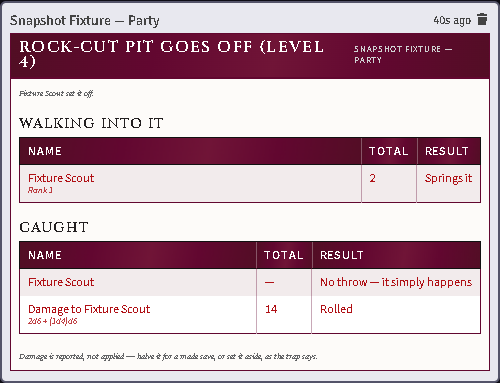

*The whispered card: who walked in, who sprang it on the secret die, who was
caught, and what it dealt.*

### Getting past one

Press **Trapbreaking** at the head of the party sheet's Order tab. It asks three
questions — who is working on it (**Character**), **Which trap**, and by which
**Column** — and shows you the throw (what it **Needs**, with each part of the
figure listed) before anyone spends the time.

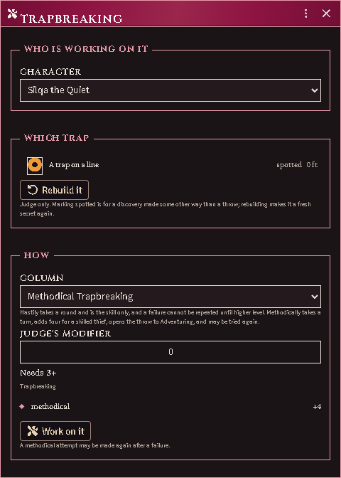

*The target is picked, never guessed: a party halted in a corridor can be
standing at more than one trap. A player's list holds only traps the party has
found — offering an unfound one would give it away. Yours also lists the unfound
traps in reach, tagged *not found*, with **Mark spotted** for a trap they found
some other way than a throw and **Rebuild it** to make a trap a fresh secret
again.*

The list holds the traps within the imported Trapbreaking reach, and the dialog
says which reach it used; where that figure is not imported, the dialog names no
reach and only a trap the party is touching is listed (RR ch. 6, combat actions). Players see the same
dialog whenever one of their characters could actually make the throw, and their
attempt is declared to you the way every other party action is.

A character with thieves' tools can work on a trap the party is standing at. The
**Column** select offers two, and the dialog shows each one's time, bonus and
retry limit before you throw (RR p. 267):

- **Hasty Trapbreaking** — the Trapbreaking skill only. A low enough unmodified
  roll sets it off, and the module refuses that character another hasty try at
  this trap until they gain a level.
- **Methodical Trapbreaking** — a skilled thief adds the methodical bonus; a
  non-thief may try through Adventuring. A plain failure can be tried again. How
  low an unmodified roll must be to set the trap off, and the size of the
  bonus, are figures imported from your book for each column.

**Work on it** makes the throw. Beat it and you choose: **Disarm it**, which
leaves it re-armable, or **Discharge it** deliberately, which spends it. A
disarmed trap can be re-armed later with **Re-arm it**, on a Trapbreaking throw.

**Crudely built** on the trap item marks it crude, and the module applies the
crude adjustments to finding it, removing it, saving against it and its attack
throw (JJ p. 238).

## Doors

Select a door on the **Walls** scene control and press **ACKS door actions**
(Judge only). The window shows what the door is built of, how many spikes are
in it, and the three things a party does to one that will not open. The
construction and the Judge's two marks, *Evil* and *Lock jammed*, are written
to the door the moment they are set, for the Judge's record and for anything
that reads the door's state; the marks change no figure in the window.

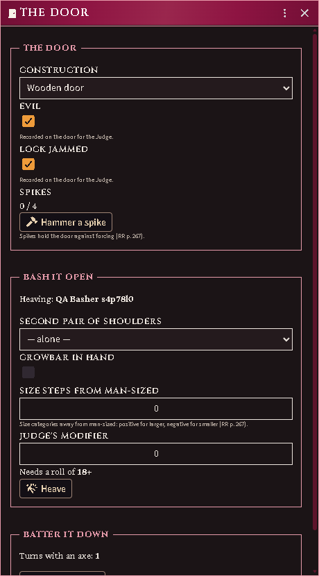

*Two spikes hammered in, the heave broken into its parts — Strength against the
spikes, and the number it needs — and what battering it down with an axe would
cost in turns.*

- **Spikes**: **Hammer a spike** drives one in, up to the most a door holds, and
  the heave counts every spike (RR p. 267). **Pull one** takes one back out.
- **Bash it open** is the throw, itemized before you take it: who is heaving,
  whether a second pair of shoulders is on it, a crowbar, how far from man-sized
  the heaver is, and the Judge's own modifier. The number it needs is shown, and
  so is every part of what you have. A botched heave rebounds on the heaver:
  the card carries the damage line, reported and not applied, as a trap's card
  does.
- **Batter it down** is the slow certainty instead — the window says how many
  turns an axe wants for that construction (RR p. 267), and a construction with
  no axe figure says so where the button would be. The turns are charged to the clock
  of the formation holding the basher, and the notice names them; a basher no
  formation holds spends nothing.

## Dealing out experience

**Deal XP** divides an adventure's total between the party and shows the
division before it is given. It opens from **Deal experience**, the star among the
party sheet's quick tools, and only a GM sees it. While *Deal experience from
the formation* is on in Game Settings, the system party sheet's own Deal XP
button is hidden, so this is the one to use; turn the setting off to go back
to the system's division.

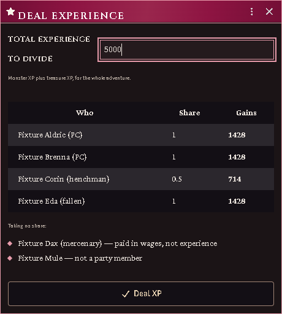

*Full shares to the player characters, a henchman at the share their terms
set, and the two taking nothing named with the reason.*

Everyone's share is listed with what they will gain, and anyone taking nothing
is listed too, with why — a mercenary is paid in wages rather than experience, a
pack mule is not a party member. A fallen member still takes their share. Only
**Deal XP** writes anything.

A monster hired as a henchman takes its share too. The system keeps no
experience for a monster, so the share is credited to the monster's own record
and the dialog says so beside it. The monster's sheet shows the total: open the
sheet's **Service** tab, and the **Terms** group's **Experience** row carries
it, with where it came from in its tooltip. The figure is a tally; it
does not advance the monster, which stays the Judge's to do.

Whether a hireling is a henchman, a mercenary or a specialist is read from the
**Category** on the hireling's own sheet, including for a hireling added on the
system sheet rather than hired through a market. Change it there and Deal XP
follows.

## Hit points for the whole party

**Hit points**, the first of the party sheet's figures, opens one window that
lists every member, and applies damage, healing or a new value to all of them
at once. Only a GM can press it; a player's copy reads how many are hurt. The
same window opens on the selected tokens from the
**Adjust hit points** button in the Tokens controls, and from the *Adjust Hit
Points (GM)* macro.

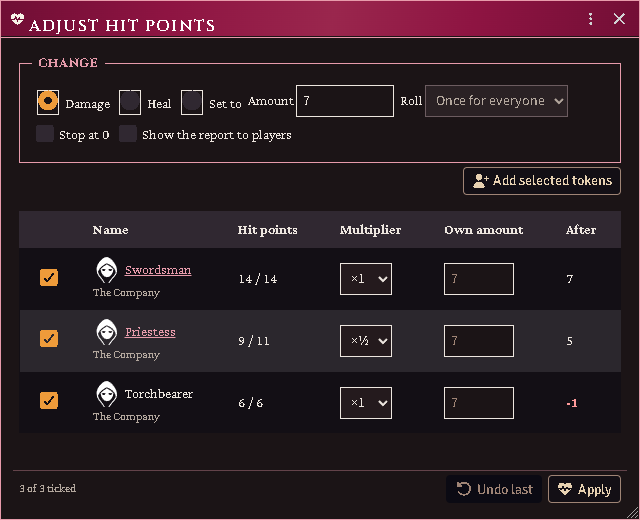

*A party's members about to take 7 damage, one of them at half, each row
showing where it will land.*

Choose **Damage**, **Heal** or **Set to**, and type an amount: a number, or
dice such as `2d6`, rolled once for everyone or once for each. Each row has its
own multiplier, for a member who takes half or double, and can take an amount of
its own instead. The **After** column shows where each row will land whenever
the amount is a number. **Stop at 0** keeps damage from taking anyone below 0.

The window writes through the system's own damage rule, so each result is what
the system would store for the same damage. The report goes to the GMs alone
unless you tick **Show the report to players**. **Undo last** puts the last
change back while the window stays open. A character the change takes to 0 or
below gets a **Mortal Wounds** button beside their result.

A hireling or monster whose token is not linked to its actor keeps its own hit
points on that token, and the party sheet counts them down by those, inside the
party token or out of it. They keep those hit points when they step out of the
party token, where the system would otherwise roll a monster new ones.

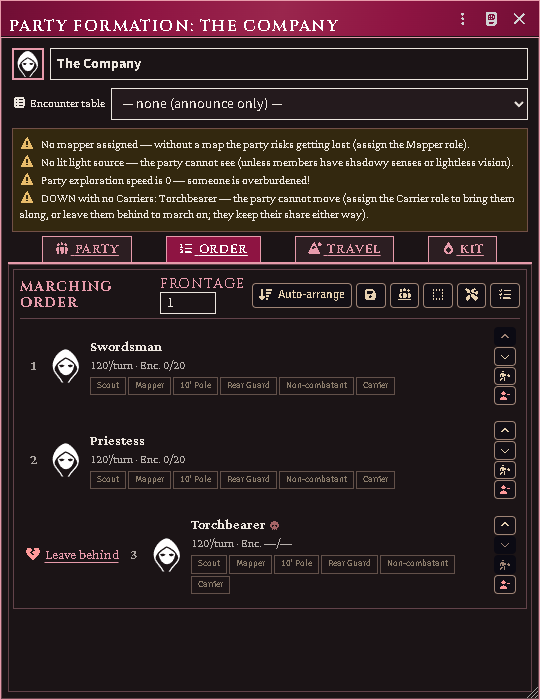

*A torchbearer whose token is not linked, down inside the party token: the
Order tab offers to leave them, and the column waits for a carrier.*

A group is listed as its bodies on the map. With none
on the map it is listed and left out, and so is a vehicle, which is adjusted on
its own sheet.

## The clock

Moving the party token advances the exploration clock in turns. Torches burn
down, spell durations tick, and the rest cycle tracks when the party is due one.

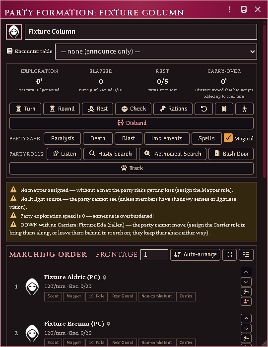

*The exploration warnings, including a fallen member the party must carry or
leave before it can move.*

Light is real: a lit torch occupies a hand, shines from its bearer's square in
the column, and goes out when it burns through. How far each kind of light
reaches and how long it burns come from your book through the importer; until
the books are imported a lit torch sheds no light, and the Kit tab leaves the
figure blank. You can change any of them in the Ruledata Browser.

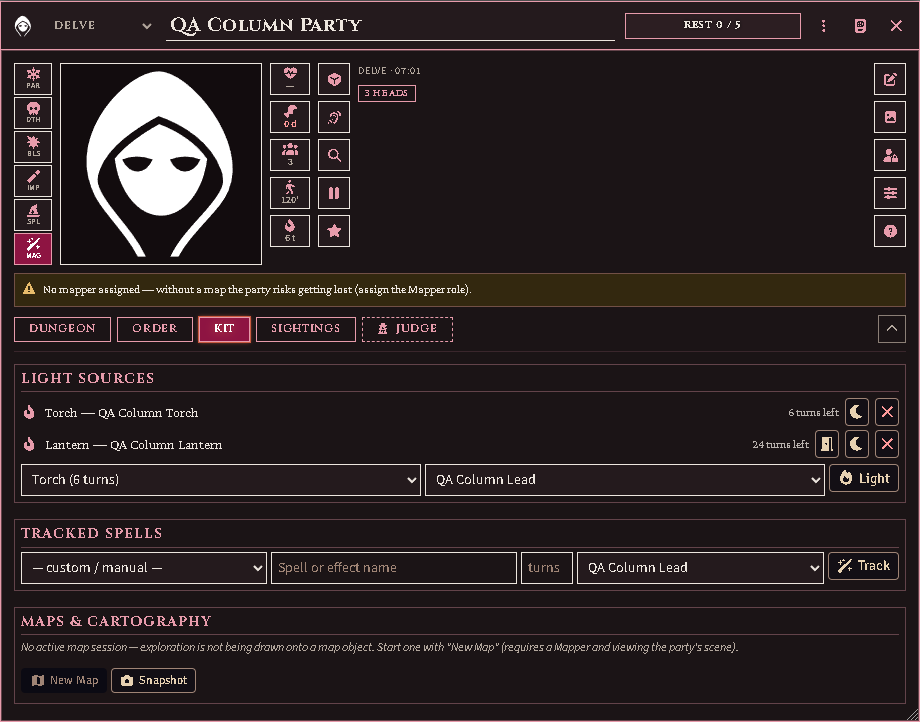

*The Kit tab's light sources, each with the turns its imported burn time
leaves. Hover the turns to see where the figure came from.*

The light figures and the wandering-monster cadence (below) arrive with the
**Rules tables**. Until both are imported, a GM is warned when the world loads.
To bring them in without a full import, run the **Reimport One Shelf (GM)**
macro from *ACKS Extras Macros* and choose **Rules tables**, with your books open
on that seat.

### Resting

A party that explores past its rest interval without resting is winded: the
sheet warns when a rest is due, then marks the party winded, and a **Rest** turn
clears it. To run a delve without that, turn off **Require rests in the delve**
in Game Settings. The clock keeps running, but no turn counts toward a
rest, no warning or card line mentions one and nobody is winded; the Rest figure
and the bar in the title bar disappear. A party already winded when you turn it
off is released on its next turn. The wandering-monster throw has its own switch
(below) and is not affected.

### Wandering monsters

The clock also makes the wandering-monster throw and, on an encounter, draws
from a table only you see. To set the table, how often the throw comes and what
it needs for one part of a map, draw a Region there and give it an **ACKS Encounter
Zone** behavior. Everywhere else, the formation's own table applies, with
**Wandering monster throw frequency (turns)** and **Wandering monster target
value** in Game Settings. The throw's die, how often it comes, what it needs
and the dice of the encounter distance are read from your Judges Journal by
the importer, and you can change any of them in the Ruledata Browser. Those
two settings start blank, which uses the imported frequency and target, and
a number you type there wins over them. Without the die or the target no throw
is made, and the **Encounter check now** quick tool says why; without the distance dice an
encounter still happens, and its card says no distance was rolled. Hover the
die, the target or the distance on a card to see where it came from. To stop the automatic throw altogether, set **Wandering
monster throw frequency (turns)** to 0 in Game Settings; **Require rests in the
delve** (above) is the separate switch for the rest.

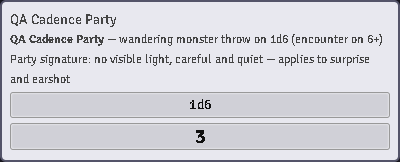

*A wandering-monster throw's card: the die and what it needs, the party's
signature, and the roll.*

A monster met off its own floor can be adjusted (JJ p. 36). Give the zone its
**Dungeon level**, and give the table the **Monster level** it is written for:
open the table, switch it to edit, fill **Monster level** on its **Summary**
tab, and **Save**. When a monster comes from a table whose level differs from
the zone's, a second card gives you the adjustment and rolls the reaction. If a
table's results are other tables, set the level on the tables that name the
monsters. Nothing is adjusted while either level is blank, and a draw from the
formation's own table never is, because it has no zone. A table in a locked
compendium opens read-only: import it into the world, or unlock the pack, to
set its level.

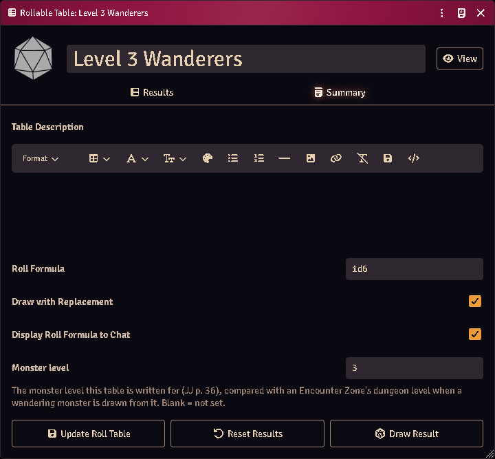

*A table's Summary tab in edit view, its Monster level filled in and saved.*

## Handing things out

A player has to own a torch to light one, and a free hand to hold it. **You do
not.** When a Judge gives a member a light from the party sheet, the gear appears
in their pack and a hand is emptied to hold it — the shield goes on the back
before the sword is sheathed, and nothing is put away that did not need to be. A
lantern arrives with its flask of oil. The same applies to roles that need a kit:
put someone on the map and they are handed a quill and parchment.

Nothing here blocks you. If the world has no such item to copy, or the character's
hands are full of *lit torches* — which sheathing cannot fix — you get told, and
it happens anyway.

**Mapping takes both hands.** The quill is in one and the parchment in the other
for as long as the role is held, which is why a mapper cannot also have a weapon
drawn. Set the role down and the hands come back.

## Seeing in the dark

Every token's vision comes from its own sheet, whether or not it is in a
party. Ordinary eyes see **only what a light source reveals** — walk a torchless
character into a black corridor and they see nothing. A
character with **lightless vision** (or infravision) sees its recorded range,
and a thief's **shadowy senses** reach their own short radius; both see as dim light — colourless,
no reading, no fine detail.

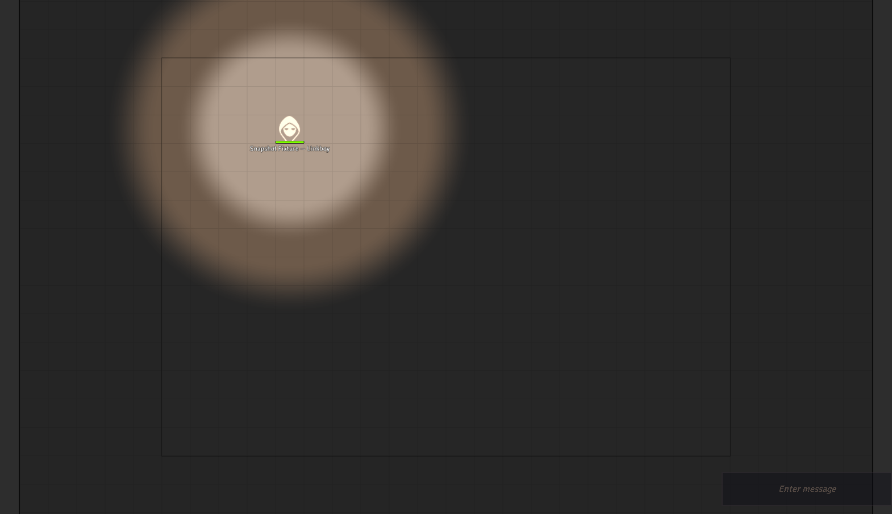

*A token under its own lantern's glow, and nothing beyond it. Nobody typed these
radii — they come off the lamp and the character's own senses.*

**Night vision** works differently from either, because it is not sight without
light — it is sight that makes more of the light there is. It brightens dim light
to daylight, and indoors it carries **a multiple of the light it is seeing
by** (MM, Night Vision): a creature standing in a torch's bright radius sees
well past its edge. It does not
need to be *its* torch — the party's lamp will do, which is exactly the creature
watching you from beyond the edge of your own light. In a corridor with nothing
burning at all there is nothing to multiply, and a night-eyed creature is as blind
as you are.

> So if you want a monster to see indoors and it has no lightless vision, you do
> not need to give it any: put Night Vision on its stat block and make sure
> something nearby is lit. If you want it to see in *pitch dark*, that is
> lightless vision, and it is a different line on the sheet.

Monsters answer from the stat block of their Full Monster sheet, so a creature with
lightless vision or echolocation gets it without you configuring anything. The
member list shows each character's dark-sight range beside their speed.

**Each sense behaves like itself, not like eyes.** The module gives each its own
detection mode, and that is the part worth knowing at the table:

| Sense | Finds an invisible creature | Works in magical darkness | Reaches through walls | Stopped by |
|---|---|---|---|---|
| Lightless vision | no | no | no | blindness; a **Hidden** character proficient in Hiding |
| Shadowy senses | yes | no | no | deafness, silence, **running** |
| Echolocation | yes | **yes** | no | deafness, silence |
| Mechanoreception (terrestrial) | yes | yes | **yes** — but only creatures that *move* | — |
| Mechanoreception (other) | yes | yes | no | — |

So a bat still hunts you inside a *darkness* spell, and going invisible does not
help; a thief creeping on shadowy senses goes blind the moment they break into a
run; and a burrowing horror feels you through the floor only while you are
moving.

Two of those need a switch Foundry does not ship, so this module offers them as
statuses on the token HUD: **Hidden** and **Running**. Neither is guessed —
toggle them when the character declares it. A GM arranges which statuses the HUD
offers under `Settings tab → Game Settings → ACKS II — Extras → Token status
palette → Arrange the palette`.

If you want a token to see differently, **edit its vision by hand** — from then
on that token is yours and the module leaves it alone. *Token vision
from ACKS senses*, in Game Settings, turns the whole thing off.

### Re-deriving every scene at once

Tokens are re-derived when you open their scene or change the creature's sheet,
so a scene you have not opened since a token's sheet changed still carries the
token's last settings. Opening a scene brings that scene up to date.

To do every scene at once without opening them, run the sweep from a script
macro of your own (there is no shipped macro or menu for it):

```js
const report = await acksExtras.lib.vision.migrateWorld();
ui.notifications.info(`${report.written} of ${report.tokens} tokens rewritten on ${report.scenes} scenes.`);
```

It walks every scene in the world and re-derives every token from its sheet.
The call says nothing by itself, so the second line prints what it did. A count
of 0 of 0 in a world that has tokens means it did not run: either *Token vision
from ACKS senses* is off, or more than one GM is connected and the sweep is
another's to run.

Tokens you edited by hand are normally left alone forever — that is the
override working. Call `migrateWorld({ reclaim: true })` instead and it drops
that protection so they follow their sheets again; those edits are not
recoverable afterwards, so the default is to leave them be. Run it after
switching the setting on.

## Sending a scout ahead

The party travels as one token, but any member can **detach** — the arrow button
in their row — and step out onto their own token. They stay in the formation:
turns, rest, encounters and their place in the marching order all keep counting.
What changes is that they now carry their own light and see with their own eyes,
which is the entire point of scouting.

Players can detach their own character; the GM can detach anyone.

A scout can range **one round's movement** ahead, then must wait for the party
to catch up or pass before going further — you will see a notice when they hit
the limit. This keeps the exploration clock honest: the party token is still
what spends dungeon turns.

Press the button again to bring them back, with everything that happened to them
while they were out. A scout who falls out there can still be brought back, to
be carried. Only a member who is down cannot step out. If a fight starts, the
party deploys around the scout as normal and the leash lifts for the combat.

## Party checks

**Party checks**, among the party sheet's quick tools, asks which check the party
makes, resolves it for every member and posts **one GM-whispered card**, not a wall of per-member public cards: a table of who rolled, what they
got, the number they needed and whether it landed, with the modifier stack under
each name and anyone who could not attempt it named at the foot.

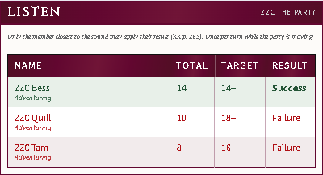

*A check every member made, on one card: total, target, verdict, and the
modifier stack behind each one.*

Party **saving throws** post the same card, and so does the Surprise Matrix
(below) — one shape for every roll the whole party makes at once.

Every number comes from your own imported book by way of the importer — this
module ships no skill ladder. Resolution order:

1. an explicit **Used for** binding on an ability item;
2. otherwise the ladder the item itself carries, at the owner's factored level;
3. otherwise the item's imported identity naming its skill.

Anything else falls back to the sheet's roll target.

The GM can overturn what the automation decided — the card is theirs.

## Surprise, on one card

Starting a combat opens the system's **Surprise Matrix**. Pick the square that
describes the encounter and the results come back as **one card** rather than a
chat message per combatant: monsters in one table, adventurers in the other,
each row naming the creature, its total and whether it was surprised.

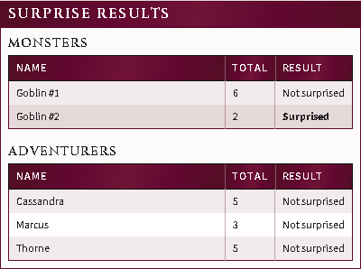

*The whole encounter on one card: monsters and adventurers, each row naming the
creature, its total and the verdict.*

Hover a total to see the dice and every modifier behind it. The rolls are the
system's own and are not changed by this — same numbers, same threshold, same
**Surprised** condition applied to the same creatures.

A **hidden** monster's result stays private: those rows travel on a second card
only the Judges can see, which is what the system already did for them one
message at a time. Nothing hidden means one card; something hidden means two.

Turn **Surprise results on one card** off to go back to the system's original
per-combatant messages. It takes effect on the next encounter — no reload.

## Initiative, on one card

Initiative comes back the same way: **one card**, one row per roll, highest
first, instead of a message per combatant.

A **combat group** is one row. The system already rolls a single die for a group
you have made with the tracker's people icon and gives that number to everyone
in it — but it announces the roll under one member's name and says nothing about
the others, so a grouped fight reads exactly like a fight where everyone rolled
separately. On the card the group is a single line, labelled the way the tracker
labels it (`Group 0`) and naming its members underneath.

Which creatures share a roll is still yours to say, and nothing is grouped for
you: select the tokens — a stack of kobolds, a summoner and everything they
called up — and press the people icon in the combat tracker. Everyone else rolls
as themselves and gets their own row.

A **hidden** combatant's number travels on a second card only the Judges can
see, as it already did. If a hidden creature is inside a group, the group's open
members stay on the public card and the hidden one appears on the Judges' card
with the same total.

Turn **Initiative results on one card** off for the system's original messages.
It takes effect on the next roll — no reload.

Creatures that roll the same number stand in one order in the tracker on every
player's screen, so End Turn and the turn marker agree for everyone. Within a tie,
a side that outnumbers the other goes last, a hostile creature goes before a friendly
one, and creatures with neither difference go in a fixed order that you cannot choose.

## Skill audit

**Skill audit**, at the head of the Order tab (GM), shows how every party roll
resolves for every member: which
item or target is used, the auto-scaled level and factor, and each bonus in the
stack.

It is also the editor for **custom skills**: flag any ability item to take part
in a party roll, scale it on a thief progression, and set a level factor (0.5
for "as a thief of half his class level").

Each row of **Party abilities** has a dice button that rolls that ability for the
whole party: every member who holds it rolls, and one card whispered to the
Judges lists the totals, the targets and the verdicts. An ability a party check
takes (Hasty Search, say) rolls that check's target, the one the Resolution table
shows, and the card says which check; any other ability rolls its own throw.
Hover a target to see where it came from and each part. Members who made no roll are named under
the card with the reason, and if nobody holds the ability the card says nobody
rolled. No round or turn passes.

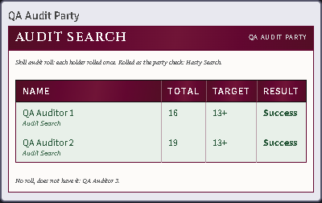

*A Party abilities row rolled for the whole party: each holder's total, target
and verdict, and the member who made no roll named underneath.*

## Common problems

**A binding shows a skill that isn't there.** Its skill was never imported, or
the import was removed. The binding still lists itself so you can see your own
choice rather than a blank select — import the skill or rebind it.

**The map went dark.** Scene sync steps are fault-isolated, so one failure costs
only itself. Check the console for which step failed.

**A phantom party keeps coming back.** Records whose party actor was deleted are
pruned at world load. If one survives, its actor still exists somewhere.

**The party crosses a wilderness map and nothing is rolled.** No miles, no
encounter card, no navigation card: the party is still in Delve, which counts
turns and bills nothing on a map whose cells are a mile or more across (you
are told so once, in a whisper). Pick **Journey** in the selector beside the
party's name, or declare the map a wilderness map with the icon on its card
in the scene navigation bar (click it to pick; see
[What kind of map is this?](battlemap.md#what-kind-of-map-is-this)). The
encounter card prints
the party's evasion target but does not roll it; surprise, and whether the
party may evade, are settled by the system's Surprise Matrix when combat starts.

**The party walks a dungeon map and no turns pass.** No turn card, the delve
clock still: the party is still on a **Journey**, which counts miles and
hours, and a dungeon's corridors are not many of either. A map that declares
nothing leaves the party in whatever mode it arrived in, so a party that came
off the wilderness map stays on its journey. The mode selector beside the
party's name shows which mode the party is in. Pick **Delve** there, or declare
the map a dungeon with **Party system here** on the Battlemap scene control's
**Map setup panel**, or with the icon on the map's card in the scene navigation
bar (the party standing on it switches at once; see
[What kind of map is this?](battlemap.md#what-kind-of-map-is-this)).

**Saves look wrong.** The party actor has no saves of its own: pressing a save
on the party sheet rolls each member's own saves.

## Macros

The *ACKS Extras* macro compendium carries one formation macro, **Party Sheet**,
which opens the exploration party sheet (above).
