# Hiring henchmen and hirelings

Recruitment runs off a **place with a market**. You post a paid search, the
market rolls what turns up, and you make a hiring throw against the people it
found.

*A market on a location sheet, ready to take a posting.*

## Post a search

Open a location with a market → **Recruitment** tab → **New posting**.

Choose what you are looking for:

- **Adventuring henchmen** — the general post; covers the whole henchman market.
- **By level** — 0th to 4th. Capped by your character's level (RR 168).
- **By class**, optionally at a level — a directed search (JJ 118).
- **By proficiency**, optionally with a class — also directed.
- **Mercenaries** / **Specialists** — by troop or specialist type.

Set the employer, and the **presented level** if your character is passing
themselves off as more important than they are. That is a real option with a
real cost: if it is discovered later, the loyalty throw takes −1 per level of
difference.

**A mercantile network searches wider.** An employer holding the Mercantile
Network power is offered **Search with the mercantile network** on the
posting, ticked where the market counts as one the holder has visited before
(RR ch. 2, Mercantile Network). The search fee is the larger market's, and a
general posting adds whoever a search at the larger class finds beyond the
town's pool; those candidates are the holder's alone to see and to hire.

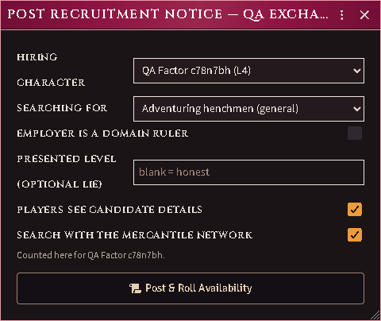

**No GM needs to be online.** A location defaults to OWNER, so players can post,
process and hire on their own.

## Let time pass

Availability belongs to the town, not to you (RR 162): a market rolls a monthly
pool and candidates arrive across weeks 1, 2 and 3.

Advance the world clock, or press **Process now** — it is idempotent, so
pressing it twice costs nothing.

**Directed searches behave differently.** A directed result is available
immediately, for the whole month, and is private to the recruiter. It appears in
the Recruitment tab's directed bucket, not the shared walk-in tabs.

## Hire someone

**Henchmen** tab → **Recruit** on a candidate.

The throw dialog shows every modifier that applies, with the situational ones as
toggles so you decide what is really in play. Roll, and on success the candidate
becomes a real actor, owned by whoever owns the employer.

The signing bonus on offer is priced on the wage the hire will be paid: the
wage the hireling states, else, for a henchman, the wage table's for their
level. A mercenary or specialist with no wage set is offered no bonus.

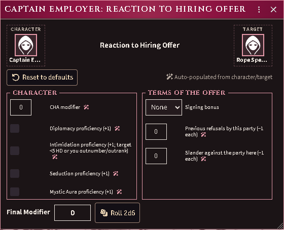

*An offer to a specialist whose sheet sets no wage: the signing bonus offers
None alone.*

**The throw reads its table from your book.** The Reaction to Hiring Offer's
results, and what each earlier refusal and each slander takes off the roll,
come from the Revised Rulebook's tables once they are imported (RR 162). Until
then the hiring page and the dialog say the table is missing and do not roll.

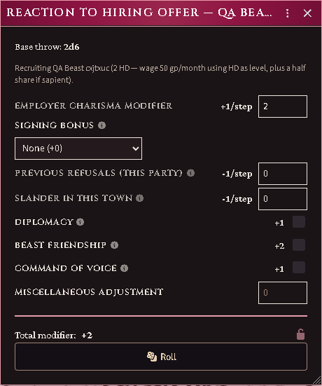

**A bulk row is offered head by head.** Hire on a mercenary or specialist row
asks how many heads the offer goes to, and each head rolls its own reaction
(RR 162). Heads that answered alike become a row of their own, so the next
offer to those who refused carries their penalty and leaves the rest
untouched. The heads who accept join as one hireling of that count, and the
signing bonus is paid per head.

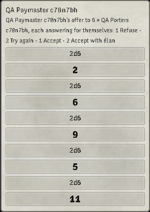

Candidates are plain records until this moment — a Class I market can roll
hundreds of them, and creating hundreds of actors would be unusable.

## Keep a retinue

**Roster** (from the character sheet, or the actor's context menu) shows every
hireling with its loyalty and morale standing, the wage ledger, and the event
history each score is computed from.

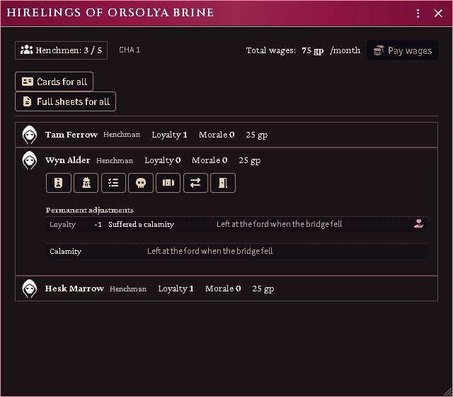

*An employer's roster: who is hired, on what terms. Open a row for that
hireling's history and the Judge's actions on it — a loyalty or obedience
throw, a calamity or a penalty on the record, a transfer, a dismissal.*

**A hireling opens on the same sheet as any character.** The compact Follower
Card is there if you want it: right-click the hireling in the Actors
directory and choose **Use Follower Card sheet** (**Use full sheet** turns it
back), or press **Cards for all** on the roster to give the whole retinue the
card at once (**Full sheets for all** undoes it). With the module's sheets, a
monster opens on the card whether hired or not, with the full stat block
behind its **Full sheet** link.

**A power is worth what your book says.** The henchman limit, a hire's base
loyalty, the hirelings' morale bonus and the hiring-offer bonuses read the
value the importer located on each power's page, or an Active Effect the Judge
gives the power; the module supplies no figure for a power it knows only by
name. A power held with no value is named where it would apply: on the roster,
in the henchman-limit refusal, and on the hiring and obedience pages.
Characters holding powers imported before 11.4.0 refresh them with **Update
Abilities** at the top of the Items sidebar, with the books open.

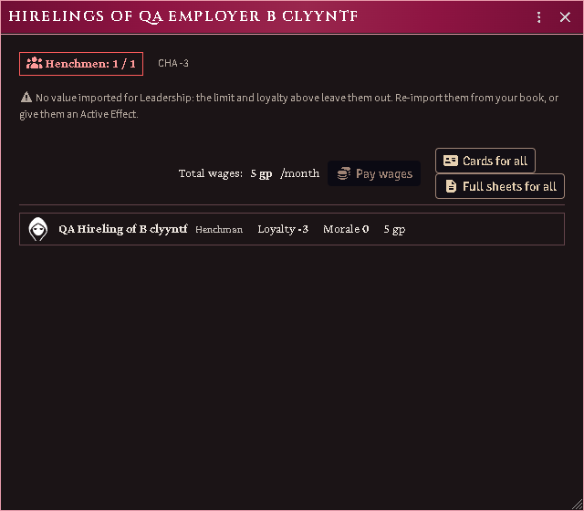

**The limit starts from your book's figure and the employer's Charisma, or
not at all.** The base arrives with the Rules tables. A world that imported
them before 11.8.0 runs **Rules tables** in **Reimport One Shelf** (ACKS Extras
Macros) once; until then no limit is counted, and the roster's tooltip says
so. An employer with no Charisma score, such as a monster leading henchmen,
shows no limit on its roster, and none is enforced on its hires.

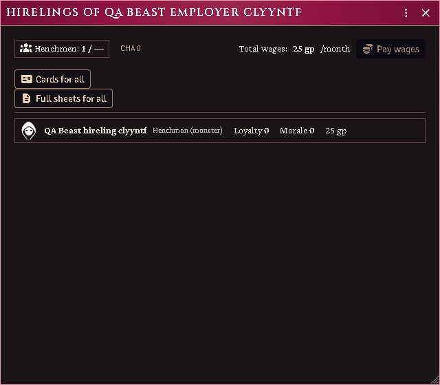

**A wage is coin that changes hands.** On payday the employer's coin leaves
their stores in the order their sheet states
([where coin is paid from](character-sheet.md#where-coin-is-paid-from-and-where-it-lands))
and lands where each hireling receives coin, so the two have to be where coin
can pass between them: together, or the hireling on the employer's roster.
What the employer cannot pay exactly is kept as arrears, and the hireling's
history records that payday as a part-payment with what is still owed. A
payment that is refused says why and records no payday.

**Pay wages is one payday wherever you press it** — on the character sheet's
Followers tab, on the system sheet's Hirelings tab, in the roster, or on the
Judge's wage card. It pays what the wage clock says is due — a month's wage
(RR 168) for each whole month gone by since that hireling was last paid — and
when nothing is due it says so, with the days until something will be. The
Followers tab states what is due beside the button, and offers the button
only while something is; until then it states what the payroll costs a month
and how many days remain before the next wage falls due. Those days pass as
the world's clock does. A player who presses it for hirelings the
Judge runs has the payday carried out by the Judge's seat; with no Judge
connected it is refused and says so, and no coin moves.

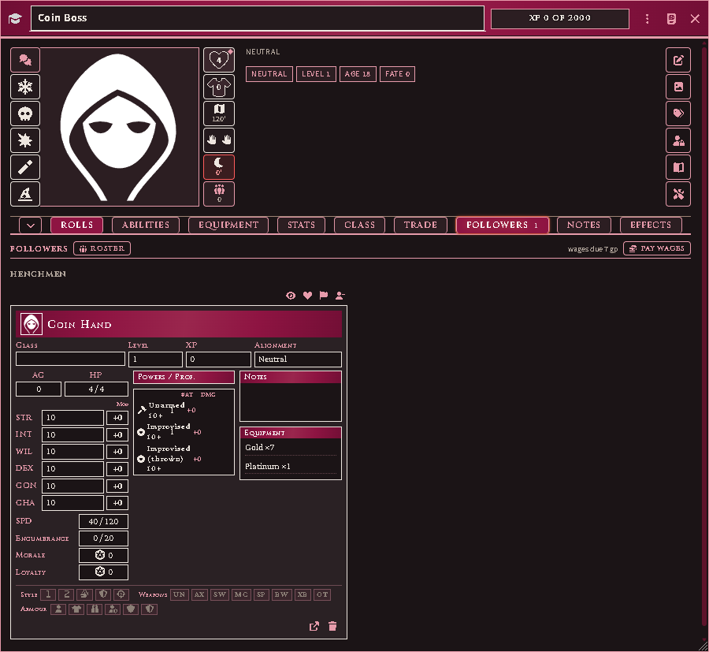

*The Followers tab with a wage due: what is owed stated beside Pay wages, and
the hireling's card listing the coin they hold.*

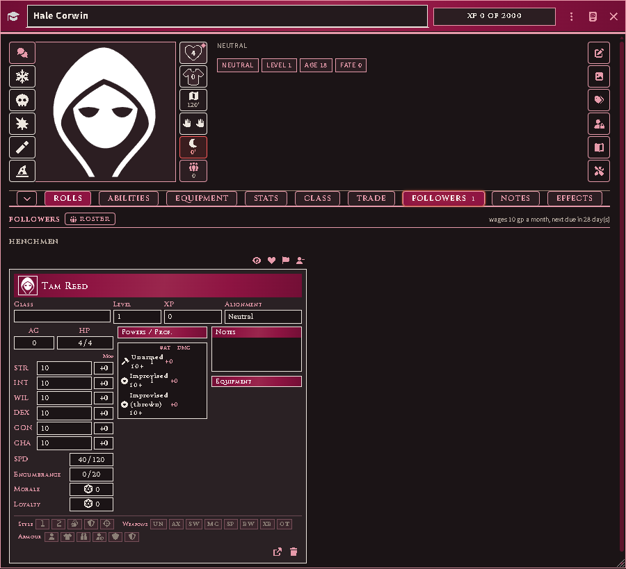

*The same tab with nothing due: what the payroll costs a month and the days
before the next wage, and no Pay wages button until then.*

**A hireling's coin is theirs to arrange.** On a full sheet it is arranged as
any character's is. On the Follower Card, each coin row is listed; a row
holding more than one carries the scissors, which divide a pile off to hand
over, and **Gather coin** folds matching rows back into one. Once they have
more than one place to keep coin, the card offers the same **Pay from** and
**Receive into** choices a character has.

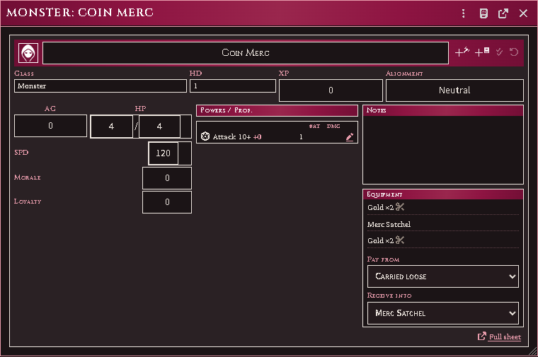

*A hireling's card from their player's seat: coin carried loose and coin in a
satchel, each row with its divide control, wages set to land in the satchel.*

**A hired unit keeps its own purse.** A unit's sheet lists its coin under
**Purse**, which is where its wage lands. Coin can be dropped onto the sheet
and dragged off it again like any other purse. A unit carries nothing else, so
any other item dropped there is refused and stays with whoever held it.

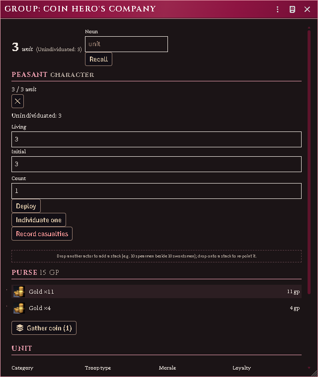

*A hired unit's sheet: its purse totalled above the coin it holds, with Gather
coin offered because two rows hold the same coin.*

The Judge adds permanents (a rescue, a betrayal), and can mark an entry
**Compensated** — it stays on record but stops scoring.

## Common problems

**"No market at this place."** Add one from the location's GM Settings.

**Nobody arrived.** Time has not passed, or the month's pool was rolled and came
up empty. Check the posting's roll detail.

**A candidate says "reserved".** They accepted with no GM online and nobody
present could create the actor. It materializes at the next GM connect.

**The level cap rejected the posting.** RR 168 caps henchman level against the
employer's level — the level you *presented*, if you set one.

**Two actors appeared for one hire.** This should not happen; hiring is
exactly-once even across duplicate GM sockets. If you see it, it is a bug worth
reporting.
