# Importing from your books

Book content arrives from **your own PDFs**. The module ships extraction
recipes — page geometry, patterns and anchors — and never the book text. The GM
connects a book once, imports what the cookbook ships, and what comes out is
ordinary world documents that everyone at the table can read, players who own
no books included.

## Connecting a book

The importer reads **your own PDFs**, from a copy the importing seat can
reach: your own disk, or a book the GM has staged on the server for the table.
A book is read at the moment something is imported from it; what comes out is
written into the world, so nobody needs the file again afterwards.

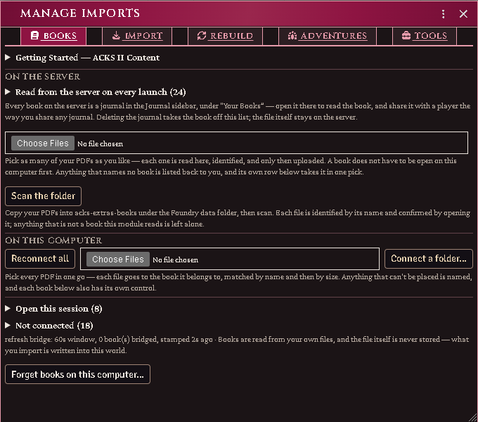

*The Books tab of Manage Imports: the books on the server, the picker and the
folder scan that put more there, this seat's books folded by state, and Forget
books on this computer.*

### Connect

Open the **Your ACKS Books (this seat)** macro: **Compendium Packs tab → ACKS
II — Extras → Macros → ACKS Extras Macros → ACKS Extras → Your Books**. It
opens **Manage Imports** on its **Books** tab. One window covers all of it: the
walkthrough, the server's books, the controls that answer for several books at
once, and a row per book. A GM can also open Manage Imports from **Settings tab
→ Game Settings → ACKS II — Extras → Manage imports**, or with the **Manage
Imports (GM)** macro in the same pack's *Import from your books* folder. Every
macro this guide names is in one of those two folders (*Your Books*, *Import
from your books*).

On a seat with no book connected, the window opens by itself on join, with the
**Getting Started — ACKS II Content** walkthrough open at its head. Tick *Don't
open this automatically again (this seat)* in the walkthrough to stop that.
The window also opens on join when books this browser remembers are waiting.

The module identifies the edition by **page count plus metadata title**, never by
file hash: DriveThruRPG watermarks each customer's copy, so the bytes differ from
person to person and a hash would only ever match one buyer's file.

Once connected, a book's row says how many shipped cookbook entries that
connection unlocks.

### Several books in one trip

In the **On this computer** band of the Books tab, use the file picker beside
**Reconnect all** and choose all your PDFs at once. **The order does not
matter.** Each file goes to the book it belongs to, worked out from the name
this seat used for it last time, its size, or the book's title in the filename
— the stock DriveThruRPG filenames all carry one.

Anything that cannot be placed is **named rather than guessed at**: a book
filled from the wrong PDF is far worse than a book left closed. Connect those
from their own row (**Connect…**), where the book is already named and nothing
has to be inferred.

### Connect a folder

Press **Connect a folder…** in the **On this computer** band and choose the
folder holding your PDFs (one level of subfolders is scanned too). Every book
recognised inside connects itself, by the same evidence rules; other PDFs
living there are left alone and named only in the console — in a folder they
are the normal case, not a mistake.

On a Chromium browser over a secure origin the folder itself is remembered:
next session, **one** permission click on the folder (**Reopen from folder**)
reopens everything in it, where per-file permissions cost one click per book.
Elsewhere the band offers a plain folder picker, and the books fall back to
being remembered by name.

### Books on the server

Browsers will not hand a file back after a reload without a fresh click, which
is why a book connected from your own disk asks for a gesture every session.
A book the **server** holds asks for nothing.

There are three ways in, and none of them asks you to connect the book on this
computer first:

- in the Books tab's **On the server** band, use the file picker at the top and
  choose your PDFs — as many as you like at once. Each one is read here,
  identified, and uploaded into `acks-extras-books/` under the Foundry data
  folder. Anything that names no book is listed back to you and left alone;
- press **Add to server** on any book's own row. The row names the book, so
  the file you hand it needs no guessing at all;
- copy your PDFs into that folder yourself (drag, FTP, host panel) and press
  **Scan the folder**.

Every route **opens and checks the file before anything is staged**, and the
first two check it before anything is uploaded: a PDF is only recorded as a
book once it proves to be that book, so a misnamed file is refused rather than
staged wrong. From then on every GM seat, on any machine, reads it
automatically at launch — no picker, no permission click, nothing to remember.

If the server already holds a file under that book's name, nothing is uploaded
a second time: the copy already there is read and staged if it is that book,
and named to you if it is not.

Every book on the server is also a **journal**. Look in the **Journal** sidebar
under *Your Books*: one entry per book, holding a PDF page. Open it and press
*Load PDF* to read the book inside Foundry, from any GM seat; the **Open**
button on the book's row in the Books tab goes to the same place. The
journal is yours alone until you share it — give a player Observer permission
on it the way you would on any other journal, and they can read the book too.
A player's seat reads at launch only the books you have shared with it, so a
book you keep to yourself costs their seat nothing when they join.

The official fillable **character sheet** has a row of its own. Nothing is
imported from it: the character sheet's export writes characters into it
(see the character sheet guide,
[The official sheet (PDF)](character-sheet.md#the-official-sheet-pdf)). Its
journal is created shared with your players, because their exports read it
too. A copy without the form's fields is refused.

That journal *is* the module's record of the book. Delete it and the book is
no longer read from the server; the **Remove** button in the Books tab does
the same. Either way the file stays where it was put, and the window tells you
where.

One thing to be clear about: a file under the Foundry data folder can be
fetched by anyone signed in to your world who knows the path, whether or not
you shared its journal. Staging a book makes it undiscoverable, not
inaccessible. If that matters for your table, keep your books on your own disk
and connect them per seat.

### Status and reconnecting

The Books tab of Manage Imports lists every book with its state — open,
waiting, or not connected — and what connecting it would unlock. A player's
copy of the manager has this tab and no other.

**Reconnect all** does everything that needs no permission first — the server's
books, served paths, and anything the browser will still open by itself — and
then spends its single click on the remembered folder, which re-reads every
book inside. Whatever is left is named, because one click can only ever
re-grant one file's permission; those books keep their own button (**Unlock**,
or **Retry** for a book remembered by address).

Each failure is reported as itself — "it did not reconnect" and "there was
nothing to reconnect" are different problems.

### Common problems

**A warning names a page count or title and asks "different edition/printing?"**
The page count or metadata title does not match any known printing. A different
printing is not necessarily wrong; the book is read anyway, and some passages
may not be found where they are expected.

**"That file is X, not Y."** The file you picked is a book the module knows, and
it is not the one it was about to fill. It is not read: a book filled from the
wrong PDF imports the wrong pages under the right names, which is far harder to
undo than connecting again. Connect that book on its own, or pick the right file.

**A book's row says "nothing shipped for it yet".** The book connected but ships
no cookbook entries, or you connected a book the current cookbook does not cover.

**It forgot my book after a reload.** Expected for a book on your own disk —
the browser will not re-grant file access without a click. Reconnect from the
window, or put the book on the server and stop being asked.

*The forget confirmation (**Forget books on this computer…**), reported only
when the clear really happened.*

## Importing from the cookbook

The **cookbook** is the shipped database: structure, pointers and extraction
assists, with no prose and no values read from a page. Importing turns an entry
into a real Foundry document, filling in from *your* book what only your book can
supply.

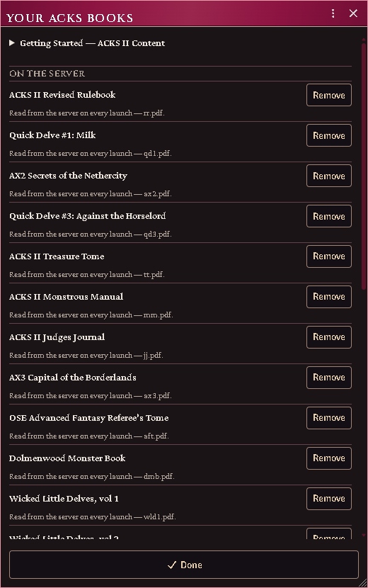

*Connect your books, then import everything the cookbook ships.*

### Import an entry

Open **Manage Imports → Tools** tab → **(Re)import individual entries**, tick
the entry, and press **Reimport**. Each ticked entry the world lacks is
imported, and each it already holds is repaired in place (*Repair in place*,
below). To import everything the cookbook ships at once, use **Import
everything** on the **Import** tab (*Managing imports*, below).

For proficiencies, powers and skills there is a finer picker: the **Browse…**
button at the top of the **Items** sidebar (GM) lists them with a category
filter, and **Import selected** imports the ticked ones.

What you get depends on the entry's kind — a monster becomes an Actor with its
weapons and abilities as embedded Items; a proficiency becomes an `ability` Item;
a piece of gear becomes a weapon, armour or item. An entry is read from your
own copy of its book: one whose book is not open on this seat is passed over,
and the step's notice says how many it passed over and why. Connect the book
and run the step again to import them.

An import never rewrites a document the world already holds; a **repair**
does. A description you edited is put to you before it is written over (*Your
edits and the book*, below).

The descriptor text is read from your PDF as the document is created and saved
into it, with the book and page as its closing line. Everyone at the table can
read it from then on, and you can edit it like any other description.

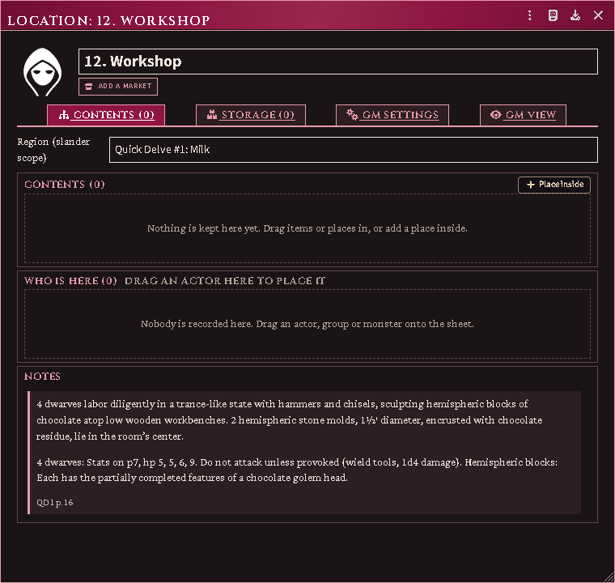

*What an import leaves behind: the entry's own words in the document, closing on the book and page it was read from.*

### What is filled in, and what is not

**Name and citation, always.** Everything else depends on what a chef-authored
locator was able to read from your book.

Absent a locator, an item is created with the system's defaults and the printed
table governs — and the entry says so with an **unaudited** marker. What the type
buys even with nothing extracted is *behaviour*: a weapon can be equipped,
attacks and takes a fighting style; armour can be worn and counts toward AC.
A plain `item` could do none of that.

### Gear typing

Gear names route through the module's equipment root, so a torch imports as a
carried light stack and a flask of holy water as a thrown splash weapon rather
than both being generic items.

### Starting equipment on a class template

A template's printed Starting Equipment line becomes one item per piece the book
lists, and two kinds of piece are taken off that list because they are not gear:

- **What a book is packed with.** A cell that names a spellbook or a prayer book
  and then its contents — a book followed by "with *a spell*, *another*, and *a
  third*" — is one book and three spells. The book keeps its printed name,
  its contents are preserved on its note, and the spells go to the template's
  **spell list**. The contents are an English list written across commas, so they
  are put back together before anything is read from them; a divine caster's
  prayer book is read exactly as a mage's spellbook is.
- **A choice the player has not made.** A cell that offers a spell of the
  character's choosing names a decision, not a spell. It stays on the book's note
  and nothing is minted for it; it becomes a pick the character owes (see
  [Picks a character still owes](classes.md#picks-a-character-still-owes)).

#### A template's spells have to exist in your world

The importer carries no spell list of its own: each name on a template's spell
list is matched against the **spell documents your world holds**, and a name
nothing answers to is reported on the chat card rather than invented. Nothing is
created for it, and nothing is lost: the template still names it.

The import chain's **Importing spells…** step reads the printed spells from your
open books, and it runs before the class and template steps. A caster can still
finish generation with an empty repertoire while another caster in the same
world fills hers, and the difference is which spells the world holds — not which
class was applied. If that happens, run the spells step (**Manage Imports →
Import** tab → **Run** beside it) with the spell book open, or bring a spell
library into the world, and apply the template again.

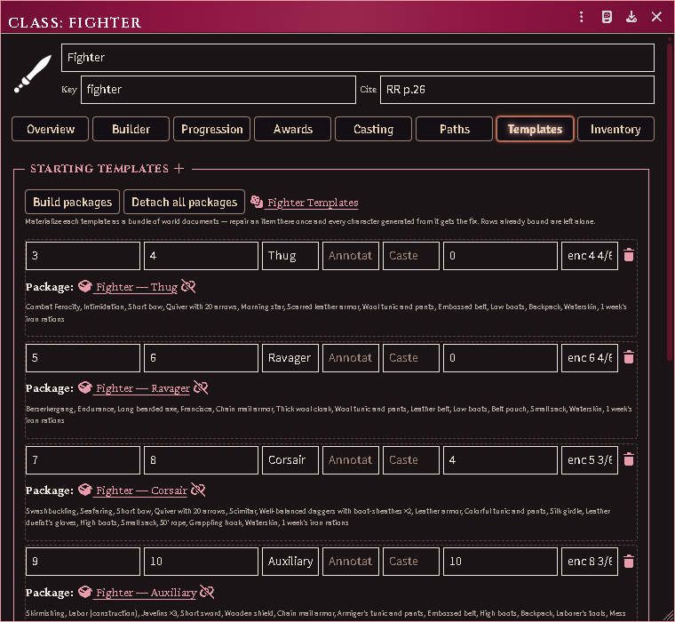

*A class doc's Templates pane: each printed template materialized as a bundle of world documents a Judge can repair.*

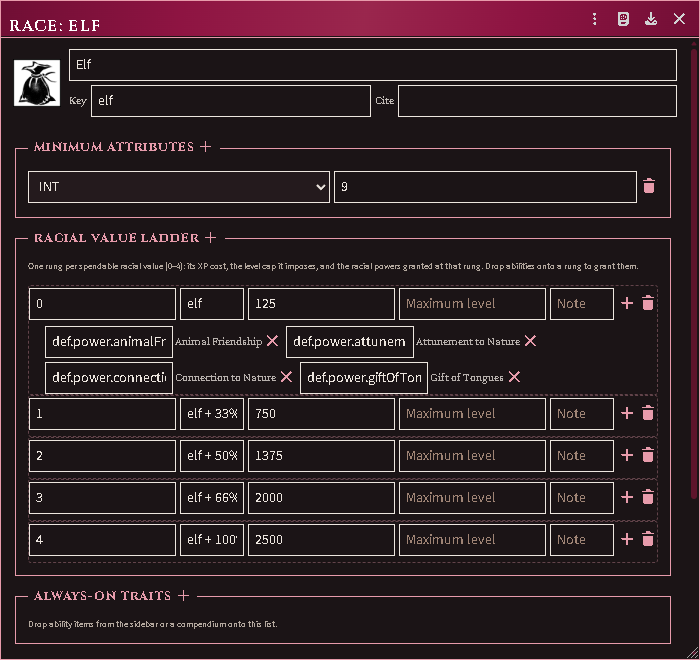

*A race document materialized from the Judges Journal — the ladder, costs, and every power resolved to the definition its rung names.*

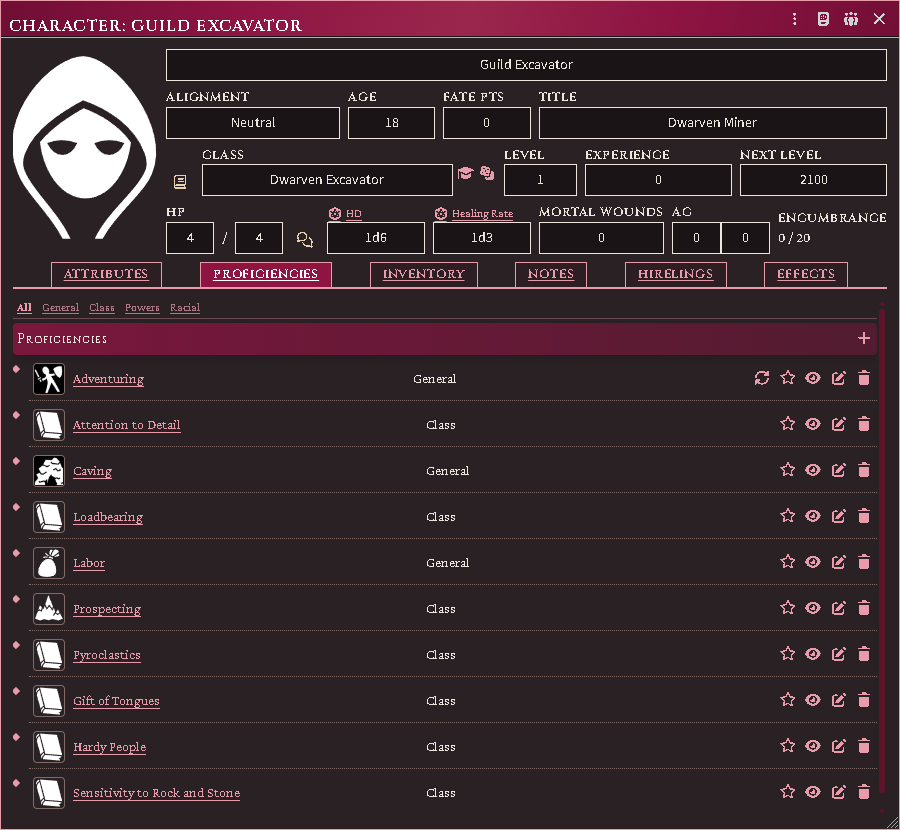

*A 1st-level class carrying every power its spread grants at the start of play.*

### Where a monster files itself

An imported monster lands in a folder named for the **type its own stat block
declares**, not for the chapter you found it in. A creature whose block types as
a beastman files under *Beastmen* beside the others, however unrelated its entry.

A name that looks misspelled is usually the book's own coinage — the Monstrous
Manual names many creatures unlike their familiar equivalents, and a name that
resembles a familiar monster's can be a different creature, not a misreading of
it (MM p.188 against MM p.53 is one such pair). An entry only imports at all when the heading on your page
matches the one the cookbook expects, so a name that arrived is the name your
book prints. Compare the stat block before assuming a typo.

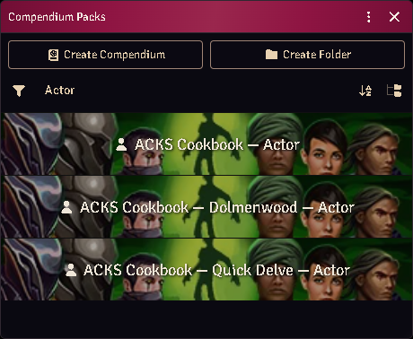

*Where everything lands: a set of compendiums per SERIES, so another game's creatures never share a shelf with the ACKS ones.*

### A community book's own shelf

A book from outside the ACKS II line files its classes and powers on its own
series' Item shelf, in its folder under *From your books*. Every seat can open
that shelf. The rest of the book (its monsters, people, items, journals and
Adventure) stays on the Judge's shelves. Nothing from it merges into an
ACKS II compendium.

A community class whose book states its levels in sentences arrives with a
row per level and its hit dice, its damage bonus, its cleaves and its
proficiency picks, read from those sentences. Its attack throws and saving
throws are those of the core class the book says it advances like, so import
the core classes from your own rulebook first. Where the book says a class
was built with the Judges Journal's class-creation procedure, its experience
is priced that way from the class-builder tables your Judges Journal import
holds; hover an experience cell to see the build. Where the importer cannot
read a level's experience or title and nothing prices them, the class sheet
says so above its tabs and names the page: type each level's
experience and title on the **Progression** tab from your copy. You type
them once; a repair keeps them.

A community class whose sheet shows *no progression rows yet* is filled in by
a repair of its book: **Manage Imports → Rebuild** tab → the book → **Go**.

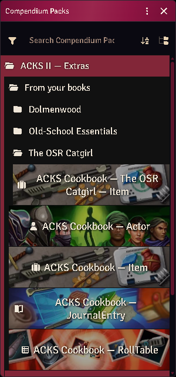

*A player's Compendium sidebar: the community book's open Item shelf in its own folder, and none of the book's Judge shelves.*

### Cross-book merging

The same conceptual family imported from a second book gains that book's new
variants rather than becoming a twin. Two signals identify it: a shared member id
and a shared family suffix. Repairing the family in place from one book keeps the
variants the other books merged in.

A family whose page names its leaders, casters and dependants gains a **Role**
axis from the import; the monsters guide,
[A family's leaders](monsters.md#a-familys-leaders), says what it generates.

### Repair in place

Every control that brings imported documents back from your books repairs
them in place:

- the **Reimport One Shelf (GM)** macro (*Import from your books* folder), for
  a shelf, a book or the rules tables;
- *Manage Imports*: its **Rebuild** tab, **Repair everything** on its
  **Import** tab, its **Adventures** tab, and **(Re)import individual
  entries** on its **Tools** tab, for entries ticked one at a time.

A repair reads the entries again and writes the fresh reading over the
documents you already have. Each keeps its id, so every character carrying it
and every link to it still finds it. It also keeps its folder and owners, and
what play has set on it: a trap's level, a vehicle's crew and damage, a
stack's quantity. Entries your world does not hold yet are imported. A ticked
entry that has no in-place write is deleted and imported again under the same
id; the confirm counts these, and the entry picker marks each with a hammer.

It asks first, with the count of what it will write over, and **No** writes
nothing. A document whose book is not open on this seat is left as it is, and
so is one from a book this module no longer offers; the repair counts both.
Open the book and repair again.

<!-- plate: importer-repair-in-place.png — the Rebuild tab's confirm, titled Repair in place (tools/live/importer-force-repair.mjs, SHOTS=1) -->

- **A class** is written whole, except a description you wrote, training you
  edited on its sheet, and a level's experience or title you typed where
  neither the book nor the class's build could supply one.
- **A monster** is read again whole: its stats, its token size, and the
  attacks and abilities its page yields replace the imported ones. Attacks you
  added stay.
- **An ability** is refreshed wherever it is carried, characters included.

The Weapons, Armor, Languages and Races shelves, the price list, monster
templates and families, NPCs, and adventure stat blocks are
written over in place too, from the same open book.

#### Your edits and the book

Where the repair meets something you changed in what the import wrote (a
description, a note on a place, a roster, an organisation's figures), it
leaves your version standing and, once it has run, opens a window titled
**Your edits and the book**. It lists each edited document in a frame of its
own, one row per edit: **Yours** above **The book's**. Hover either value to
see where it came from; a row marked **Unstamped** has no record of what the
import wrote, so the difference may be the book's own change rather than yours.

- Tick **Take the book's** on the rows you want replaced, then press **Apply
  these choices**.
- **Take the book's for every edit** replaces them all.
- **Keep every edit of mine** replaces none, whatever is ticked. Closing the
  window does the same.

An edit you keep stays listed, and the next repair asks about it again.

<!-- plate: importer-repair-choice.png — the window with one edited document (tools/live/importer-force-repair.mjs, SHOTS=1) -->

**Pregenerated characters** are never written over without asking. Each one
the repair meets is listed in the same window, under **Pregenerated
characters**, with a note and three answers:

- **Keep it under a new id, and restore the book's under its own** — your
  character stays, renamed *(kept)* and no longer the book's, and the book's
  is imported again in its place.
- **Leave it as it stands.**
- **Write the book over it, keeping the edits kept above** — the sheet import
  runs again onto the character, its items kept.

The note says which answer is chosen to start with. A character marked
**Changed since it was imported**, or **Imported before changes were
recorded** (it carries no record of what was imported), starts at the first
answer; one marked **Matches what was imported** starts at **Leave it as it
stands**. A character a player owns is not listed.

### Managing imports

**Manage Imports** is one window with every import control; the Connect section
above says how a GM opens it, and **Your ACKS Books (this seat)** opens it on
the Books tab. Its five tabs:

- **Books** — connecting, putting on the server and the status of every book,
  as the sections above describe.
- **Import** — the import chain, step by step in its order. **Import
  everything** runs the whole chain; **Run** beside a step runs that one,
  for when its documents were deleted or a book was connected after the
  chain ran. Every step passes over what the world already holds. **Repair
  everything**, beside it, repairs in place every book open on this seat and
  every open adventure book, after one confirm that lists the parts; it ends
  by reading the rules tables again.
- **Rebuild** — a shelf, a book or the rules tables, repaired in place: pick
  one and press **Go**. The same choices as **Reimport One Shelf**.
- **Adventures** — each adventure book open on this seat, with what its
  Adventure carries: see *Repair an adventure book* below.
- **Tools** — **(Re)import individual entries** (the entry picker), **Audit the
  recipes**, **Repair checks**, **Build merchandise items from imported
  tables**, overhead tokens (below), **Remove ALL imports** and **Refresh**.

**Overhead tokens.** When another module you have installed and active ships
monster compendium art, the Tools tab offers **Overhead tokens from** that
module's title; with several, one button each. It sets the token image of
each imported monster whose name matches the compendium's exactly. The book's
image stays as the portrait, and the token's size and scale stay as they are.
The confirm counts what will change and what is left: a token you set yourself,
a name with more than one image or none, a monster the compendium has no art
for. A tick in the confirm also moves tokens already placed on scenes that
still show the book's image. **Restore book tokens** puts back what each
monster showed before. A Rebuild gives a monster its book token again; apply
the overhead art once more.

**Repair checks** opens the repair window (*Repair this world*, under
*Macros* below) and scans.

The window runs one thing at a time and says what is running; each control
asks before it deletes. **Remove ALL imports** deletes every document this
module imported, after one confirm that counts them; imported characters a
player owns stay. The **Delete Everything Imported (GM)** macro does the same.

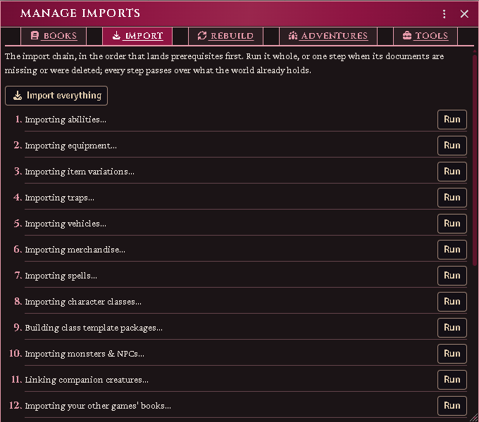

*The Import tab: the chain in its order, each step numbered with its Run
button, and Import everything above them.*

### Rules tables

The rules tables arrive with **Import Everything**. To read them again on
their own, pick **Rules tables** in **Reimport One Shelf** (or on the Rebuild
tab): they are re-read in place, and nothing is deleted. They materialize as
Foundry documents in your world, register into the shared tables registry, and
the henchmen and location features read them. The pick is every table at once,
or one table's own entry beneath it, so the formation's figures or the travel
tables can be read again on their own.

The re-read needs the books those tables come from open in the browser that
runs it. A book is connected per browser, so on another computer or browser
connect it again under **Books** first. A run with a book closed says which
book it wanted and leaves the old tables in place. A notice at load names the
tables still missing, by document.

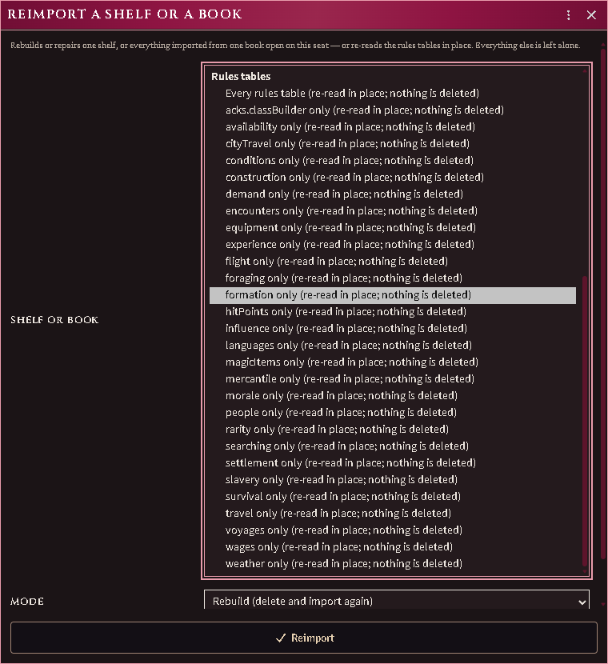

*Reimport One Shelf with the rules tables open: every table, or one table's
own entry — here the formation figures alone.*

**(Re)import Individual Entries** lists every rules-table document under
*Rules tables*, ticked when your world holds its import, with the printed pages
it reads beside it. Tick one to read just that document again. A table you have
overridden in **ACKS Imported Rules Tables** (**Settings tab → Game Settings →
ACKS II — Extras → Imported Rules Tables**) keeps your override on top, and
removing the override brings back your book's figure.

Each row of **ACKS Imported Rules Tables** names the book and page its table
was read from, under the table's name, so you can check any figure the module
applies against your own copy. A table the module works out from others names
the pages of the tables it was worked out from. A class's tables name the page
in the **Cite** field of its class sheet, so a class with none there, such as
a homebrew one, names no page. A table you have overridden names no page while
your override stands.

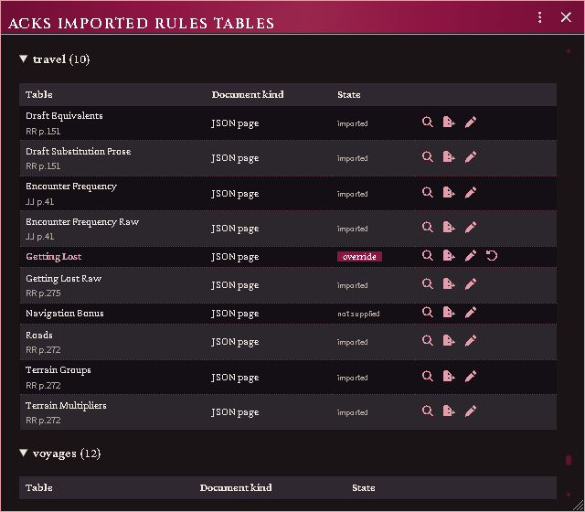

*A re-read document in ACKS Imported Rules Tables: each table with the page it
came from, and the overridden one with none.*

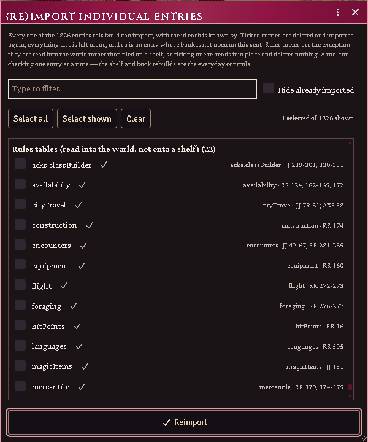

*The entry picker's rules tables: each document ticked as imported, its id and
the pages it reads on the right.*

The wilderness encounter charts arrive as RollTables, one for each column: the
territory and rarity throws, each civilized group, each terrain's monsters at
every rarity, and the terrain-encounter lists. They are filed under
**Encounters** in the RollTable shelf's **ACKS Imported Tables** folder. Edit
one in its sheet and drop it on its row in **ACKS Imported Rules Tables**: the
travel panel's encounter throw then draws from your version, while the chart's
other columns keep what your book gave them. Every column of that chart then
reads from the override, and **Remove override — fall back to the import** on
any of them brings back the whole chart. A territory or rarity result has to
stay one that table already holds, because the throw acts on it, so a word it
does not know is refused.

The tables a terrain encounter leads to arrive the same way, one RollTable
each and each on its own die, with the treasure type and ruin modifier for
every terrain beside them in the rules tables. They belong to the same rules
table as the charts.

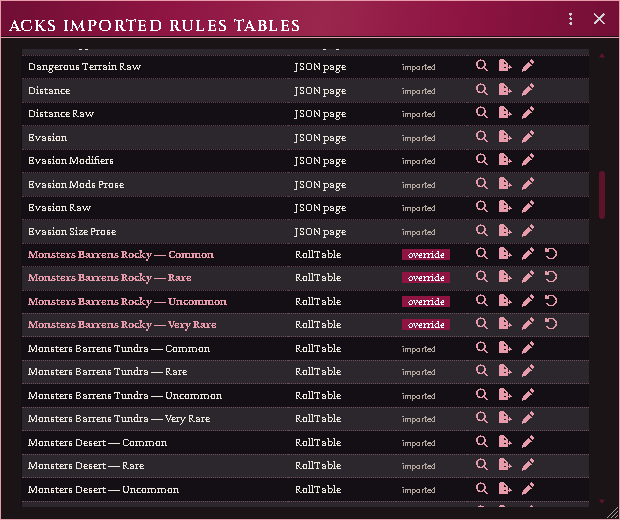

*One terrain's monster chart overridden by a dropped column: all four of its
columns now read from the override, each with its revert, while the next
terrain still reads the import.*

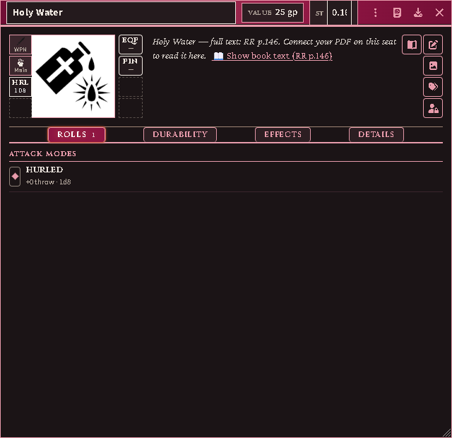

*An item priced only in prose, its cost read from its own paragraph.*

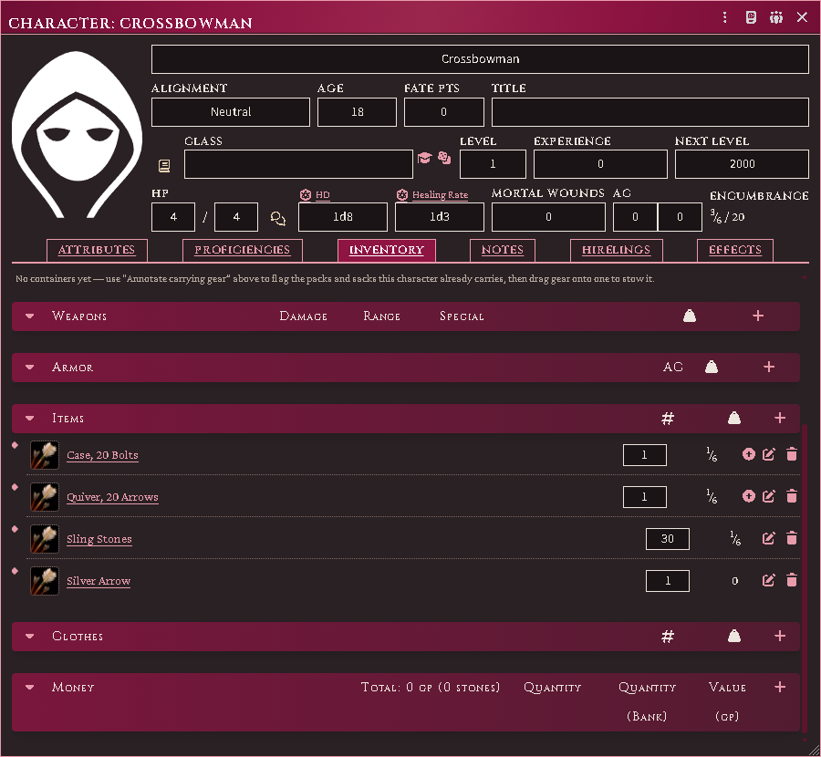

*The four rows the weapons grid types Ammunition, filed as gear with a count and a fraction of a stone rather than among the weapons with a damage die.*

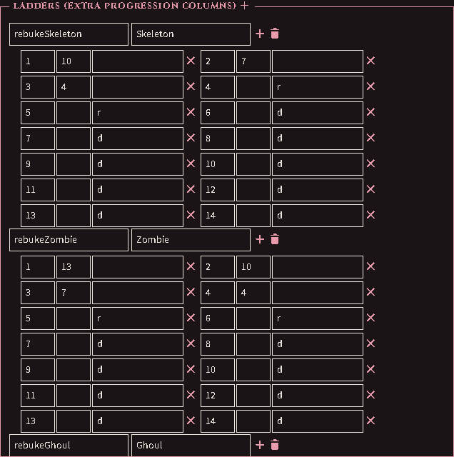

*The crusader's rebuking grid as ladders on the imported class — one per kind of undead, each rung carrying its target or the cell the page prints where no throw is made.*

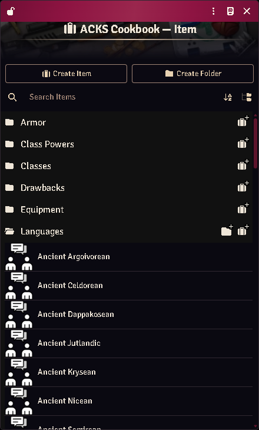

*The Appendix A taxonomy read from the connected book, filed on its own shelf in the library — none shipped.*

### A settlement's map

Books that key a city to a map bring the map in as a scene, with a region for
each quarter and a hidden token for each keyed place, in the chain's maps step
(**Standing up maps…**). Run it after the **Importing points of interest…** and
**Importing organisations as factions…** steps: the map stands on their places,
and hands each organisation the quarters it controls.

### A dungeon map's walls

Some adventure maps are walled as they import. The maps step reads the plan
off your own copy of the page and draws its walls, doors, secret doors,
terrain walls and invisible walls (which stop movement and let sight through,
like bars). The scene is dark and turns token vision on, so a token sees what
its own torch or lantern, or its party's, lights, and nothing past the walls.
A creature that sees in the dark sees its own range too. Each player keeps
the squares their tokens have explored. A walled map is indoors: its darkness
is locked, so a module that runs the day and night leaves it dark, and a
Region over the whole map keeps that module's weather out. To light a
building by day, uncheck **Darkness Level Lock** in its Scene Configuration first.
A map without walls is outdoors and takes the day, the night and the weather.
A map already in your world is never re-drawn. To draw it again, delete the
scene and run the step again.

### A book's passages, as journal pages

A book's essays and other passages import whole, as pages of a journal on
the book's Judge JournalEntry shelf, one journal for each group the cookbook
files them under. Each page is titled by what the passage is, keeps its
paragraphs as the page sets them, and ends with its page reference.
**Import Everything** runs the step.

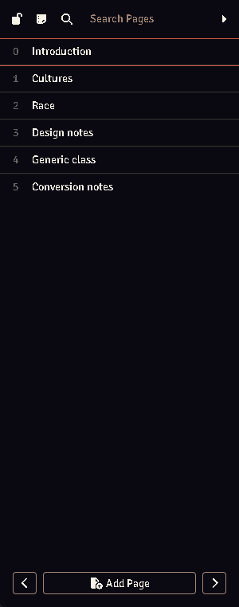

*A journal of a book's passages, by its page list: one page a passage.*

### An adventure book, as one Adventure

The last step of **Import Everything** keeps each open adventure book in your
library as one **Adventure**, on the book's Adventure shelf. It carries every
document the book's import made, every map, and the zones laid over those
maps, filed in the world's folders. Open it and click **Import** to set the
adventure up again in another world. Import adds what that world is missing
and changes nothing it already holds. To put a document back as the book has
it, delete it and import again.

Your edits to the Adventure are kept. A later run rebuilds it only when what
it carries has changed and you have not edited it since.

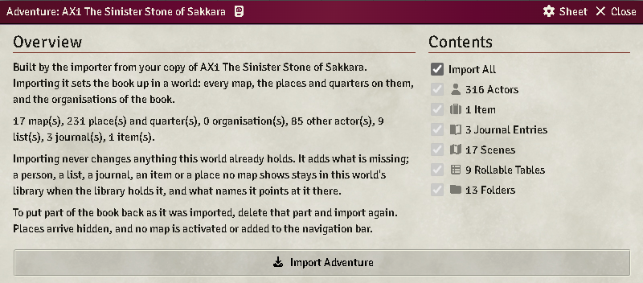

*An adventure book's Adventure in the library, from beneath its title and map: what it carries, counted, and the Import button.*

The Books tab shows each open adventure book's count of what its Adventure
holds, under the book's row in **Open this session**.

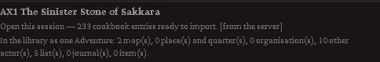

### Repair an adventure book

The **Adventures** tab of *Manage Imports* lists each adventure book open on
this seat. **Repair** beside a book repairs it in place: it writes over what your world holds of the book's
creatures and people, its places and organisations, the market profiles on
them, its items and its roll tables; imports what your world lacks of the
book; refreshes its maps; and writes its Adventure on the shelf anew. Every
document keeps its id, so pins on its maps and seats in its organisations
still point at the right thing.

It asks first, with the count of each and of what it writes later, and **No**
writes nothing. An edit you made to what the import wrote (text on a place or
a person, a roster, an organisation's figures or relations, a market's
figures) is put to you in **Your edits and the book**, as in *Repair in
place* above, and so is each pregenerated character. Your **maps are kept**,
with your regions, fog and tokens, and refreshed in place. A copy you dragged
out of the library, a character a player owns, and a document another book
took over are kept too.

**Write Adventure** writes the Adventure alone, as the last step of *Import
Everything* does.

<!-- plate: importer-adventure-repair.png — an adventure book's confirm, titled Repair in place (tools/live/importer-force-repair.mjs, SHOTS=1) -->

To build a map again, delete the scene first and then repair.

### People an adventure prints in full

Where an adventure prints a person's full stat line (class and level, scores,
proficiencies, spells and gear), the import makes that person a **character**
on the Judge's shelf, never a monster. The class is bound at the printed level
by the same import as the official character sheet's, so saves, attack throw
and spell slots are the ACKS II class's. A class name from an older printing of
the game is read as the name the library carries. The biography keeps the line
**as printed**, followed by a line for each figure the class gives differently
and a line for each name your library could not match.

A person a book writes out as labelled lines under a display name (class and
level, scores, hit points, proficiencies by kind, abilities, inventory) is
made a character the same way. Class and general proficiencies go in their
own rows, the inventory is worn and the coin counted, and the paragraph about
the person is the biography, before the as-printed block. A proficiency your
library lacks is imported from your open books first.

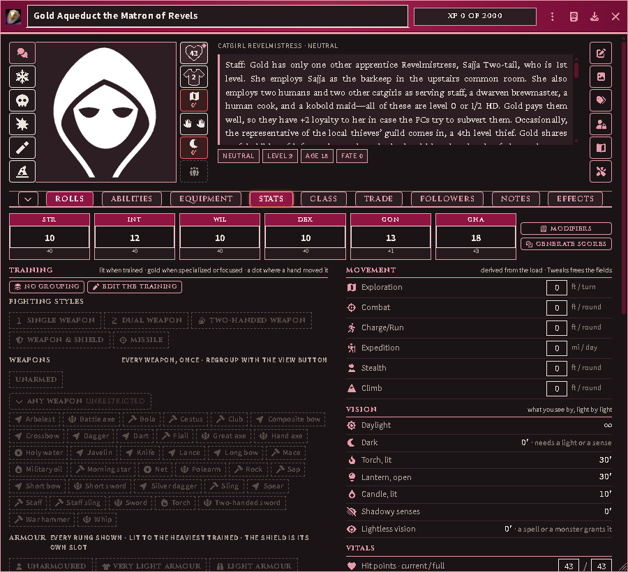

*A person written out as labelled lines, as a character on its Stats tab.*

A rebuild of the entry keeps the character's id, so links to it hold. A
rebuild, or **Remove ALL imports**, never deletes a character that a player
owns.

An adventure's pregenerated characters are made the same way and filed in the
book's **Pregenerated** folder, on the Judge's shelf. To give one to a player,
right-click its entry in the compendium, choose **Import**, and give that
player Owner permission on the copy it makes. A rebuild of the pregen leaves
the player's copy alone. The copy keeps the entry's id, so importing the same
pregen a second time asks whether to replace the first copy; choose **New
Actor** for a second one.

A class printed with a word before it, such as a tradition, is bound as the
library class the rest of the name gives, and the as-printed block says
**Class read as**. A class your library does not hold is named under **Not in
the library**, and the character has no class. Build it with the class builder
([Advanced mode](classes.md#advanced-mode--the-class-builder)) under the
printed name, then rebuild the entry.

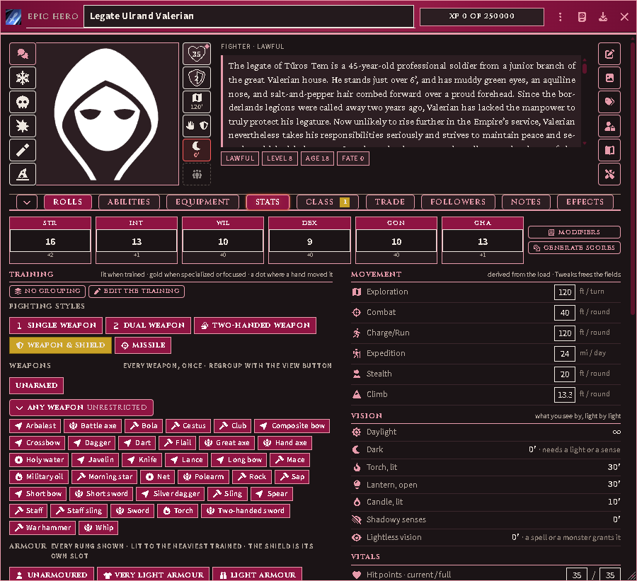

*An adventure's inhabitant as a character: the class bound at the printed level, and its saves and throws the class's own.*

### An adventure's rooms, as places

An adventure's keyed rooms import as **places** in the book's **Places**
folder on the Judge's shelf: one place for each room, inside the area or
level it belongs to, and each level inside a place for the book. **Import
Everything** runs the step after the people and creatures, so a room can link
to them. A room's notes are its text from your copy. Its roster lists who is
there: the core creature where your library holds one, the adventure's own
person or creature, or, where nothing else matches, a creature made from the
room's own stat line, filed in the book's **Creatures** folder. Roster rows
are hidden from players. A count printed as dice, and the hit points, are in
the row's notes.

A room already in your library is not read again. To bring one in again as
the book has it, delete it and run the step; the rooms inside it move onto
the new one.

A plan of a dungeon level or a building is named for that place, and each
room on it stands as a hidden token on the key the page prints. The maps
step, and the Adventure's **Import**, bring those rooms into the world with
their plan, each inside the area, level and book it belongs to, so a place's
sheet lists the rooms in it. A room no plan shows stays in your library. Run
the maps step after the rooms exist as places: a plan drawn before they do has
no tokens, and the fix is to delete the scene and run the maps step again.

At world start the module cleans up a place that holds nothing and is nothing
in particular. A place that other places sit in is kept, so a level with its
rooms stays. The setting is **Settings tab → Game Settings → ACKS II — Extras
→ Clean up empty locations**.

### Common problems

**"N passed over — their book is not open on this seat."** The entry's book is
not connected on this seat. Connect it and run the step again.

**Everything is passed over.** No books are connected on this seat.

**"N passed over — their page did not match the cookbook."** Your printing's
page does not carry the heading the cookbook expects, which usually means a
different printing. Nothing is written for those entries.

**The rules tables say a supplement was skipped.** A few tables come from
supplements, and the notice names the ones not connected on this seat. Every
other table was read. Connect the supplement and read the tables again
(**Reimport One Shelf**, *Rules tables*) to fill the rest. A warning that names
tables it could not read, from books that are open, is a fault worth reporting.

*The notice for a supplement this seat has not connected: information, not a
warning.*

**An imported ability shows a ladder, not a number.** Correct — ladders travel
whole and resolve against the character who owns the item.

**I imported twice and got a duplicate.** Import checks for an entry already
present; a duplicate usually means the first copy was renamed or moved out of the
folder it was created in.

**Will a repair touch my own copy?** No. A document you dragged out of the
library into the sidebar, or duplicated there, is yours. **Reimport One Shelf**
and **(Re)import individual entries** leave it as it is and repair the
library's own document. Only **Remove ALL imports** (or the **Delete Everything
Imported (GM)** macro) removes it.

**Reimporting lost my edits.** A repair keeps each document's id, folder and
owners, and puts every edit you made to what the import wrote to you in **Your
edits and the book** (see *Repair in place*). An edit is replaced only where
you took the book's value there.

## Browsing, auditing and fixing entries

What the cookbook claims, what your book actually says, and what to do when they
disagree.

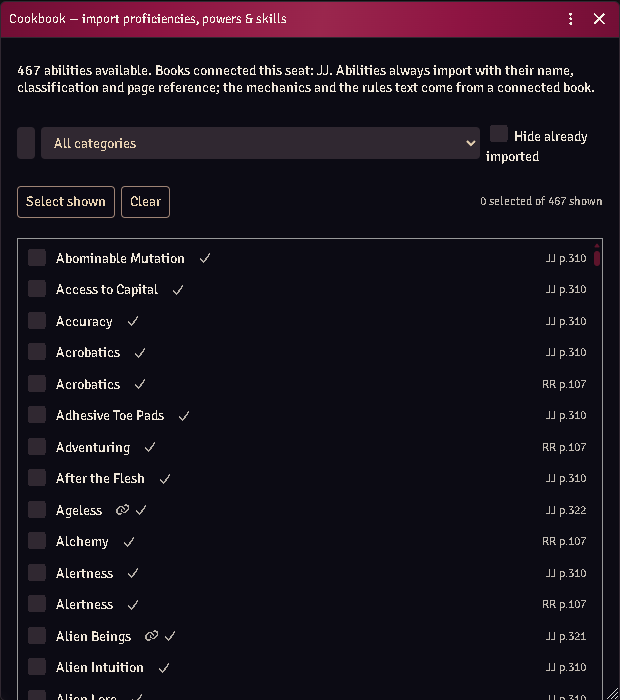

*The Items sidebar's **Browse…** dialog: every ability with its book and page citation.*

### Browse

**Manage Imports → Tools → (Re)import individual entries** lists every entry
this build can import, grouped by kind, with the id each is known by and its
citation. A check mark means the world already holds it, and a hammer means a
repair deletes and imports it again under the same id. The filter box narrows
the list, **Hide already imported** drops what the world holds, and **Select
all**, **Select shown** and **Clear** tick and untick rows.

Importing an entry extracts its passage from your own PDF and writes it into the
document. Extraction is per-entry — nothing is pulled on connect.

### Unaudited entries

An entry marked **unaudited** carries mechanics that have not been read against
the printed page. It is a parse, not an interpretation: probably right, genuinely
offered, and not asserted as the book's ruling.

Treat it as a suggestion. If it disagrees with your book, your book wins.

### When an entry points at nothing

An imported ability whose cookbook definition is no longer shipped stays in
your world, pointing at nothing. These are unambiguously this module's
(generated, with a cookbook id that no longer resolves), which is what makes
them safe to offer for removal. **Prune** at the top of the **Items** sidebar
(GM) finds and lists them, and asks before it deletes anything.

### What never ships

Worth knowing when you are judging whether something is a bug:

- No prose. Passages are read from your own PDF at import; what ships is where
  to find them on the page.
- No values read from a page. Costs, damage, AC and build costs are matched
  against your own extracted text at runtime by a shipped *pattern* — the
  pattern ships, the number it finds never does.
- No book tables. They are imported from your copy into your world.

### Common problems

**The passage came out garbled.** A printed heading can carry glyph artifacts —
a detached superscript, a decomposed accent. Matching folds both forms and falls
back to a prefix, so a stray glyph does not zero the entry's mechanics. If it
still misses, the entry is worth reporting with the book and printing.

**An entry says it needs a book I own.** Check the edition: identification is
page count plus metadata title, and a different printing may not match.

**The art did not come through.** Art is resolved geometrically and only for
entries carrying an authored placement box. No box, no art — quietly, by design.

## Macros

Beside the import macros named above, the **ACKS Extras Macros** compendium
carries two Judge macros for the world's data as a whole (in its *ACKS Extras*
folder).

- **Repair This World (GM)** opens the repair window (also **Settings tab →
  Game Settings → ACKS II — Extras → Repair this world**): scan for data this
  module left damaged, tick the findings and press *Fix selected*; every fix
  is checked by scanning again. Its first check lists the characters,
  monsters and items the system marked as migrated while they still hold
  older field names. The module reads those values back each time the
  world loads, so an armour's Armor Class and a weapon's damage and bonus
  already show; fixing writes them to the record, so they no longer depend on
  the module to be read. A later check lists the weapons you imported whose
  alternate damage is not the one their row in your weapon table names: ticking
  one writes the row's die there, or leaves it blank where the row names none.
  A weapon you built yourself has no row and is never listed.
- **Restore the Compendium Library (GM)** puts every ACKS compendium back in
  the folder its package's manifest names.
