# Places, storage and markets

A **place** is anything that holds things: a duchy, a town, an inn, its cellar,
and the chest in the cellar. They nest, they hold goods and living things, and
some of them have a recruitment market. One actor type covers all of it.

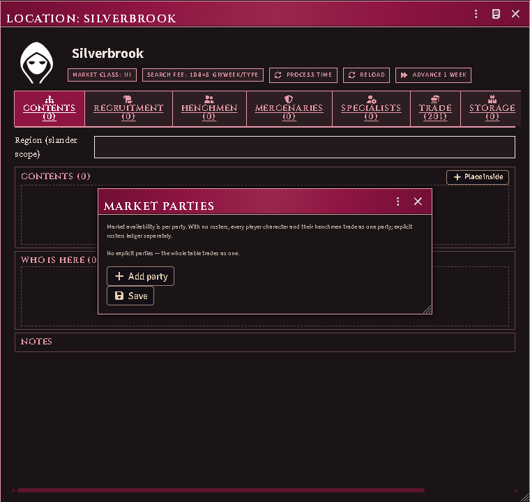

*A place that holds goods, and who is recorded there.*

## Make a place

Actors sidebar → **Create Actor** → type **Location**.

A new place opens on the **Contents** tab with nothing but a name. That is the
whole of the minimum: identity, and what it sits inside.

- **Parent** — the place this one is in. Set it and a breadcrumb appears
  (Duchy › Inn › cellar).
- **Stack count** — for eight identical warehouse bays, keep one actor and set
  the count to 8. Split one off when it becomes interesting.
- **Roster** — the living things kept here: a garrison, a stabled horse, a
  captive. These are references to real actors, so a deleted actor leaves a
  struck-through row rather than vanishing.

A place a domain holds names that domain beneath who is here. A place inside
a held one names the domain that holds the place around it. Which places a
domain holds is kept on the domain's own sheet
([Holdings](domains.md#holdings)).

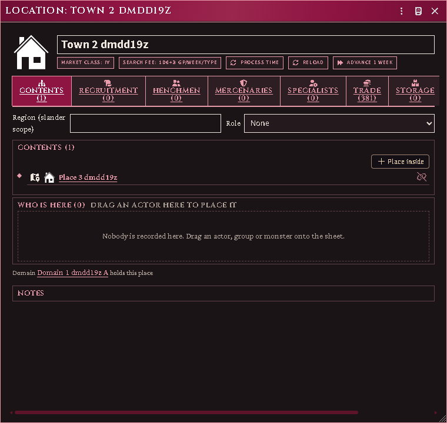

*A town a domain holds, naming the domain on its Contents tab.*

A place's notes have a tab of their own, **Notes**, beside Contents. Everyone
who can see the place reads its shared notes there, and its owners can write
them. Beneath them a place also keeps a private record, which only the Judge
can read. A place with either written on it is kept when **Clean up empty
locations** clears empty places at world start.

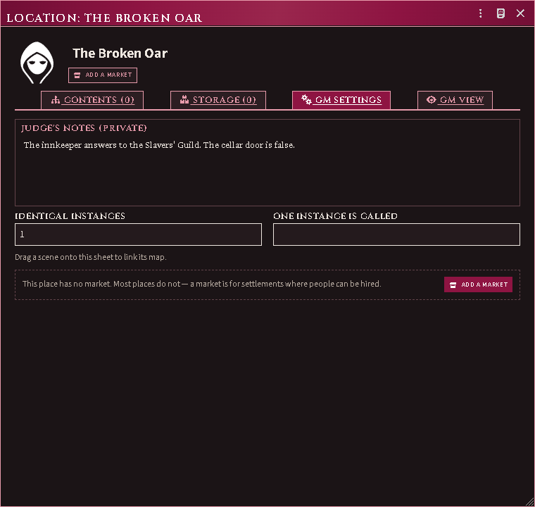

*A place's private record, beside the shared one and readable only by the
Judge.*

If the place is a map you already have, link it: **Scene config → Place**, or
right-click the scene in the Scenes sidebar → **Create Place for Scene** (or
**Open Place**, once it is linked). The link is never made automatically —
most scenes are battle maps and lighting tests, and forty auto-created actors on
first load is not a favour.

A place can also stand ON a map: drop the actor on any scene and its token is a
point of interest — a marker with its name on hover and no bars, which the
formation guide's [Points of interest](formation.md#points-of-interest) section
walks. A quarter drawn as a district can name a place as its own from the
district's sheet.

## Mark a place's role

A place can have a **Role**; **City gate** is the one offered. Pick it
on the **Contents** tab, on the line with **Region**. The Judge sees the
picker; players see a tag instead. The points-of-interest step of a settlement
import marks a book's gates for you.

A gate is a point of entry to the market it stands inside: put the gate inside
a place that has a market (or anywhere below one). Its **Contents** tab then
shows **Point of entry:** with the market's name, and an **Enter the market**
button that opens the market's sheet on its **Ventures** tab, where entering
is charged. A character standing at the gate's token counts as standing at
the market, so they can enter, trade and store goods there even when the
market's own token or map is elsewhere. A market without a gate is entered
just as before. A gate with no market above it tells the Judge so on its
sheet; an imported gate finds its market once the settlement's market step
has run.

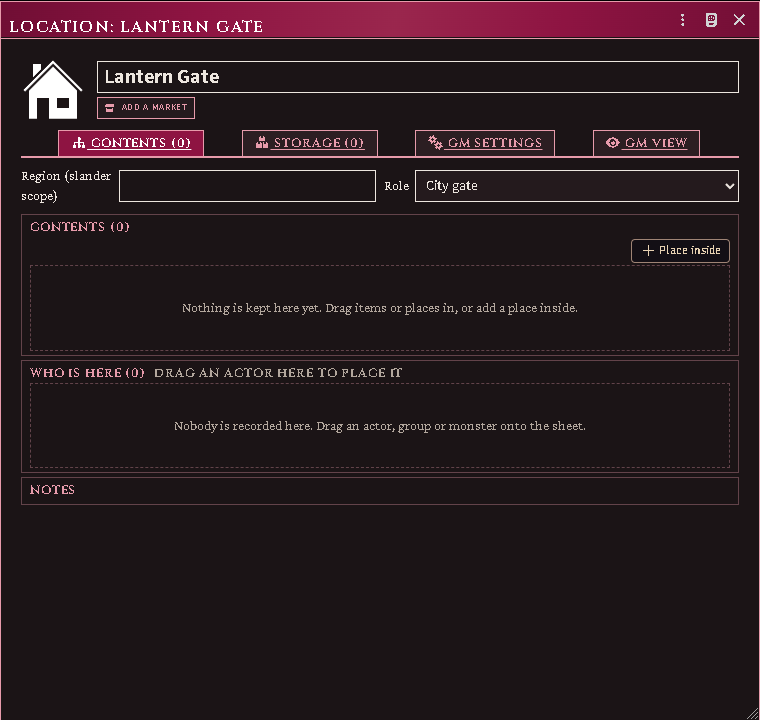

## A place that is a lair

A place that is the lair of a monster, such as one an adventure's import
makes, carries a **Lair** section on its **Contents** tab, below the occupants.
Only the Judge sees it. The **Monster** line links the monster the place is the
lair of, with the page the importer read it from in its tooltip; the
**Encounter** line links the group the lair rolled and shows its head count.

**Roll** makes that group: the monster's own in-lair count is thrown, an
encounter group is made from it, and the place links it. A lair rolls once, so
**Roll** is greyed out while the lair holds its group (delete the group to roll
again) and wherever there is nothing to roll, and hovering it says why. A party
arriving on the lair's Scene rolls it the same way
([formation](formation.md#overland-travel)). A lair in a compendium rolls from its
world copy: **Roll** is disabled on the shelf place, and a line beside it says
to drag the place out of the compendium into the Actors sidebar and roll there.

## Store goods there

Drag an item onto the place's sheet, or press **Leave something here** — on the
**Storage** tab of the place's sheet (the Judge's seat) or of your own
character's sheet.

**Drag it from a character's sheet, not from the Items sidebar.** Goods are
filed under whose they are, and an item in the sidebar or a compendium belongs
to nobody yet — there is no owner to file it under, so that drop is refused with
a notice rather than landing unattributed. To put a hoard into play, give it to
a character first (or to the party's pack mule) and stow it from there.

Goods are grouped by **whose they are**, because a warehouse holding three
characters' gear is three inventories in one actor, not a shared pile. Each
character sees a **Take it back** button on their own rows; the GM sees it on
all of them. A player does not have to own the place to leave goods there or take
their own back.

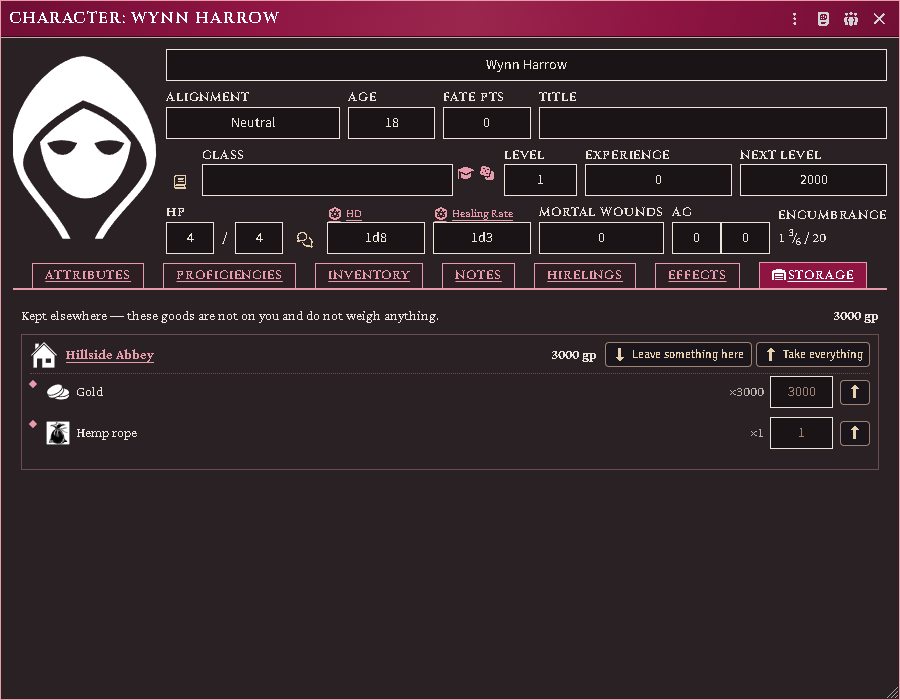

*A player's seat, on the Storage tab of the system's character sheet: coin and
a rope kept at a place the Judge runs, with the controls to leave more and to
take it back.*

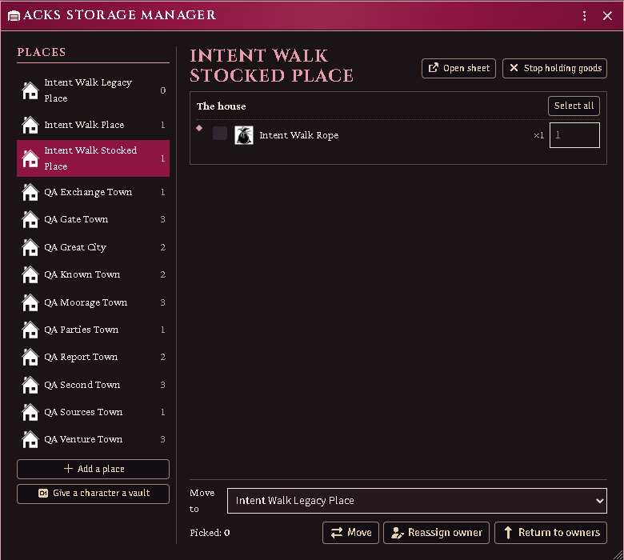

*Moving goods in and out of a place that holds them, and giving a character a
vault.*

A place holds goods only once you say so. A new location, and every place an
import brings in, holds none until you press **Hold goods here** on its
Storage tab, pick it under **Add a place** in the storage manager, or drop an
item on its sheet yourself. **Add a place** also takes a cart, a stronghold or
any other actor that is not a character. The manager lists every place that
holds goods, empty or not, and only those are offered under **Move to**. A
place that holds goods is kept when **Clean up empty locations** clears empty
places at world start; **Disable Storage Here** turns it off again.

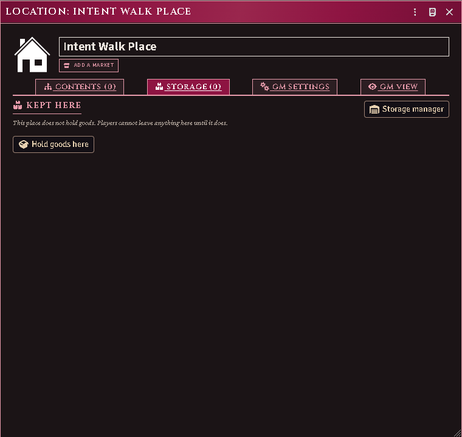

*A place that holds no goods yet: its Storage tab says so, and **Hold goods
here** turns it on.*

One of those piles is **the house** — what the place itself owns rather than
what somebody left there. A player takes a row of the house only once the
Judge releases it: on the location's sheet, **Storage** tab (Judge seat), press
the lock beside the row (**Player-retrievable (Judge)**) and it opens. That
holds for a spoil too, marked with a bone; the Judge releases it, and no throw
claims it.

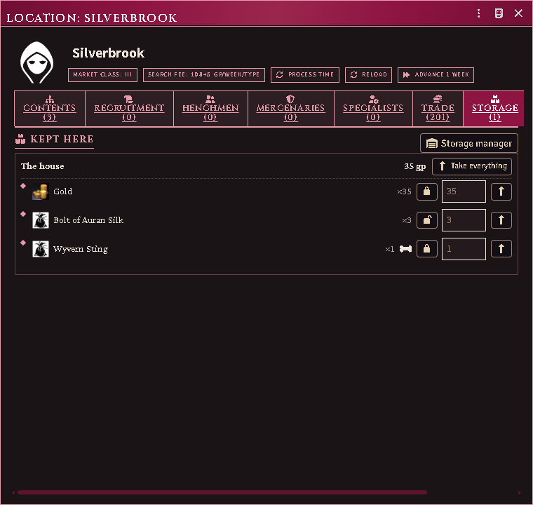

*A location's own coin and stock: the Judge's locks, and a spoil beside them.*

Stored goods are real items on the location actor, so an item that has left a
character genuinely stops weighing on them. Stowing is a **move, not a copy**:
the item leaves the character. Dragging between two ordinary character sheets is
the system's own copy, which is why a plain "treasure actor" leaves the original
behind — a place is the surface built to hand goods over without duplicating
them.

> Attribution is a UI convention, not a security boundary. Anything that must
> genuinely stay private belongs on a GM-owned actor.

**Deleting a place returns its goods by default** — each owner gets a container
named after the place. **Settings tab → Game Settings → ACKS II — Extras → When
a place holding goods is deleted** can change that to *They are lost with the
place*, for the campaign where a sacked city takes your warehouse with it.

Coin stows like anything else you carry: drag a coin row onto a place or into a
pouch, or pick it in **Deposit here**. To leave part of a purse, divide the
stack first ([the character sheet](character-sheet.md#coin-and-stacks)) and
stow the pile.

Coin that is safe is coin kept at a place; the module shows no **bank** column
on any sheet. The system's money rows carry a bank figure of their own, and any
balance found there is moved out when the world loads: a character's into their
vault, and anyone else's (a monster, a hired unit, a token) into the coin they
carry.

## Paying with coin kept elsewhere

Coin kept at a place is still yours to pay with. A payment draws on your
stores in the order your sheet states
([where coin is paid from](character-sheet.md#where-coin-is-paid-from-and-where-it-lands)),
and coin that arrives can be sent to a place keeping coin for you.

How far that reaches is the Judge's, in **Settings tab → Game Settings → ACKS II —
Extras → Paying with coin kept elsewhere**. It answers for every payment that does not itself say
where it happens — a wage, a bribe, a fee:

- **All of it, wherever it is kept** — the default. A vault three days' ride
  away pays as readily as a purse.
- **Coin on hand, and coin kept on the scene the payer stands on** — the
  strongroom of the town you are in counts; the one in the town you left
  does not.
- **Coin on hand only** — what you carry, and nothing else. Coin kept at a
  place has to be fetched before it can be spent.

Some transactions say where they happen, and the setting does not move them.
What you buy, sell, import or commission at a market is paid with coin on
hand or kept at that market, whatever the world's setting
([markets](markets.md#coin-at-a-market)).

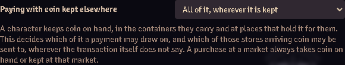

*The world setting as the Judge sees it, at its default.*

On the system's own character sheet the Money header gains two lines: how
much is kept for the character and at how many places, which opens the Storage
tab, and the same **Pay from** and **Receive into** choices the module's sheet
offers.

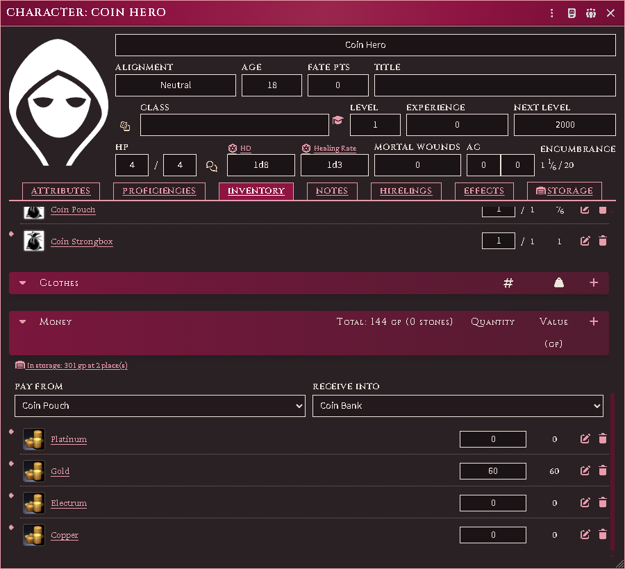

*The system sheet's Inventory tab: the coin kept elsewhere totalled under the
Money header, and the two choices above the coin rows.*

## Be somewhere to leave something there

A character's own sheet lists the places their goods are, under **Kept
elsewhere** on the Equipment tab, and each row says whether they can put
something down there from where they are standing.

The list is deliberately short. It holds **everywhere they actually keep
something**, whatever else is true of it, plus **wherever they are standing
right now**, their own vault, and any place they have **pinned**. A world with
a whole imported city in it holds dozens of places nobody has ever left
anything at, and none of them belong on a character sheet — so owning a place,
or marching with someone who owns it, does not put it on the list by itself.
Pin it while you are there and it stays.

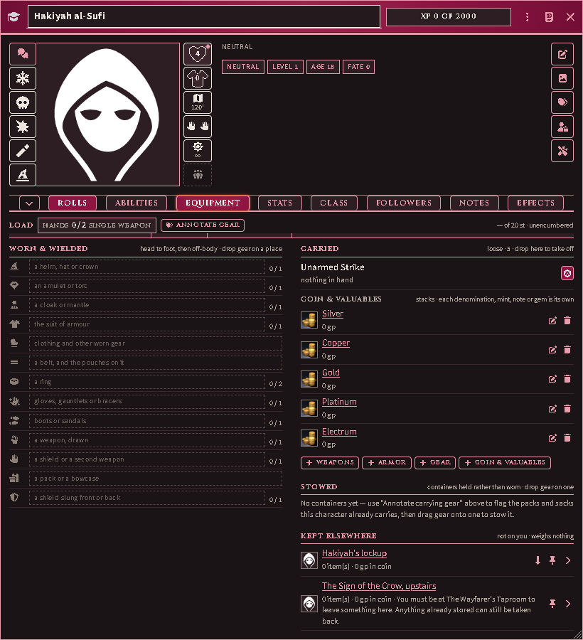

*The lockup is a cart in the street beside them, so the deposit arrow is
offered. The inn is a map they are not on, so the row names that map and offers
no arrow — only the ways back out.*

A place that **is a map** is reached by being on it, whether or not it is the
map currently up on everyone's screen. A place that is not a map — a cart, a
shrine, a cellar — is reached by standing at its own token, or by a claim on it:
your own vault, a place you hold, a place somebody you are marching with holds,
or one you have **pinned** to your sheet by dragging it there. A character in a
party has no token of their own, so the party's token is where they are.

**Taking things back is never gated.** A character who has walked away from
their own goods can still withdraw them from anywhere; it is only leaving
something NEW that asks where you are standing.

## Give a character a vault

A vault is a place of one character's own: only they and their players can reach
it. One is made automatically the first time a balance is moved out of the
system's bank figure (above), or an estate is settled on the character.

A vault that is **deleted does not come back on its own**. **Give a character a
vault**, in the Storage manager (Settings tab → Game Settings → ACKS II —
Extras → Storage manager → **Open Storage Manager**), makes one on demand.

This is not the same as the manager's **Add a place**, which makes a *shared*
place — a wagon, a stronghold, an inn — that anyone with access can reach.

## Add a market

Most places have no market. **Add a market**, in the place sheet's header or on
its **GM Settings** tab, creates one, and six extra tabs appear: **Recruitment**,
**Henchmen**, **Mercenaries**, **Specialists**, **Trade** and **Ventures**.

**Remove the market**, on the same GM Settings tab, removes the data with it,
not just the tabs.

A market can disagree with the book about who is common here. On the **GM
Settings** tab, **Class rarity here** takes a class and a tier, one row each: a
directed search for that class then rolls on the tier you picked, whatever the
rarity table says. A university town where mages are easy to find is one row.

A market can also leave classes out. **Classes never offered here** lists
them, one row each, picked from the classes your imported tables can offer: a
candidate whose class roll lands on one rolls again, and a search asking for
one is refused, the class shown greyed out in the search's list. A class you
name yourself when placing a candidate as GM is still placed.

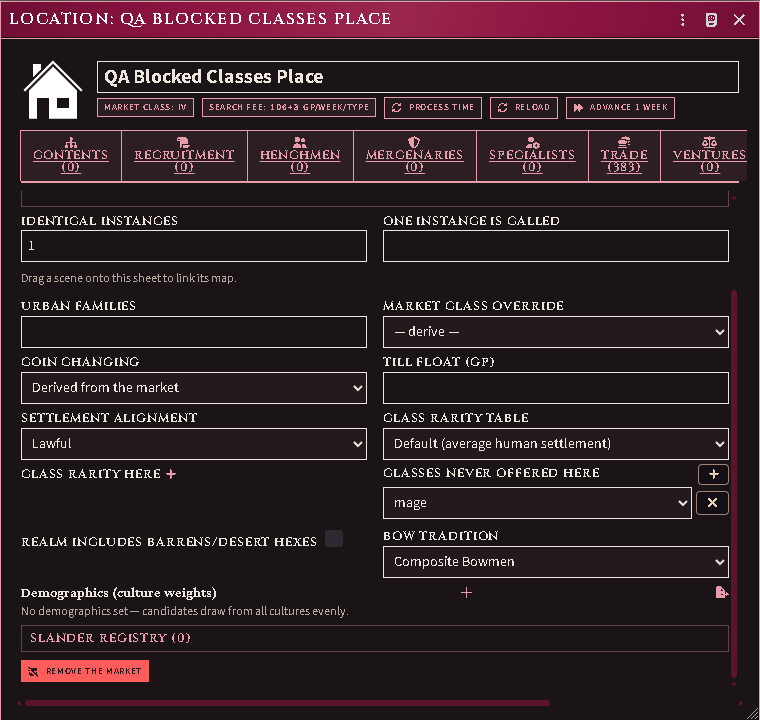

*A market's GM Settings with one class it never offers.*

The cultures the people here come from are the place's **Demographics**. A
candidate's culture is drawn from the listed cultures of their class's race,
weighted as you set them; a race with none of its cultures listed draws from
all of them.

Who holds the town can matter too: see
[what standing does](factions.md#what-standing-does).

## Macros

The **ACKS Extras Macros** compendium (Compendium Packs sidebar tab) carries
four storage macros.

- **Open Storage Manager** opens the storage manager (GM only): every place
  that holds goods, whose the goods are, and the controls to move them.
- **Enable Storage Here** and **Disable Storage Here** turn storage on or off
  for the selected place, cart or stronghold (GM only). Disabling refuses while
  the place still holds anyone's goods.
- **My Stored Goods** opens your character's sheet on its Storage tab, which
  lists what you have in storage and where.

## Common problems

**The market tabs aren't there.** The place has no market. Press **Add a
market** in the place sheet's header or on its GM Settings tab — they are opt-in
per place.

**A roster row is struck through.** Its actor was deleted. The row stays so you
can act on it; remove it when you have.

**The breadcrumb stops short.** A parent points at a place you cannot see, or
one in an unloaded compendium. The chain renders as far as it resolves.

**Taking goods back isn't offered.** The goods are attributed to a character you
do not own. A GM can reassign attribution in the **Storage manager** (Settings
tab → Game Settings → ACKS II — Extras → Storage manager → **Reassign owner**).

**"Nothing was moved."** The stack you picked is empty. A balance in the system's
bank figure is not coin anyone carries — it is moved out at the next world
load, a character's into their vault.

**"… carries no goods, so nothing can be handed to it."** The sheet you dropped
something on lists no goods — an organisation, a party, or a hired unit for
anything but coin — so nothing there could show it again. Nothing was moved
or copied. Drop it on whoever is to carry it, or on a place.

*The warning a rope dropped on an organisation's sheet gives. The rope stays
with whoever held it.*

**"A GM must be connected for that."** The payment, deposit or withdrawal
touches a place your seat cannot write to, and the Judge's seat carries those
out. Nothing was taken; try again once the Judge is connected.

**My character has no vault.** Deleting one does not regenerate it. A GM makes a
new one with **Storage manager → Give a character a vault**.

A character is who leaves goods, not a place: **Enable Storage Here** refuses a
character and points at the vault instead.
