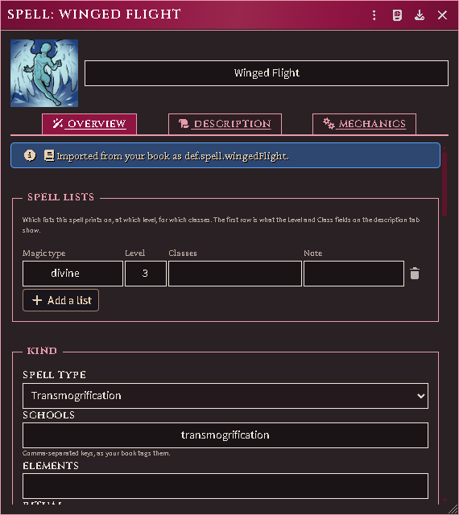
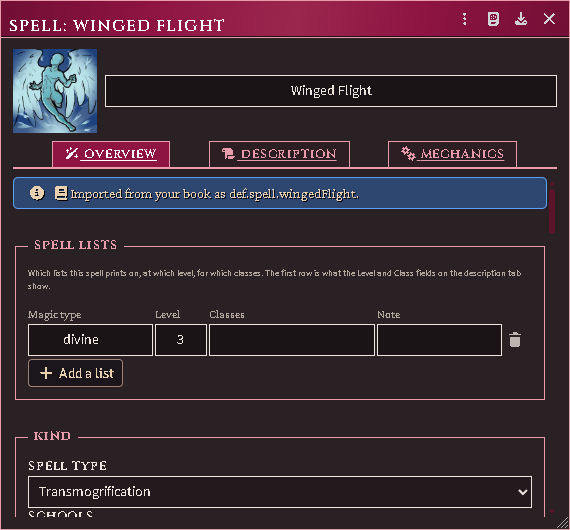

# Magic

The spell is a document with structure. Every spell — imported from your
book, dragged from a compendium, or made by hand — opens on the ACKS Spell
sheet.

## The spell sheet

**Overview** is the stat line as fields. *Lists* names every list the spell
prints on, each with its magic type and level; a spell on two lists is
offered to both traditions' casters, once. *Type* is the spell type the book
groups it under. *Range* and *Duration* are a shape — a distance, a touch,
the caster alone, a count per caster level, concentration — with the value
and unit the shape needs. *Reversible* marks the spell and *Reversed name*
says what it becomes; a reverse you keep as a document of its own is named
under *Reverse of*, with a link to its pair. Below those the tab holds the
casting time and components, the target, the area, what the spell affects,
its saving throw, and the citation of the page it was read from. A spell
read by the generic scan and not yet checked against the page carries an
*Unaudited* mark: the printed text is authoritative.

**Description** is the system's own tab: the text, and the level, class,
range, duration and save strings a plain sheet shows. Those strings follow
the fields above — change a shape and the string is rewritten; type one by
hand and it stays until the field beneath it changes.

**Mechanics** holds the effect rows, each edited in a window of its own:
what the row does, whom it applies to, its value flat or per level. A
summoning spell's rows are read when it is cast (below); the other kinds of
row are recorded on the spell and nothing casts them. The system's Active
Effects sit below them.

*An imported spell on the Overview tab.*

## Casting a summoning spell

A summoning spell on a character you own asks for the creature and the count
from its own rows, whichever door you cast it from — the system's sheet
button, the character sheet's Magic tab or a hotbar macro. You click where
each creature stands and the tokens appear; the cast is spent only after
that, and cancelling spends nothing. The caster carries a record of the
cast, which runs for the spell's imported duration. When the duration ends a
card in chat says how many of its creatures still stand, with a **Dismiss**
button. The character sheet's party cell and Magic tab show and dismiss them
too ([character sheet](character-sheet.md#the-band-and-the-rails)).

## Importing your spells

Connect your Revised Rulebook (**Manage Imports → Books** tab, opened from
**Settings tab → Game Settings → ACKS II — Extras → Manage imports**, or with
the *Your ACKS Books (this seat)* macro) and run **Import everything** on its
**Import** tab. The macros are in **Compendium Packs → ACKS II — Extras →
Macros → ACKS Extras Macros**, in the *Import from your books* and *Your
Books* folders. To import the spells alone, use the *Spells* shelf of the
**Reimport One Shelf (GM)** macro or of the **Rebuild** tab. One document per
printed entry lands in the imported Items compendium (*ACKS Cookbook —
Item*, under **Compendium Packs → ACKS II — Extras → From your books**), in
its *Spells* folder, and each of the sample rituals with them, the stat line
already on the fields and the text closing on its page. Run it again and
nothing doubles; *Repair in place* reads the entries again over the
documents you hold, keeping the cast counter, a description you wrote and
the effect rows you added where the page gave none. A printed spell the
world lacks lands beside the rest on the next import or repair of the shelf.

*A printed spell on the sheet after the import that adds it.*

Spells import before classes, so a class's starting templates find the
spells their spellbooks name. A class whose page prints its own repertoire
carries it as references to the imported spells, and every spell pick the
class asks is held to that list at the level the character casts
([classes guide](classes.md#picks-a-character-still-owes)).

## Disabling

*Uninstall — Strip Spell Data* (in the *ACKS Extras* folder of **Compendium
Packs → ACKS II — Extras → Macros → ACKS Extras Macros**) removes the fields
from every spell in the world, on characters and on unlinked tokens, and
keeps the system's strings, so a spell still shows its stat line with the
module gone. Spells inside compendiums are not touched. Run it before
disabling; it needs the module's code.
