# Item Markets

Buy and sell equipment at any settlement with a market, at ACKS II
availability and prices — with merchant imports, commissions, directed
searches, the magic-item market, mercantile ventures, market research, and
the goods and demand a settlement trades in.

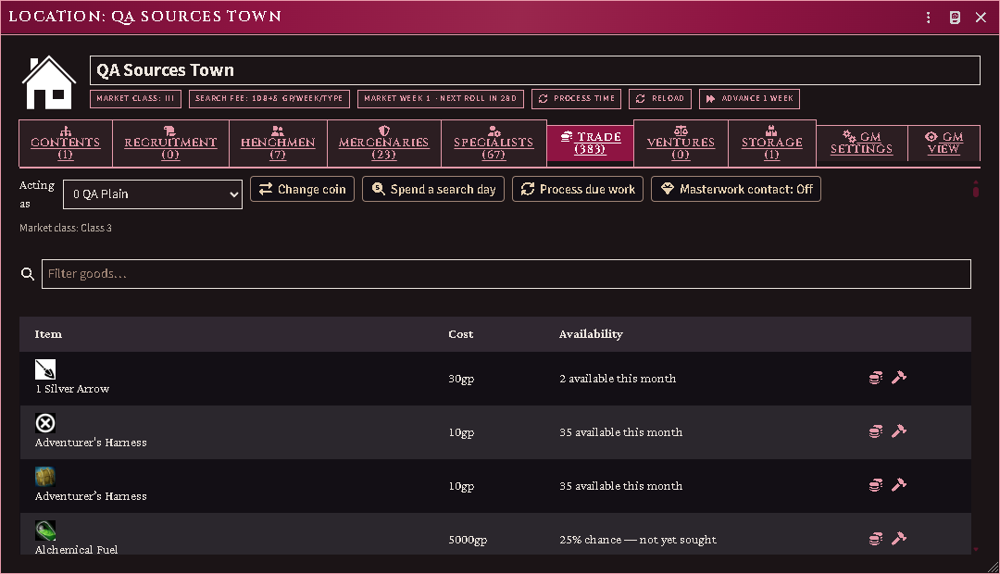

*A market's Trade tab: who the Judge is acting as, the coin, search-day and
process controls, the Judge's contact switch, the market class, and the
catalog with what the class makes available this month, each row carrying its
cost, its availability and its buy and order controls.*

## Setup

1. Import the rules tables from your books via **the importer** (Getting
   Started, or Reimport One Shelf → Rules tables): equipment availability,
   market characteristics, magic-item transactions, wages and construction,
   and the market chapter's prose figures. Every number the market applies is
   read from these; an action whose table is missing refuses and names it.
   A table the extractor could not fill completely is reported at import and
   shows as incomplete rather than as "unavailable".
2. Import **merchandise** (the same step): each trade good becomes a
   Merchandise Item in the cookbook compendium. A world Item of the same key
   overrides it, and a good you make yourself joins every roll and window.
3. Give a location a market (its market class derives from urban families,
   or set the override). The location sheet grows a **Trade** tab for the
   shop and a **Ventures** tab for mercantile ventures.
4. Optional: **Configure parties** (module settings) if more than one group
   trades separately; otherwise the whole table is one party.
5. Optional: **Shop sources** (module settings, Judge only) chooses where
   every shop's stock comes from: the world's items and each Item compendium,
   with how many priced items each holds. Untick a source and no shop lists
   it. Every source is in until you untick it, so a compendium a module adds
   later stocks the shops at once.

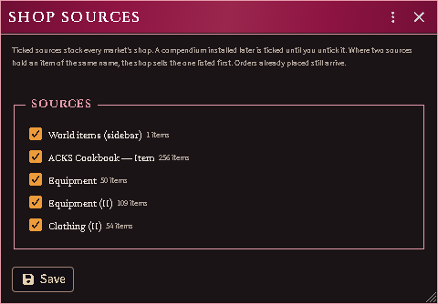

*Shop sources with every source ticked: the world's items and each Item
compendium, each with how many priced items it holds.*

## Acting as

Every action on a market's Trade and Ventures tabs is taken as one character:
the **Acting as** picker at the top of either tab, one choice for both. A
player chooses among the
characters they own; the Judge among the player characters and their own.
The choice is remembered on that client. Orders, searches and ventures show
to the party that made them; the Judge sees every party's, labelled, with a
block per party of what it believes about demand and where its venture
stands.

## Buying and selling

The Trade tab lists every priced item in the sources the shops stock from
(Setup, step 5), with live availability: so many per month per party at this
market's class, scarce goods as a percent chance your merchants find one.
Buy opens the purchase dialog — quantity, an optional merchant Bargaining
profile (GM), and for a large party the dedicated shopping day (RR 124).
Purchases stack: countable gear merges, and thirty swords arrive as thirty
swords to hand out. What arrives is the item the row lists, from the source
it was listed from, even where another source holds one of the same name.
Sell offers your own priced goods at their condition-reduced value; sold
goods leave play.

A **search day** (button on the toolbar) spends another dedicated day
looking: your party's caps rise by one base increment and scarce goods get
a fresh look.

If the market cannot supply an item:

- **Import it** (in the purchase dialog): a merchant sources it from a local
  or a regional hub, paid up front; the wait and the risk of loss in transit
  are rolled for you (RR 124).
- **Post a directed search** (binoculars on the row): say how many; the
  merchant keeps looking each market month and holds a find for you.
- **Commission it** (hammer on the row): a craftsman builds it at their
  construction rate; wages paid up front, delivery on completion.

Masterwork gear appears only where the Judge switches the **Masterwork
contact** on (Trade tab). The gate reads the masterwork tier the equipment
sheet writes.

## Coin at a market

A market deals where it stands. What you buy, import or commission there is
paid with coin you have **on hand or keep at that market**, drawn in the
order your sheet states
([where coin is paid from](character-sheet.md#where-coin-is-paid-from-and-where-it-lands)).
Coin kept anywhere else — a vault, a bank in another quarter — does not reach
the counter: fetch it, or leave it at the market first. That holds whatever
the world's setting for paying with coin kept elsewhere says
([location storage](location.md#paying-with-coin-kept-elsewhere)), and it is
what keeps carrying coin across a city a decision somebody has to make.

A purchase that coin cannot cover is refused with **Not enough coin on hand
or kept at this market**, and nothing moves. What a sale earns you, and what
the changer hands back, lands where your sheet says arriving coin goes when
that is on hand or at this market, and is carried loose otherwise. A venture's
tolls, bribes, purchases and proceeds follow the same rule at the market they
happen in.

To keep coin at a market, open its **Storage** tab and press **Leave
something here**, or drag a coin row onto the place. It lists there under your
name.

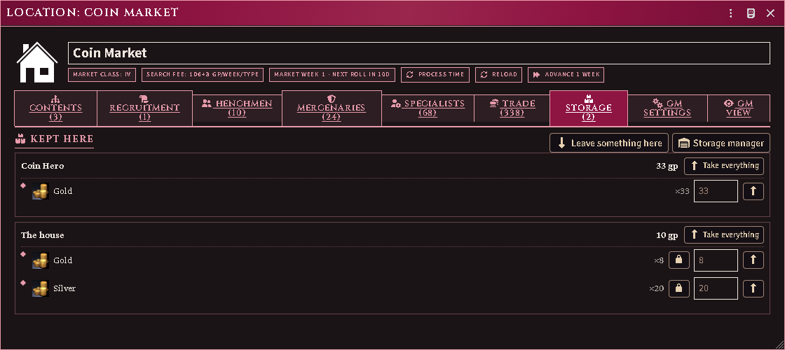

*A market's Storage tab: the coin one character keeps there, which their
purchases at this market draw on, beside the house's own.*

## Being at the market

A market deals with a character who can reach it, the way any place is
reached ([being somewhere](location.md#be-somewhere-to-leave-something-there)).
A player's purchase, sale, import order, commission, venture day or exchange
for a character who cannot is refused before anything is rolled, and nothing
moves. Where the market is on a map, the refusal names the character, the map
and the market.

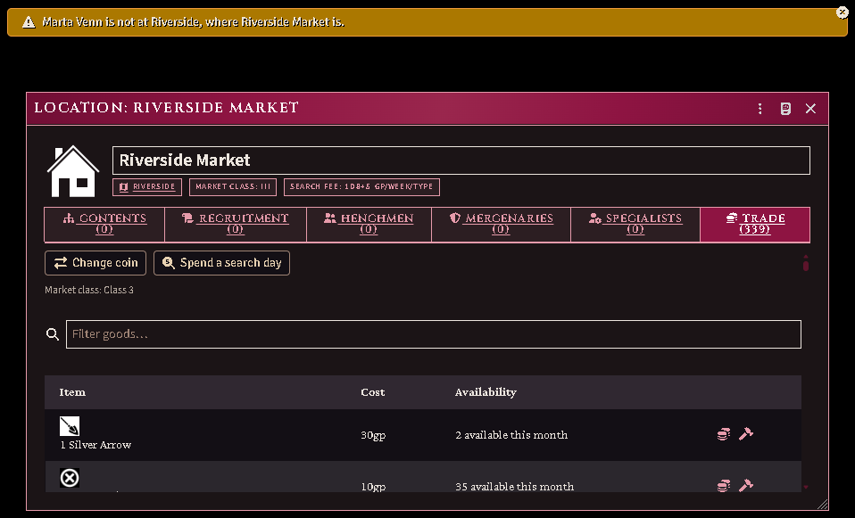

*A player's purchase for a character who is not on the market's map: the
refusal says who is not where.*

The Judge's seat is not held to it. A trade the Judge makes for a character
who is not there goes through, and a line opening **Judge's override** states
the refusal that was set aside.

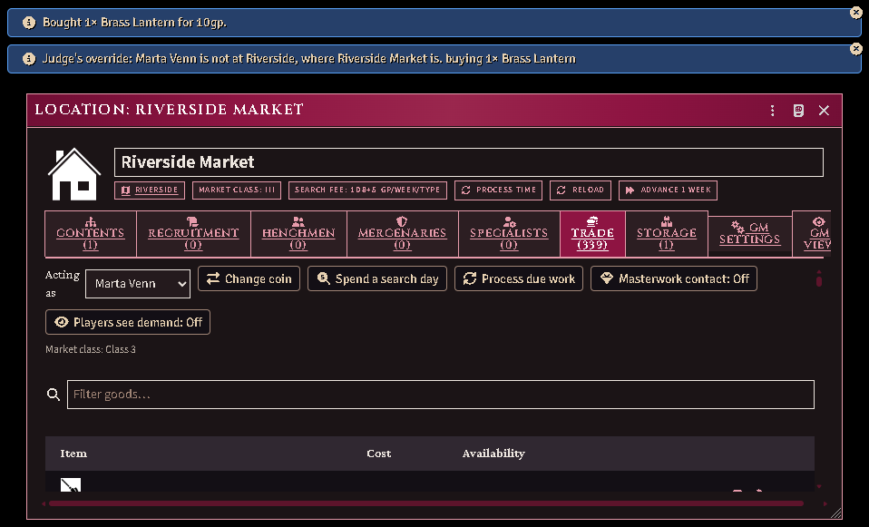

*The same purchase from the Judge's seat: it goes through, and the override
line states the refusal it set aside.*

## Changing coin

**Change coin** turns one denomination into another at face value: pick the
stack, say how many, and pick what you want them as. It is a market's
service rather than a party's, so it is refused where no market stands, and
the Judge can set a market's exchange to derived, market or none on the GM
Settings tab. A player's exchange is carried out on the Judge's seat, so
coin moves only when both sides of it do.

## Magic items

The equipment sheet's Construction tab carries the magic panel: the GM
marks an item magical with its kind, rarity, apparent value, and base cost.

Unidentified items trade at apparent value. Identification runs the JJ
ladder (JJ 130) through any qualified character or henchman; failures wait
for a level. Fully identified items sell at base cost (more for their
maker) and buy at the Tower's premium (JJ 131). Availability and the
purchase preview band a magic item on the magic grid, never the equipment
one. A magic item sold to a market stays on its shelf — a **held** row on
the Trade tab — and can be bought back.

## Merchandise

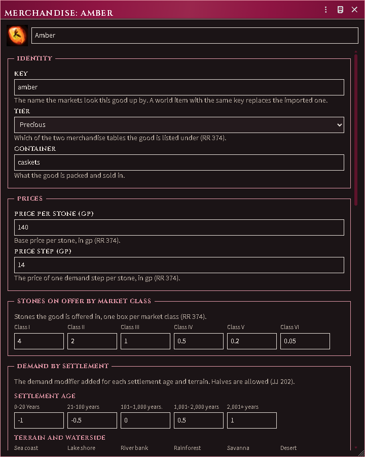

*A Merchandise Item the Judge made: its key, tier and container, the prices
and the stones offered per market class, and the demand columns it answers
to.*

A Merchandise Item is one trade good: its price per stone and price step,
the daily stones on offer by market class, the settlement age and terrain
columns that move its demand, the peoples that want it, its band on the
random-merchandise tables, and the item kinds it stands for. The importer
fills these from your books (RR 374, JJ 202); a good you add as a world
Item — or a world Item with an imported good's key — takes part in every
roll and window like a printed one. **Aliases** name the older or
setting-book goods it stands for; a setting-book import translates through
them first.

## Demand

A market's demand modifier per good is three layers: the **base** the
Demand Generator or a book wrote, a derived layer reserved for trade routes,
and the Judge's **pins**, which win. *Set demand* on the Ventures tab sets,
pins, clears or unpins one good; **Players see demand** is the Judge switch
that shows players the true modifiers rather than only what their party
believes.

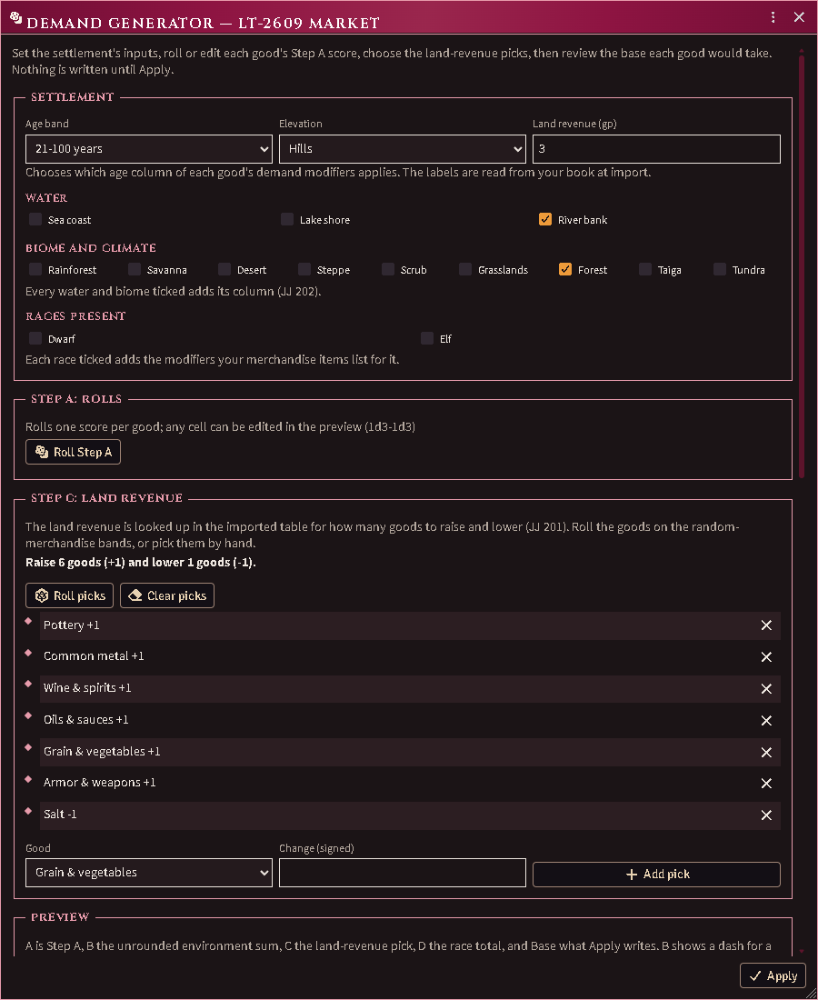

*The Demand Generator: the settlement's inputs, Step A rolled per good, the
land-revenue picks, and (below) the preview of what Apply writes.*

The **Demand Generator** (Ventures tab, Judge) builds the base from the
settlement's age, water, biome, elevation, land revenue and peoples (JJ Ch6
Step 7 A–D). Every good's roll and total is shown before anything is
written; Apply replaces the base and leaves pins alone, and a base you typed
or a book imported asks before it is replaced. The inputs and rolls are kept
for the next visit.

## Market research

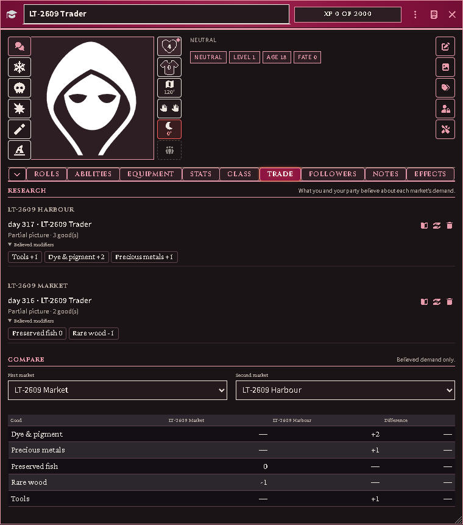

*A trader's Trade tab as the player sees it: the party's reports by market
with the modifiers each learned, and Compare across two markets.*

An assessment (below) writes a **market report**: the market, when, who
assessed, and the modifiers learned. Reports are Items kept in a trade
house — a location actor the module makes on first use — and stamped to the
assessor. A character with Bargaining, Mercantile Network, a merchant
profession or a report of their own (or one the Judge marks as a trader on
their sheet) has a **Trade** tab: Research lists the party's reports by
market, and Compare sets two markets side by side on believed demand only.
A report can be opened and annotated, given to another character of the
party, or discarded. A market's own Ventures tab lists the reports held
about it. A false assessment is a report with wrong beliefs; only the Judge's copy
says so.

**A partial assessment leaves the choice to the trader.** A partial result of
**Assess supply & demand** leaves the report holding a number of picks; its
owner chooses the goods on the report sheet and learns their modifiers then
(RR ch. 8, Assessing Supply and Demand). A false result asks the same choice
and looks the same, but the modifiers it gives are wrong. The assessment card
links the report.

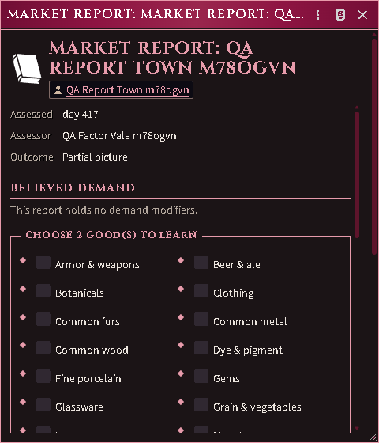

## Setting-book market profiles

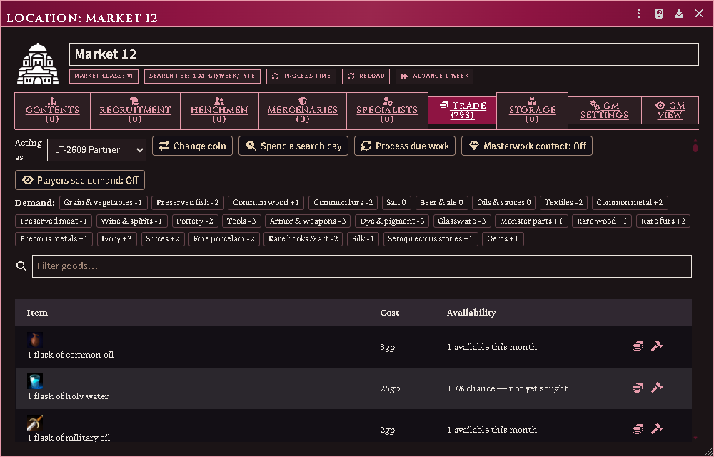

*A market a setting book prints: imported as a location with its market
class and the base demand modifier for every good the book's grid names.*

Importing a setting book that prints a regional demand grid and domain
records (AX3) gives each market its class, urban families and base demand.
A market the book gives no other entry becomes a location of its own; its
printed name arrives with the import. Older-edition goods translate to your
merchandise through the Judge's aliases first, then the module's map. A good
that translates nowhere is left out and named in a warning after the import;
add that name to a merchandise item's **Aliases** and import again to bring
it in. A class, family count or
base you already set is kept, and a re-import refreshes only what the same
page wrote.

## Mercantile ventures

Ventures run from a market's **Ventures** tab, on dedicated days that
resolve as game time passes:

1. **Enter the market** — declare what the party brings to the gate.
   - **What you bring.** Declare cargo capacity, vehicles included
     ([Taking it to market](vehicles.md#taking-it-to-market)). Under
     **Goods at the gate** the dialog lists every merchandise load in the
     packs of your party's members at the market and aboard each vehicle
     you tick. It also lists the treasure or gear they carry that has a
     merchandise type: tick **Brought to sell** on what you mean to sell.
     Anything with no merchandise type is not listed and not charged.
   - **What the gate takes.** The toll falls on your capacity, loaded or
     empty, and your market impact is fixed from the imported baselines
     (RR 371). The tariff (RR 372) falls on every load listed and on each
     good brought to sell. It is charged at the rate your book prints for
     the market's class on each good's base price; a good marked exempt on
     its merchandise sheet pays nothing. The Enter dialog shows every
     charge, good by good, before you confirm. The trader pays it all, in
     one payment; who in the party chips in is yours to settle.
   - **No charge.** If a member at the market rules the domain the market
     lies in, the gate takes neither charge. A good you tick **Smuggled**
     pays no tariff. Tick **The party sneaks in** and the gate takes no
     toll either, and everything you bring is smuggled. Either way the
     Judge is told what came in and resolves the attempt.
   - **As the party or separately** (RR ch. 8, Entering the Market,
     Parties). A party of more than one chooses at the top of the dialog.
     Entering separately, each character posts an entry of their own, with
     their own vehicles, goods and toll, and trades in a venture of their
     own; the dialog shows the maximum market impact each then gets. Once
     one of you enters separately, the rest of the party can only enter
     separately that month, until everyone has left. A vehicle goes through
     the gate once a month, so each brings their own. Only the character
     who rules the domain enters free.
   - **Moorage and stabling** (RR 372). Choose whether your ships take a
     berth and your animals the stables, or you anchor and pasture outside;
     one choice covers the whole entry. Each wagon or cart you bring asks
     how it is **Stabled as**, and remembers your answer for next time.
     Count your loose animals by kind; the dialog shows the day's fee. You
     pay it when you leave, for every day you stayed, the day you arrived
     and the day you leave both included. A stay still running when the
     month ends is charged then, to the day the month ends. Sneaking in does
     not escape it; the character who rules the domain stays free. After
     upgrading, re-import the Mercantile rules tables so the rates arrive:
     until then an entry with anything to stable is refused.
   - **Judge's options.** The Judge may have the tariff thrown at each entry
     (the **Randomize the market tariff** setting); the dialog then shows
     the span it can come to. After upgrading, re-import the Rules tables
     so the dice arrive. The module charges nothing the book does not. A
     Judge who wants more, such as a bribe at the gate or a guild fee, adds
     it with a world script on the `acksExtras.marketGateQuote` hook (see
     below).

   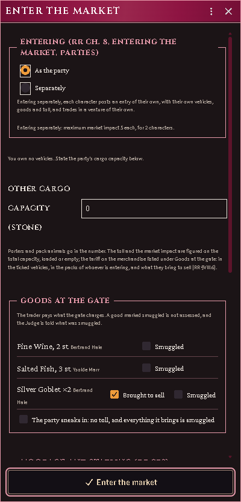

   *A party of two at the gate: entering as the party or separately, and
   the goods it brings, with the goblets ticked as brought to sell.*
2. **Assess supply & demand** — opens the influence page against the
   market: your Charisma, a tone proficiency, a bribe (RR 287) and your
   reaction effects set the Judge's throw against the imported bands, which
   decides how many demand modifiers you learn, and whether they are true;
   what you learn lands as a market report (RR 373). The bribe is paid to
   the market as the day is posted, whatever the day brings.
3. **Solicit** a merchandise type — opens base stones × impact to trade and
   reveals the month's price (rolled once per type per month).
4. **Trade merchandise** — buy or sell stones against your solicitation,
   into or out of the hold you pick, optionally negotiating the spot price a
   step your way — or into an outraged refusal (RR 376).
5. **Leave the market** when you are done, or to declare again — you pay
   your stay, the toll and tariff stay with the gate, what you solicited
   closes, and any of your party's days still queued are withdrawn. Leaving
   is refused while your purse cannot cover the stay. Entering again pays
   the gate again.

**Adding your own gate charges.** The gate charges what the book charges and
nothing else. A house rule goes in a world script, which must run on every
client: a module of your own, or a script macro run at startup. It listens on
`acksExtras.marketGateQuote`, which runs whenever the gate quotes: in the
Enter dialog's preview and again at payment. A handler reads the quote and
pushes charges onto `quote.extra`, in copper, and the trader pays them with
the rest. The Enter dialog lists each added charge and the ledger records
it. A handler must give the same answer every time, or the preview
and the payment disagree.

```js
Hooks.on("acksExtras.marketGateQuote", (quote, { location }) => {
  if (location.name === "Example Port" && !quote.sneaked) quote.extra.push({ label: "Harbor watch", cp: 500 });
});
```

The quote holds what is assessed (`loads`) and what is smuggled
(`smuggled`), plus the book's charges (`tollCp`, `tariff`) and the
`privilege` or `sneaked` that waived them. The handler's second argument
also says whether the trader enters `separately`. The stay is
`quote.stay`: its `lines`, and `cpPerDay`, the day's fee in copper, which a
handler may set to charge a different stay; the days are counted as above.
The same functions are on `acksExtras.markets.gate`, and the stay's on
`acksExtras.markets.stay`.

**A mercantile network counts in a market its holder has visited before.** On
a venture each solicitation reads the goods of a market class larger or with
more market impact; the module picks whichever opens more, good by good, and
the Enter dialog lets the trader choose one for the visit. Tolls and the
month's prices never move (RR ch. 8, Entering the Market). A market is known
only from an earlier visit: the days of one stay are one visit, and an entry,
a hire or a purchase counts. The Judge's switch on the market's Trade tab
marks it known as well.

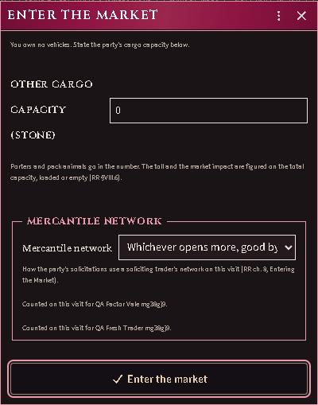

The queue under the buttons lists your party's days still to resolve. The
same trader cannot queue the same day twice; a queued day has a withdraw
button (the Judge's, or the owner's of the trader who posted it), and nothing
paid for it comes back.

A day that cannot resolve because its table is not imported posts the
table's name to the trader and the Judge. Merchandise loads ride in the hold
they were bought into, your packs or a vehicle's, one stone per unit, ready
to haul to a market whose demand pays better.

## Trade history

**Trade history** on a market's Trade tab lists what your own traders did
there, newest first, with each row's coin movement and the net; the Judge
sees every trader's rows with a trader column. The same history, across
every market, is on a trader's own character sheet under its Trade tab. A
trader reads their assessment rows as the report said — a false picture is
listed as partial.

## The clock

Imports, commissions, searches, and venture days all resolve when world
time advances (any worldTime clock), on the GM's client — or the **Process
due work** button on the Trade tab, which the Judge always has and an owner
has while something of theirs is pending.
