# The Monstrous Manual stat block

The system's own `monster` actor, given the full stat block: classification,
ecology, defences, attack routines, spoils, and the henchman fields that let a
monster be hired.

## What opens first

A monster opens on its **card** — the half-page you fight from. Attacks and
their damage, the creature's powers, and its spells by level, in a window a
little over half the height of the full block.

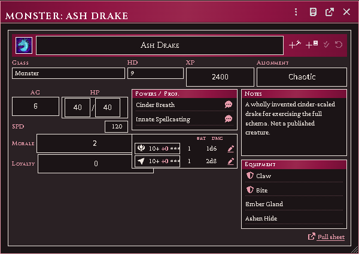

*What a monster opens on: attacks, powers and spells on one page.*

A power or spell whose entry carries prose has a **speech bubble** beside it.
Click it and the whole entry goes to chat, so the table reads "Terrifying
Visage" instead of waiting for someone to find the book. Rolling is separate and
still sits on its own d20, and a power with no prose gets no button.

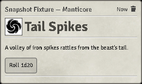

*A named power posted to chat for the table to read.*

Under the vitals, **Number appearing** lists the monster's dungeon and
wilderness formulas, each with a die that rolls it to chat — the same roll the
full sheet's Statblock makes. A line that counts groups rather than bodies has
no die: the Statblock shows the count with its unit, and the roll waits for the
Judge.

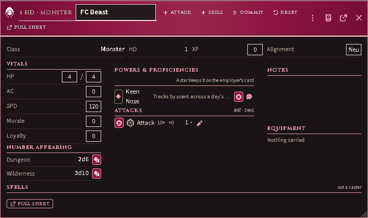

*Number appearing under the vitals, a die beside each formula.*

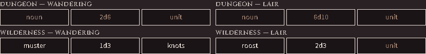

*The Ecology tab's sides, each with its noun, count and unit; a side in knots is
counted in groups.*

Everything else is one click away on **Full sheet** — the chip in the card's
header band, or the portrait beside the name. If you would rather land on the
full block, set it once under **Sheet Configuration** on any monster — that
choice is yours and this module will not move it again. **Animals** still
open on the full block.

## The sheet

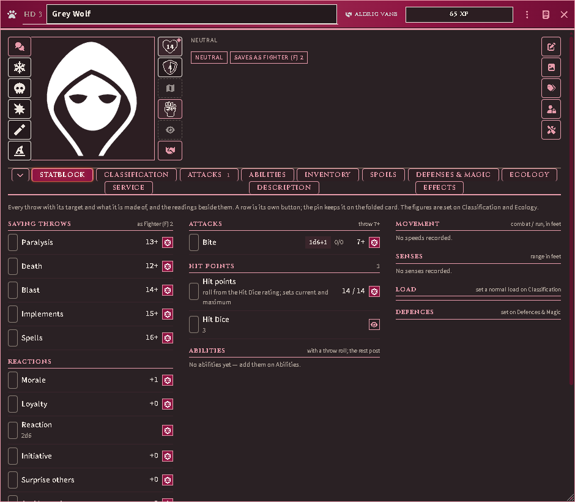

*The full sheet on the shared frame: the band, the rails, and the Statblock
tab of a creature in service — every throw a row with its pin.*

**Full sheet** from the card, or open an **animal** actor, and this is the
sheet you get: the same frame as the character sheet. The **band** in the
window header holds the body form's glyph, the Hit Dice rating, the name, the
employer's chip while the creature serves (a dot on it says a calamity's
loyalty throw is owed) and the XP award. The **rails** either side of the
portrait are the reaction roll and the five saves on the left; hit points,
armour class, the speed in force, the attack throw, the lightless range and
the creature's tokens on the scene on the right. Press the chevron on the
tab strip and the sheet **folds** to the band, the rails and the pinned
rows. An animal's combat block uses the monster's own field paths, and the
extended block is where its body form, carrying load and training live.

The tabs:

- **Statblock** — the dashboard: saves, reactions and encounter rolls in
  the first column, attacks, hit points and abilities in the second, and
  the readings in the third — speeds, senses, the load bar, the defence
  pills and a caster's slots. A row is its own button; its pin keeps it on
  the folded card.
- **Classification** — the pen for what the frame reads: types, identity,
  the Hit Dice rating and its roll, saves-as and the five save targets, the
  loads, the attributes, and the **Figures** rule with the core fields the
  system's header used to carry (hit points, armour class, attack throw,
  morale, initiative, surprise, XP award, alignment, movement).
- **Attacks** — the attack routine, natural weapons and their damage types.
- **Abilities** — special abilities, tagged by category and carrying their XP
  contribution.
- **Inventory** — generic items, armor and clothing the monster carries.
  Armor Class is the value set on Classification and is not changed by
  anything carried here.
- **Spoils** — what a body is worth.
- **Defenses & Magic** — immunities, resistances and susceptibilities with
  the silver flaw, and what the creature casts as (class and level). The
  spell page itself is the **Spells** tab, on for any creature that carries
  a spell.
- **Ecology** — habitat, number appearing (each side's noun, count and unit;
  leave the unit blank when the count is bodies), lair chance, treasure.
- **Animal** — on an animal only: body form, carrying load and training.
- **Service** — core's retainer fields and the manager picker, and, while
  the creature serves, the same Service panel a hireling's character sheet
  shows ([henchmen](henchmen.md)): standing, terms, the employer, the
  ledger and the recorded events.
- **Description** — the prose, a section at a time; each opens for editing
  in place and grows with its text. The appearance is edited on the art row
  instead, from the pen on the tools rail.
- **Effects** — the system's active effects.

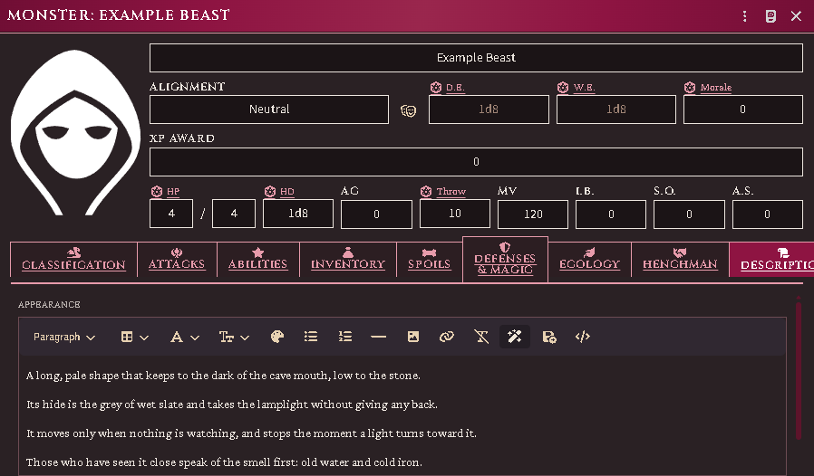

*The Description tab's Appearance open for editing: the toolbar above, and the
text below it in full.*

No new actor type is invented: this is core's `monster`, extended through flags,
so everything that already reads a monster keeps working. The sheet is a
subclass of the system's own, so it keeps every tab core defines — and core's
plain sheet is still there under **Sheet Configuration** if you want the lean
view for a particular actor.

## A monster that casts

An imported creature whose entry names spells carries them. A spell it casts
"(as the spell)" or lists among its spell-like abilities is a copy of the
imported document on its Spells tab, marked with the frequency the page
prints beside it; one that casts as a class of a level gets that class's
slots at that level and a repertoire drawn from the class's list; one whose
entry prints a repertoire carries it as printed. A name no imported spell
answers stays in the prose. The Spells tab is on for any creature that
carries a spell, its slots at zero unless the entry fills them. A creature
imported before the spells were gains its spells on *Repair in place*; a
creature generated from a template whose row prints a spell column gets its
slots and a drawn repertoire at generation.

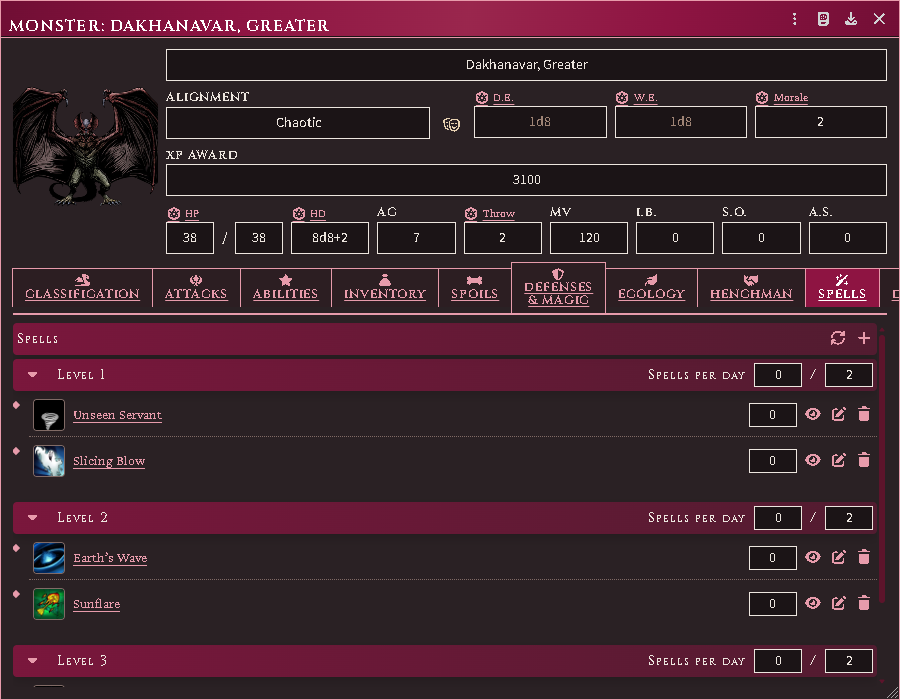

*A creature that casts as a class: its slots by level and the repertoire
drawn to them.*

## A family's leaders

An imported monster family is a template: drop it on a group, or press its
**Generate**, and pick from its axes. Where the family's page names the
leaders, casters and dependants that come with a band, the template carries a
**Role** axis beside the kind. Left blank it generates the ordinary member;
pick a role and the creature is built from that role's own figures on the
page: its hit dice, armour, hit points and damage bonus, with its attack
throw and saves worked out from its hit dice and its experience read from the
page where one is printed. A caster's level is rolled when it is generated,
and its slots and spells follow. A role the page prints for another kind but
not for the one you picked shows greyed out, labelled as not printed for that
choice.

A damage bonus shows on the Statblock after each attack's damage, and its
tooltip names the two parts. The system adds it to every melee and missile
damage roll.

A leader's attack throw comes from the rulebook's attack-throw ladder (RR
ch. 6), which imports with the rulebook's tables: import those before the
family. Hover a leader's throw or saves on its Statblock to see what they were
worked out from. Without the ladder, a leader keeps the member's throw and the
tooltip says the ladder is not imported. To change the ladder, edit its rows in
the Ruledata Browser, then repair the template.

With the AXIOMS Compendium connected and its tables imported, a family also
gets champions, sub-chieftains and chieftains worked out by the AXIOMS
leader procedure from each member's own figures; import the family after
those tables. Where the page prints its own leaders, a **Leader figures** axis
before Role chooses between them: *As printed* (the default) or *AXIOMS
procedure*. Where the page prints none, the procedure's leaders are the only
ones and the Leader figures axis is not shown for that kind. A procedure
leader rolls its hit points from its dice; the hit-point note on its Statblock
names what its figures came from, and hovering its armour class on the rail
names the member's armour and the rank's addition.

A creature outside a family whose page names its leaders gets a template of
its own beside it when you import it, named for it with "(leaders)". It works
as a family's does, with the creature as its only kind. With the AXIOMS tables
imported, a beastman whose page names no leaders gets one too, with the
procedure's leaders.

### Dressing a beastman in a troop kit

With the rulebook's tables imported, a beastman family (and a beastman's own
leader template) gets a **Kit** axis after Role, one option for each infantry
and missile troop type the rulebook's Beastman Troops table prints for that
kind (RR ch. 9). It reads *Stat block* by default, which is the creature as its
own page prints it. Pick a troop type and the rank and file takes that row's
armour class, damage bonus, movement and morale; it gains no items, and the
kit's own words, with the page, are added to its notes. A leader in a kit takes
the row's movement and morale and keeps its own damage bonus; its armour class
is worked out when you generate it, from the row's armour class and how much
better armoured the leader is than its warrior. With the AXIOMS tables
imported, *Unarmoured* gives the kind's natural armour class instead. Hover the
armour class on the rail, the morale row or a weapon's damage tag to see which
row a figure came from; where the AXIOMS die conversion is imported, a weapon's
damage tag also names the die its damage bonus converts it to.

Import the tables before the family, or repair the family in place after
importing them: a template built without them has no Kit axis. Mounted troops
(the rider rows) are not offered.

A family imported before this module version has no Role axis. Repair it in
place (**Manage Imports**, *Repair in place*), or import it again. A creature
imported earlier gains its leader template the same way.

## What an attack card shows

An attack posts the system's own card. What this module knows about the
attacker — a maneuver, a mount, a shield variant, a condition, a named
weapon's bonus — joins the system's labelled modifiers as rows of its own, so
the dice tooltip audits the whole stack in one list. Who reads the card is the
roll mode the attack was rolled under; the module adds no audience setting of
its own.

## Monsters as hirelings

A monster can be hired like any other follower. Core's own `addHenchman` rejects
non-character actors, so the module wires the retainer fields directly.

Animals are typed here too, which is what lets the group and mount features tell
an animal from a person.

What a beast can carry, and who is riding it, sit on the extended block with the
rest of its body.

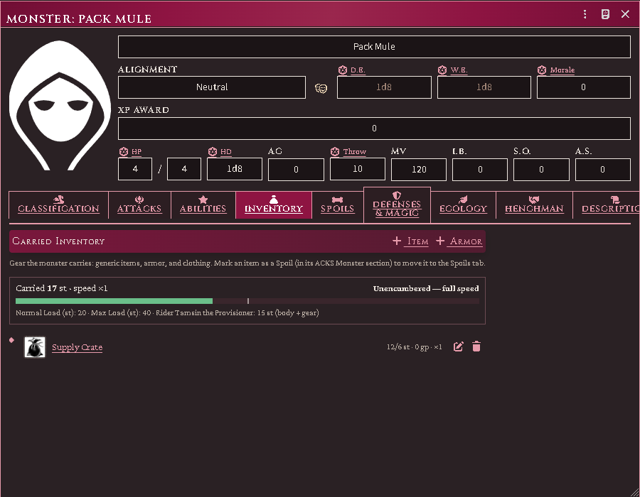

*The capacity primitive on the sheet: carried weight, MM loads, and the rider
named.*

## Groups of monsters

Drop a monster on a group's sheet, or press **Make an encounter group** on the
monster's tools rail for a new group with the creature already in it, filed under
Encounters.

The sheet lists the group like an inventory. Each monster is one row, with its art, its
name and its counts, which you edit where they stand. Anyone with a record of their own
nests under the row. To put a monster on the map, drag the row's art or name onto the
scene: the row and everyone under it go together, except any who have fallen or left
or who are already out. Hold Shift to place them off the grid, or Alt to place them
hidden. To send only some, set the small Count field and press the row's Deploy button,
which places them at the group's token, or at the middle of the scene.

To move a monster to another group, open both sheets and drag the row's art or name onto
the other sheet. Everyone under the row goes with it, the fallen and those who left
included. If the other group already has that monster, the two rows become one and the
bodies on record may take new numbers. You need to own both groups, and anyone on a map
has to be recalled first.

Add a group's token to a combat and the whole group goes out: everyone it holds lands
on the scene from the token's square, each with a combatant of their own, and the
group's token hides. Ending the combat recalls them and shows the token again. Add the
token to the same combat again to bring them back early. A group with no one to send
tells the Judges so and changes nothing, and a group that is part of a party is
deployed by the party.

Each monster in the group has its own **Roll** on its row. Press it, choose the dungeon
or the wilderness line, and choose wandering, in lair or by lair chance, which throws
that monster's chance first and lets it pick the side. Its line reads out in the dialog
before you press, and the dialog opens on the line the scene calls for.

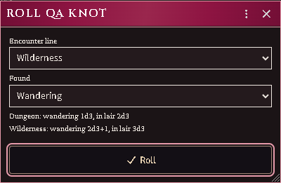

*One monster's Roll: which line, how it was found, and both lines read out.*

That monster's stack is sized at once, and a card only the Judges see shows each die.
Every other stack stays as it is, so a mixed group is rolled a monster at a time. Every
count stays editable, and hovering one says where it came from.

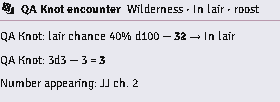

*The Judges' card: the lair chance thrown, then the count.*

**Roll again** replaces what that monster's last Roll sized, your change to it included.
A row you typed a count on has no Roll: zero both counts to get it back. A side counted
in units is not a number of bodies, so a Roll cannot size it. The row names those sides,
and a monster counted in units on every side has no Roll, nor has a creature with no
count imported. Once a body from a rolled stack is out, on record or fallen, that row's
Roll refuses, because a new count would erase it.

The first Roll takes the group's noun from the side it read, unless you typed one, and
marks its token hostile and linked to the group. Hit points are not rolled here: each
body rolls its own as it is deployed or individuated.

**What players see.** Token shows, on the sheet, sets what every seat reads off the
token: **The noun alone**, over a masked portrait, or **The name and the count**, with
the art. Your own nameplate always reads the name and the count. While it is set the
token's name and art follow it, so a name or art you set on the token by hand is
replaced. Hide the token with Foundry's own toggle until they meet it.

A family dropped on the sheet asks which variant the stack is, and generates that
creature, as the template's own Generate does.

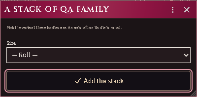

*A family asks which variant the stack is; an axis left on its die is rolled.*

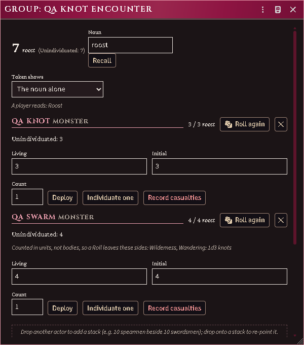

*An encounter kept as one document: the token's reading, and each monster's Roll
and its count.*

## Where an imported creature came from

A creature converted from another game's book — an Old-School Essentials
adventure brought in by the importer — carries a **Source** tab that a
hand-built monster does not.

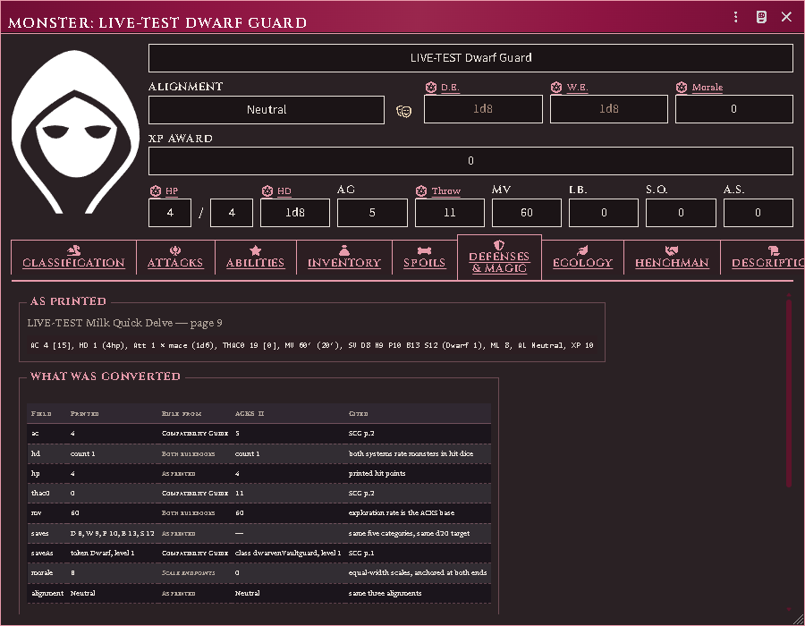

It shows three things side by side:

- **the stat block exactly as printed**, so you can hold it against your own
  copy of the book;
- **every field that was converted**, with the rule it was converted by — a
  published conversion, both rulebooks agreeing, a straight transcription, or a
  derivation;
- **every field deliberately left alone**, and why. Experience and treasure type
  are the common ones: neither game's numbers mean the same thing, so the
  printed value is kept and shown here rather than written into a field where it
  would read as an ACKS II value.

Anything the importer's reader did not recognise is listed too, so a clause it
could not place is visible rather than lost.

The tab is read-only. If a number looks wrong at the table, this is where you
check it — and then correct the field itself on the tab that owns it.

## Common problems

**A save throws an error on an old monster.** Pre-migration monsters store saves
under the old keys (`breath`/`wand` rather than `blast`/`implements`). The sheet
warns instead of throwing — re-save the actor to bring it current.

**The stat block is empty.** The actor is a `monster` but was never given extras.
Fill in the Classification tab; everything else keys off it.

**Damage types show a neutral icon.** The weapon has no type and none could be
resolved from the equipment classifier. That is honest — it shows a neutral icon
rather than guessing.
